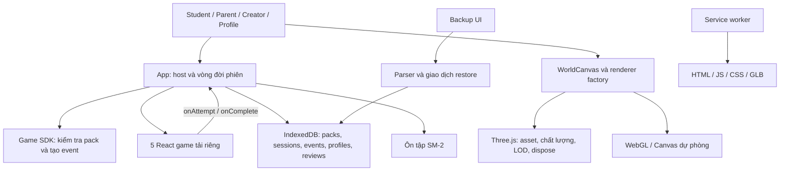

# Đánh giá chuyên sâu Bảo An Learning — 14/10/2026

**Kết luận:** dự án có nền tảng tốt cho một sản phẩm học tập trên thiết bị: game tách khỏi lưu trữ bằng SDK, kết quả ghi bằng giao dịch IndexedDB, cảnh 3D có quản lý tài nguyên và 5 game đều có thể hoàn thành. Tuy nhiên, bản hiện tại **chưa sẵn sàng phát hành ổn định**. Có **5 lỗi P1** ảnh hưởng sao lưu, phiên chơi, thoát bài, ngoại tuyến và khả năng mở game khi cảnh lỗi; **7 vấn đề P2** cần sửa để bảo toàn nội dung, dữ liệu ôn tập và độ tin cậy của kiểm thử.

Đây là đánh giá **working tree hiện tại**, gồm những thay đổi chưa commit, không chỉ commit `b3702c2`. Không sửa mã sản phẩm. Các tệp thêm nằm trong báo cáo và thư mục bằng chứng `docs/deep-review-2026-10-14/`; build tạo lại `dist/`. Kiểm tra trình duyệt sử dụng context mới, tách khỏi dữ liệu người dùng.

## 1. Phạm vi và bằng chứng

Đã đọc các luồng host/SDK/storage, hồ sơ, backup/restore, nhập JSON/Excel, báo cáo, 5 game, service worker và vòng đời renderer; chạy build, typecheck, các nhóm kiểm thử Node và kiểm tra trình duyệt trên production build. Có ảnh desktop 1440×900, mobile giả lập 390×844 và 320×640. Không dùng số liệu cũ trong tài liệu để thay cho kết quả của lần đánh giá này.

| Kiểm tra | Kết quả thực tế |
|---|---|
| `npm run typecheck` | Đạt |
| `npm run build` | Đạt, Vite 7.3.7 |
| Syntax parsing | Đạt |
| Core | 44/44 |
| Features | 24/24 |
| Content import | 4/4 |
| Backup parser | 17/17; fixture cũ chưa bao phủ hồ sơ/game mới |
| Renderer | 85/85 khi được phép dùng HTTP localhost |
| Guide animation | 13/13 |
| `npm run gate:premium-art` | Đạt gate kỹ thuật của 5 GLB; không thay nghiệm thu mỹ thuật |
| `npm audit` | 0 advisory tại thời điểm kiểm tra |
| Walkthrough production bổ sung | 5 game completed, 34 event; sau refresh vẫn 5 completed/34 event |
| Migration fixture DB v1 → v3 | Giữ nguyên phiên completed cũ, thêm `profiles`/`reviews` |
| Suite Edge cũ, dự kiến 69 test | Chạy đến test 19; log có 16 lỗi trong 18 test đã hoàn tất. Chủ động dừng do fixture/đường mở game đã lỗi hệ thống. **Không có full-suite PASS** |
| `npm run test:assets` | Lỗi: script trỏ tới `tests/visual-assets.test.mjs` không tồn tại |

Lượt `npm test` trong sandbox kết thúc với 167/174 đạt: 7 test HTTP bị `EACCES` localhost. Chạy lại toàn bộ nhóm renderer ngoài sandbox đạt 85/85. Đây là hạn chế môi trường của lượt đầu, không được tính thành 7 lỗi sản phẩm. Gộp các nhóm Node và guide có 187 kiểm thử đạt qua các lượt tương ứng; con số này không chứng minh toàn bộ ứng dụng đã đạt regression.

Bằng chứng chính:

- [Kết quả tái hiện, 5 game và ngoại tuyến](<D:/Phần mềm 2026/BAO_AN_LEARNING_lam lại/docs/deep-review-2026-10-14/reproduction-results.json>).
- [Migration, sao chép học liệu và hit test menu mobile](<D:/Phần mềm 2026/BAO_AN_LEARNING_lam lại/docs/deep-review-2026-10-14/edge-results.json>).
- [Log npm test](<D:/Phần mềm 2026/BAO_AN_LEARNING_lam lại/docs/deep-review-2026-10-14/npm-test.log>), [renderer chạy lại](<D:/Phần mềm 2026/BAO_AN_LEARNING_lam lại/docs/deep-review-2026-10-14/renderer-unsandboxed.log>), [suite Edge chạy một phần](<D:/Phần mềm 2026/BAO_AN_LEARNING_lam lại/docs/deep-review-2026-10-14/playwright.log>), [npm audit](<D:/Phần mềm 2026/BAO_AN_LEARNING_lam lại/docs/deep-review-2026-10-14/npm-audit-unsandboxed.json>).
- [Snapshot HEAD và SHA-256 của 164 tệp nguồn/cấu hình/asset](<D:/Phần mềm 2026/BAO_AN_LEARNING_lam lại/docs/deep-review-2026-10-14/source-snapshot.json>).

Trace/video tạm dung lượng lớn của lượt Playwright bị dừng đã được dọn trong chính thư mục đánh giá; log, ảnh lỗi và error context được giữ. Toàn bộ bằng chứng còn lại khoảng 9 MB trước khi thêm báo cáo này.

## 2. Kiến trúc và điểm mạnh



Phân chia game và lưu trữ là điểm mạnh đáng giữ. Component game nhận pack và callback, không tự ghi IndexedDB. SDK kiểm tra danh tính câu hỏi, mục tiêu, metadata và giới hạn dữ liệu. `storage.addEvent()` kiểm tra phiên active trong cùng giao dịch với ghi event; `eventId` tất định và retry giống nhau không tạo thêm bản ghi. Kết quả chỉ hiển thị sau khi callback lưu thành công.

Backup hiện có những cơ chế tốt: đọc snapshot trong một giao dịch, restore chỉ thêm, kiểm tra xung đột ngay trong giao dịch ghi và không xóa kho cũ. Vấn đề chính là contract của backup chưa được mở rộng cùng schema mới, không phải thiếu hoàn toàn cơ chế chống mất dữ liệu.

Renderer có ownership, abort, dispose, giới hạn hai GLB tải/giải mã đồng thời, điều chỉnh chất lượng, cache bóng và LOD. Kiểm tra bổ sung thấy một canvas khi chơi từng game. Đây là bằng chứng tốt cho các luồng đã thử, chưa phải phép đo rò rỉ bộ nhớ hoặc benchmark điện thoại.

Migration thêm store bằng kiểm tra tồn tại thay vì xóa DB. Fixture v1 đã giữ nguyên phiên cũ khi mở v3. Báo cáo cũng phân biệt “tỷ lệ lượt đúng” với mức thành thạo; đây là cách diễn giải dữ liệu phù hợp.

## 3. Những lỗi cần xử lý trước phát hành

P1: lỗi chặn chức năng chính hoặc làm trạng thái học tập sai trong tình huống sử dụng bình thường. P2: lỗi dữ liệu/nội dung, khả năng sử dụng hoặc kiểm thử cần sửa trong đợt ổn định. Không phát hiện lỗi cần xếp P0 trong phạm vi đã kiểm tra.

### R01 — [P1] Sao lưu không còn tương thích với dữ liệu ứng dụng đang tạo

**Đã tái hiện bằng hàm và UI.** Chơi một câu Math, thoát bằng bàn phím để tiếp tục kiểm tra, mở Góc phụ huynh và bấm “Tải bản sao hồ sơ”: UI báo `Phiên học 1: có trường không được hỗ trợ.`

Host luôn thêm `profileId` vào phiên mới. `readSession()` và `readEvent()` của backup dùng danh sách trường nghiêm ngặt nhưng không cho phép `profileId`. Danh sách module chỉ chứa ba game cũ, nên `word-connect`/`sequence-trail` cũng bị từ chối. Snapshot/restore chỉ bao phủ ba store, thiếu danh tính hồ sơ và lịch ôn tập. `validatedCurrent()` dùng cùng validator nên dữ liệu hiện tại có thể chặn cả xem trước restore.

Vị trí: [App.tsx:135](<D:/Phần mềm 2026/BAO_AN_LEARNING_lam lại/src/App.tsx:135>), [backup-io.ts:22](<D:/Phần mềm 2026/BAO_AN_LEARNING_lam lại/src/core/backup-io.ts:22>), [backup-io.ts:148](<D:/Phần mềm 2026/BAO_AN_LEARNING_lam lại/src/core/backup-io.ts:148>), [backup-storage.ts:24](<D:/Phần mềm 2026/BAO_AN_LEARNING_lam lại/src/core/backup-storage.ts:24>).

**Sửa:** thiết kế format backup mới gồm `profiles`/`reviews`, giữ parser v1 cho tệp cũ và quy tắc gán legacy record về hồ sơ mặc định. Bổ sung cả năm module; kiểm tra quan hệ profile–session–event–review; restore toàn bộ store cần thiết nguyên tử. Không bỏ kiểm tra trường lạ để làm test xanh.

**Nghiệm thu:** hai hồ sơ chơi cả năm game → export → restore vào context mới → danh tính, event, review và báo cáo giữ đúng; v1 vẫn đọc được; conflict/quota rollback toàn bộ.

### R02 — [P1] Mở tab khác làm hỏng phiên đang chơi

**Đã tái hiện:** tab A mở Math; tab B mở trang chủ cùng origin. Phiên của A bị chuyển từ active sang abandoned. A tiếp tục chọn đáp án và nhận “Không lưu được câu trả lời…”, dù bộ nhớ không đầy.

Effect khởi tạo lấy **tất cả** sessions và đánh dấu mọi phiên active là abandoned. Effect phụ thuộc `refresh`, còn `refresh` phụ thuộc `activeProfileId`; đổi hồ sơ cũng chạy lại thao tác này. DB không có thông tin sở hữu phiên theo tab để phân biệt tab đã đóng với tab còn học.

Vị trí: [App.tsx:89](<D:/Phần mềm 2026/BAO_AN_LEARNING_lam lại/src/App.tsx:89>), [App.tsx:110](<D:/Phần mềm 2026/BAO_AN_LEARNING_lam lại/src/App.tsx:110>).

**Sửa:** tách khởi tạo DB, tải hồ sơ và dọn phiên; xác định ownership/lease của phiên theo tab hoặc một cơ chế kiểm tra phiên còn sống. Chỉ abandon phiên đã xác định không còn chủ sở hữu. Khóa hoặc xử lý rõ việc đổi hồ sơ khi còn bài đang chơi.

**Nghiệm thu:** hai tab cùng origin không đổi trạng thái phiên của nhau; đổi hồ sơ không kết thúc phiên ngoài ý muốn; reload/crash vẫn được xử lý theo chính sách không hỗ trợ resume.

### R03 — [P1] Thanh đầu trang che nút thoát game

**Đã tái hiện ở 1440×900.** Nút “Thoát trò chơi” ở `x=1254.7, y=12.5`, nhưng `elementFromPoint()` tại tâm nút trả về nút “Hiệu ứng” của header. Header có `z-index:100`, overlay game là 95. Playwright click bị chặn; trong walkthrough phải dùng Enter để tiếp tục kiểm tra.

Vị trí: [professional-design-system.css:46](<D:/Phần mềm 2026/BAO_AN_LEARNING_lam lại/src/styles/professional-design-system.css:46>), [panorama271.css:11](<D:/Phần mềm 2026/BAO_AN_LEARNING_lam lại/src/styles/panorama271.css:11>). [Ảnh lỗi](<D:/Phần mềm 2026/BAO_AN_LEARNING_lam lại/docs/deep-review-2026-10-14/game-exit-overlap.png>).

**Sửa:** xác định một thang lớp thống nhất cho header, game, profile và completion. Đặt toàn bộ dialog trên header hoặc bố trí game dưới header có chủ ý. Bổ sung quản lý focus và nền inert khi dialog mở.

**Nghiệm thu:** thoát bằng chuột/touch ở desktop/mobile; hit test trúng nút; Tab không đi ra nền; dialog không bị header che.

### R04 — [P1] Game chưa tải làm trắng ứng dụng khi mất mạng

**Đã tái hiện với service worker thật.** Mở trang chủ trực tuyến, chờ SW hoạt động và tải lại; chưa mở Word Connect; chuyển context sang offline rồi bấm Bắt đầu. Browser phát lỗi `Failed to fetch dynamically imported module .../WordConnect-*.js`; `#root` trở thành rỗng.

SW chỉ precache bốn URL. Các chunk game tải qua `React.lazy` chưa được cache nếu chưa dùng; `Suspense` xử lý trạng thái chờ nhưng không bắt lỗi tải chunk. Vì vậy lời hứa “100% Offline-First” chưa đúng với luồng bình thường này.

Vị trí: [sw.js:3](<D:/Phần mềm 2026/BAO_AN_LEARNING_lam lại/public/sw.js:3>), [loaders.ts:1](<D:/Phần mềm 2026/BAO_AN_LEARNING_lam lại/src/games/loaders.ts:1>), [App.tsx:260](<D:/Phần mềm 2026/BAO_AN_LEARNING_lam lại/src/App.tsx:260>). [Ảnh trắng](<D:/Phần mềm 2026/BAO_AN_LEARNING_lam lại/docs/deep-review-2026-10-14/offline-game-failure.png>).

**Sửa:** tạo precache manifest từ build gồm tài nguyên bắt buộc, hoặc có bước tải gói ngoại tuyến và trạng thái “đã sẵn sàng”. Thêm ErrorBoundary và đường thử lại cho game/miniapp/backup tải riêng. Chỉ thông báo sẵn sàng offline khi các tài nguyên cần thiết đã được xác nhận.

**Nghiệm thu:** sau chuẩn bị offline, mở cả năm game chưa từng chơi, miniapp và backup khi mất mạng; lỗi chunk không làm mất giao diện host.

### R05 — [P1] Chọn game phụ thuộc hoàn toàn vào tương tác canvas

**Đã tái hiện:** trang chủ ban đầu có 0 nút `.ba3d-play`, canvas không có tabindex. Khi mô phỏng mọi `getContext()` không khả dụng, renderer về unavailable nhưng vẫn có 0 nút mở game. UI lại hướng dẫn “Chọn trò chơi bằng các nút Bắt đầu”.

`StudentScreen` chỉ dựng các control khi `focused` có giá trị; giá trị ban đầu phải đến từ click 3D. Người dùng bàn phím không có đường chọn đảo. Legacy renderer chỉ chọn được ba world cũ, nên hai game mới cũng không có đường mở trong chế độ dự phòng này.

Vị trí: [StudentScreen.tsx:76](<D:/Phần mềm 2026/BAO_AN_LEARNING_lam lại/src/screens/StudentScreen.tsx:76>), [WorldCanvas.tsx:165](<D:/Phần mềm 2026/BAO_AN_LEARNING_lam lại/src/world3d/WorldCanvas.tsx:165>), [engine.ts:234](<D:/Phần mềm 2026/BAO_AN_LEARNING_lam lại/src/world3d/engine.ts:234>).

**Sửa:** luôn có danh sách DOM chọn đủ năm game/đảo, dùng cùng registry và pack selection. Canvas là cách chọn bổ sung; fallback không phụ thuộc renderer để mở bài.

**Nghiệm thu:** dùng Tab/Enter hoàn thành đường mở cả năm game; tắt WebGL hoặc cả canvas vẫn mở và lưu được bài bằng DOM.

## 4. Các vấn đề P2

### R06 — [P2] Menu mobile chồng nhau dù không báo tràn ngang

Ở 390 px, ba nút menu có vùng `339.9–367.9`, `348.6–376.6`, `357.3–385.3`: các vùng chồng lên nhau. Hit test tâm hai nút đầu không trúng chính nút. Ở 320 px, chữ bị ép thành nhiều dòng và vượt chiều rộng nút. `scrollWidth == clientWidth` ở cả hai viewport, nên test “không tràn ngang” đơn độc không bắt lỗi.

Nguồn: [professional-design-system.css:50](<D:/Phần mềm 2026/BAO_AN_LEARNING_lam lại/src/styles/professional-design-system.css:50>), [professional-design-system.css:125](<D:/Phần mềm 2026/BAO_AN_LEARNING_lam lại/src/styles/professional-design-system.css:125>). [Ảnh 390 px](<D:/Phần mềm 2026/BAO_AN_LEARNING_lam lại/docs/deep-review-2026-10-14/word-connect-390.png>), [ảnh 320 px](<D:/Phần mềm 2026/BAO_AN_LEARNING_lam lại/docs/deep-review-2026-10-14/home-320.png>).

Sửa responsive header riêng cho 320/390 px, tránh selector `!important` desktop ghi đè breakpoint cũ; kiểm tra kích thước vùng chạm, giao nhau giữa nút, hit test và zoom chữ. Không coi kích thước viewport giả lập là nghiệm thu điện thoại thật.

### R07 — [P2] Đáp án Excel không hợp lệ bị âm thầm đổi thành A

Đã gọi importer với câu `2+2`, phương án `3/4/5/6`, cột đáp án `Z`; và câu `3+3`, phương án `5/6/7/8`, đáp án trống. Cả hai được nhập với `correctIndex=0`, không có warning. Người soạn có thể xuất bản một bộ chấm sai mà không được yêu cầu xác nhận.

Nguồn: [excel-import.ts:276](<D:/Phần mềm 2026/BAO_AN_LEARNING_lam lại/src/core/excel-import.ts:276>). Sửa bằng bảng ánh xạ A–D/1–4 rõ ràng; đáp án trống hoặc không khớp duy nhất phải báo lỗi dòng, không chọn mặc định. Kiểm tra ít nhất bốn phương án hợp lệ theo contract trước khi báo nhập thành công.

### R08 — [P2] Sao chép bộ học liệu làm mất mục tiêu kiến thức từng câu

Đã dùng UI sao chép `math4-adventure@1`, chỉ đổi tên rồi xuất bản v2. Mục tiêu ban đầu gồm FRACTIONS, AVERAGE, GEOMETRY, NUMBER; v2 biến **cả sáu câu** thành `MATH4.FRACTIONS`.

`fromPack()` lấy objective của câu đầu cho một trường chung; khi dựng pack, mọi item dùng trường chung này. Không đổi đáp án vẫn làm sai phân loại kỹ năng trong báo cáo.

Nguồn: [CreatorScreen.tsx:55](<D:/Phần mềm 2026/BAO_AN_LEARNING_lam lại/src/screens/CreatorScreen.tsx:55>), [CreatorScreen.tsx:77](<D:/Phần mềm 2026/BAO_AN_LEARNING_lam lại/src/screens/CreatorScreen.tsx:77>). Sửa row model để giữ `id` và `objectiveId` của từng mục khi tạo phiên bản; thao tác áp mục tiêu chung phải rõ ràng. Nghiệm thu bản sao chỉ đổi tiêu đề giữ nguyên metadata từng câu.

### R09 — [P2] Lịch ôn tập của hai bộ học liệu có thể ghi đè nhau

Khóa review chỉ là `${profileId}:${itemId}`, không có pack hoặc content version. Creator tự tạo ID `question-1`, `pair-1`, `sentence-1` cho mỗi bộ, nên va chạm xảy ra với các bộ do người dùng soạn. Tái hiện hàm với `pack-a/shared-item` rồi `pack-b/shared-item` cho cùng trẻ: cùng cardId; bản thứ hai mang pack-b và tăng repetitions từ 1 lên 2, interval từ 1 lên 6 ngày như đã ôn cùng kiến thức hai lần.

Nguồn: [App.tsx:156](<D:/Phần mềm 2026/BAO_AN_LEARNING_lam lại/src/App.tsx:156>), [spacedRepetition.ts:111](<D:/Phần mềm 2026/BAO_AN_LEARNING_lam lại/src/core/spacedRepetition.ts:111>), [CreatorScreen.tsx:55](<D:/Phần mềm 2026/BAO_AN_LEARNING_lam lại/src/screens/CreatorScreen.tsx:55>).

Sửa bằng danh tính kiến thức được đặc tả rõ, tối thiểu profile + pack + version + item nếu các phiên bản không được phép chia sẻ lịch. Nếu muốn chia sẻ giữa phiên bản/game, cần khóa kiến thức ổn định riêng và quy tắc migration. Ghi event và cập nhật review hiện tách giao dịch, nên cũng cần cách tái dựng/reconcile review nếu ghi lịch thất bại.

### R10 — [P2] SW có thể dùng HTML và model cũ sau cập nhật

Harness chạy trực tiếp mã SW xác nhận: navigation online trả `NEW HTML`, rồi navigation offline trả `OLD HTML`. Nhánh network-first không cập nhật cache HTML sau fetch thành công. Cache name cố định; GLB dùng URL cố định và cache-first, không tái kiểm tra dù máy chủ có ETag/revalidation. Đây là kiểm tra logic SW, chưa phải thử triển khai hai release lên hosting.

Nguồn: [sw.js:2](<D:/Phần mềm 2026/BAO_AN_LEARNING_lam lại/public/sw.js:2>), [sw.js:38](<D:/Phần mềm 2026/BAO_AN_LEARNING_lam lại/public/sw.js:38>), [sw.js:47](<D:/Phần mềm 2026/BAO_AN_LEARNING_lam lại/public/sw.js:47>).

Sửa cache theo build/version hoặc asset hash; cập nhật navigation cache an toàn; phân biệt tài nguyên bất biến với model mutable; dùng `event.waitUntil()` cho ghi cache. Khi activate chỉ dọn cache thuộc ứng dụng. Nghiệm thu cập nhật release A → B, sau đó offline vẫn mở được đúng B và đúng model.

### R11 — [P2] Test xanh ở lớp hàm chưa bảo vệ contract mới

Suite backup/gameplay browser vẫn mở DB version 1 và kỳ vọng ba store. Trang chủ mới chỉ tạo nút Play sau chọn canvas, trong khi nhiều test gọi nút ngay. Test fault injection không kiểm soát service worker, khiến route chặn GLB có thể không chặn fetch của worker; log có trường hợp mong fallback nhưng thực tế ready. Cấu hình premium chưa chọn bài browser cho hai game mới.

`tests/profile.test.mjs` tự định nghĩa validator và hàm lọc bên trong test, thay vì gọi triển khai production; nó không chứng minh storage/profile UI hoạt động. `test:assets` trỏ tới file thiếu. Đây là khoảng trống có bằng chứng thực tế, không phải lý do xếp toàn bộ test hiện có là vô dụng.

Nguồn: [backup-profile.spec.ts:22](<D:/Phần mềm 2026/BAO_AN_LEARNING_lam lại/tests/visual/backup-profile.spec.ts:22>), [gameplay-regression.spec.ts:10](<D:/Phần mềm 2026/BAO_AN_LEARNING_lam lại/tests/visual/gameplay-regression.spec.ts:10>), [profile.test.mjs:7](<D:/Phần mềm 2026/BAO_AN_LEARNING_lam lại/tests/profile.test.mjs:7>), [package.json:17](<D:/Phần mềm 2026/BAO_AN_LEARNING_lam lại/package.json:17>).

Sửa fixture/migration v1→v3, luồng chọn đảo hiện tại, fixture có profileId và cả năm module. Fault injection dùng context chặn SW, còn offline/update có suite SW riêng. Thêm kiểm tra hành vi hai game mới, chuyển hồ sơ, nhiều tab và backup. Chỉ cập nhật nhãn PASS sau full production suite thực sự chạy xong.

### R12 — [P2] Nhập XLSX chưa có ngân sách tài nguyên

Phân tích mã xác nhận upload XLSX không kiểm tra kích thước file; `unzipSync()` giải nén toàn bộ archive trên luồng UI, sau đó parser không giới hạn hàng/cột và độ dài XML. Giới hạn JSON 1 MB không áp dụng cho luồng Excel. Workbook nhiều dữ liệu hoặc archive nén có độ nở lớn có thể làm UI mất đáp ứng. **Không chạy tệp phá hoại hoặc cố làm trình duyệt hết bộ nhớ** trong đánh giá này.

Nguồn: [CreatorScreen.tsx:129](<D:/Phần mềm 2026/BAO_AN_LEARNING_lam lại/src/screens/CreatorScreen.tsx:129>), [excel-import.ts:108](<D:/Phần mềm 2026/BAO_AN_LEARNING_lam lại/src/core/excel-import.ts:108>), [excel-import.ts:211](<D:/Phần mềm 2026/BAO_AN_LEARNING_lam lại/src/core/excel-import.ts:211>).

Sửa giới hạn byte nén/giải nén, số entry, XML, hàng/cột/ký tự; chỉ đọc entry cần thiết, giải nén có giới hạn và đưa công việc lớn sang worker có hủy. Kiểm tra workbook hợp lệ sát giới hạn và tệp vượt giới hạn bị từ chối có thông báo.

## 5. Hiệu năng, bảo trì và tính nhất quán sản phẩm

| Hạng mục | Đo/quan sát hiện tại | Ý nghĩa |
|---|---:|---|
| JS toàn bộ chunk | 1.133 MB chưa nén | Không đồng nghĩa tải tất cả ngay khi vào trang |
| Entry JS | 316.65 kB; gzip 100.32 kB | Creator/profile và helper Excel đang nằm trong đường tải ban đầu |
| Three vendor | 595.22 kB; gzip 149.92 kB | Tải riêng nhưng cần khi mở cảnh premium |
| CSS | 276.09 kB; gzip 52.17 kB | 18 stylesheet được import cùng lúc |
| Catalog 5 GLB premium | 7.272 MB dữ liệu gốc | Tải cả catalog ở initialize; transfer nén cần đo riêng |
| Toàn bộ dist | 14.504 MB | Bao gồm asset công khai, không phải riêng bundle JS |
| Canvas trong walkthrough | 1 ở từng game | Đã xác nhận các luồng này, chưa suy ra không rò rỉ |

Không công bố FPS điện thoại từ viewport giả lập. Chưa chạy benchmark 60 giây có kiểm soát, cold load qua mạng chậm, thermal/battery hay heap soak trong đợt đánh giá này. Các trình duyệt đã chạy đồng thời cho kiểm tra chức năng, nên không sử dụng FPS quan sát được làm số liệu hiệu năng nghiệm thu.

Ưu tiên bảo trì:

- Hợp nhất CSS theo màn hình/component và token. Chuỗi override từ nhiều thế hệ cùng `!important` đã tạo lỗi stacking và responsive thực tế. Chưa nên viết lại toàn bộ UI; sửa contract layout trước rồi bỏ từng lớp legacy khi có regression.
- Tách host theo trách nhiệm session, profile, review và content. `App.tsx` hiện điều phối nhiều tác vụ, khiến dependency của refresh tác động đến vòng đời phiên.
- Khai báo trực tiếp `fflate` trong dependency phù hợp: mã production import thư viện nhưng hiện nó được kéo qua `@types/three`. Build đầy đủ đang thành công; đây là phụ thuộc gián tiếp cần làm rõ để tránh thay đổi type package làm mất runtime dependency.
- `getAll()` rồi lọc theo profile ở sessions/events/reviews sẽ đọc dữ liệu mọi trẻ. Khi lịch sử lớn, thêm index profile/time và phân trang báo cáo; chưa có benchmark đủ để khẳng định hiện đang chậm.
- Lịch ôn tập hiện chỉ hiển thị số câu đến hạn, chưa có luồng chọn/chạy đúng các câu đó. Ngày dùng `toISOString().slice(0,10)` theo UTC; ở Việt Nam trước 07:00 có thể khác ngày địa phương. Cần đặc tả ngày học và kiểm tra đổi ngày khi tab mở qua đêm.
- Chọn pack hiện dựa trên kind, không dựa vào môn/lớp hồ sơ; Sequence và Sentence có thể chọn nội dung của nhau. Hồ sơ grade hiện chủ yếu là metadata. Nếu quảng bá cá nhân hóa theo lớp, cần luồng lọc/xác nhận rõ và điều chỉnh capability manifest.
- Phiên bản không thống nhất: UI V3.8, package/title/backup metadata V3.7 RC1; README còn nói gate fail và chưa có asset trong khi lần này gate pass. Một số liên kết handoff trong README trỏ tới tài liệu đã chuyển archive. Release readiness nói DB v1/ba store trong khi runtime v3/năm store. Cần một nguồn phiên bản và báo cáo theo đúng source/build.
- `chunkSizeWarningLimit=650` khiến Three 595 kB không còn hiện cảnh báo mặc định 500 kB; việc tăng ngưỡng không phải tối ưu bundle. Giữ ngân sách đo được thay vì dùng sự vắng mặt của warning làm tiêu chí.
- Không thấy workflow CI hoặc lint configuration trong phạm vi repository đã kiểm tra. Thêm pipeline tối thiểu typecheck, unit, build và production smoke sau khi sửa fixture; không dùng tài liệu PASS cũ thay cho pipeline.

## 6. Bảo mật và dữ liệu học sinh

`npm audit` không tìm advisory trong dependency đã khóa tại thời điểm kiểm tra. Nội dung game chủ yếu render thành text React; parser JSON có giới hạn dung lượng và kiểm tra cấu trúc; loader GLB từ chối tài nguyên URI ngoài tệp. Trong các luồng `src` đã đọc, không thấy dùng `eval` hoặc `dangerouslySetInnerHTML` để thực thi học liệu. Đây là các điểm tích cực, không phải chứng nhận không có lỗ hổng.

Ứng dụng hiện có hồ sơ cục bộ, chưa có xác thực phụ huynh hoặc kiểm soát truy cập giữa người dùng chung thiết bị. “Mỗi hồ sơ” là lọc dữ liệu, không phải ranh giới bảo mật. JSON backup nếu được sửa theo R01 sẽ chứa lịch sử và thông tin hồ sơ, nên cần mô tả phạm vi export rõ. Chưa có cơ chế quản lý retention/xóa toàn bộ dữ liệu của một trẻ; `deleteProfile()` chỉ xóa row hồ sơ, không xóa session/event/review liên quan.

Phạm vi phù hợp hiện tại là thử nghiệm học tập trên thiết bị dưới sự quản lý của người lớn. Nếu mở rộng thành dịch vụ lưu dữ liệu học sinh, cần thiết kế xác thực, quyền truy cập, dữ liệu tối thiểu, chính sách xóa/sao lưu và biện pháp bảo vệ riêng; đánh giá này chưa bao gồm backend, hosting headers, tài khoản hoặc kiểm tra pháp lý.

## 7. Kế hoạch xử lý đề xuất

1. **Ổn định chức năng chính:** sửa R01–R05; đồng thời sửa menu mobile R06. Giữ schema cũ có migration rõ; không xóa DB để né lỗi. Trước khi gọi bản ổn định, export/restore đủ năm store, phiên nhiều tab và đường mở game khi không có renderer phải chạy được.
2. **Bảo toàn ý nghĩa dữ liệu:** xử lý đáp án Excel R07, metadata editor R08 và khóa ôn tập R09. Mỗi thay đổi cần fixture giữ đúng nội dung/mục tiêu của bộ cũ và phiên bản mới.
3. **Ổn định phát hành:** hoàn thiện SW offline/update R04/R10, ngân sách XLSX R12 và suite production R11; thống nhất phiên bản/tài liệu. Chạy full Edge/Chrome sau sửa, ghi đúng full suite và targeted retest.
4. **Đo rồi tối ưu:** baseline cold load, 60 giây từng cảnh trên máy chuẩn, thiết bị điện thoại thật, long task và dữ liệu lịch sử lớn; sau đó mới tối ưu CSS/chunk/asset/index theo nút thắt đo được.

Các walkthrough hiện tại xác nhận phần cốt lõi chơi và ghi kết quả hoạt động; chúng không thay thế những tiêu chí phát hành còn lỗi. Đợt tiếp theo nên tập trung vào dữ liệu và khả năng sử dụng trước khi thêm game hoặc mỹ thuật mới.

## 8. Chạy lại bằng chứng bổ sung

Hai script chỉ tạo dữ liệu trong context trình duyệt mới và đóng context khi xong; khởi chạy preview localhost 5198/5199. Cần production build và Edge trên máy.

```powershell
node --experimental-strip-types docs/deep-review-2026-10-14/reproduce.mjs
node --experimental-strip-types docs/deep-review-2026-10-14/verify-edges.mjs
```

Script ghi JSON kết quả và ảnh, có trường `harnessError` nếu chính harness không chạy hết. Lượt cuối của cả hai script không có harnessError. Walkthrough dùng bàn phím Enter cho nút thoát bị header che để kiểm tra tiếp những chức năng khác; không coi thao tác đó là bằng chứng nút chuột đã được sửa.
