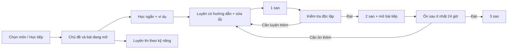

# Kế hoạch sửa và nâng cấp Bảo An Learning cho tự học lớp 3

**Ngày lập:** 14/10/2026. **Trạng thái:** kế hoạch triển khai, chưa phải tính năng đã hoàn thành.

**Yêu cầu đã xác nhận:** Bảo An học lớp 3; ưu tiên **Toán, Tiếng Việt, Tiếng Anh** để tự học và luyện **Violympic, Trạng Nguyên Tiếng Việt, IOE**. “Văn” trong kế hoạch này là môn Tiếng Việt tiểu học. Bộ sách và bài đang học ở trường chưa được cung cấp; phần học liệu phải có cấu hình/đối chiếu riêng trước khi gắn nhãn bám sát SGK.

**Bổ sung yêu cầu:** có khu vực tải file câu hỏi mẫu để phụ huynh/giáo viên điền câu hỏi rồi nhập vào bộ dữ liệu; hỗ trợ tạo bộ mới hoặc bổ sung câu cho bộ hiện có qua một phiên bản mới.

**Đích triển khai đầu:** một ứng dụng dùng được trên thiết bị của gia đình, có lộ trình bài học, sao thành tích, điều kiện mở bài, ôn đúng kiến thức cần ôn, sao lưu đầy đủ và gói ngoại tuyến. Giữ React/SDK/IndexedDB và tài nguyên 3D hiện có. Học liệu, giao diện và tiến độ phải hoạt động khi cảnh 3D không khả dụng.

Kế hoạch này ưu tiên **độ tin cậy dữ liệu → bài học và sao → ôn tập → luyện thi → mở rộng nội dung**. Nó cập nhật thứ tự công việc cho mục tiêu mới, thay vì tiếp tục mở rộng đảo/game theo [kế hoạch V3.8 cũ](<D:/Phần mềm 2026/BAO_AN_LEARNING_lam lại/docs/KE_HOACH_V38_GIAO_DIEN_VA_GAME_MOI.md>). Cơ sở lỗi và bằng chứng ở [báo cáo đánh giá chuyên sâu](<D:/Phần mềm 2026/BAO_AN_LEARNING_lam lại/docs/DANH_GIA_CHUYEN_SAU_2026-10-14.md>).

## 1. Những quyết định thiết kế cho bản đầu

| Quyết định | Phương án triển khai |
|---|---|
| Màn hình chính | **Học tiếp – Ôn hôm nay – Chọn môn**; có ba thẻ Toán/Tiếng Việt/Tiếng Anh |
| Đơn vị tiến độ | Môn → Chủ đề → Bài học; mỗi bài đầu tiên có một mục tiêu kiến thức chính |
| Vai trò game | Hoạt động luyện trong bài; không bắt chơi đủ năm game mới vượt bài |
| Sao | 0–3 sao cho một bài; giữ mức cao nhất; luyện lại chỉ cộng phần nâng thành tích |
| Điều kiện vượt bài | Kiểm tra độc lập đạt ≥80%, ít nhất 5 câu theo blueprint đã duyệt; tương ứng 2 sao |
| Sao thứ ba | Ôn độc lập đạt ≥80% bằng câu khác, sau ít nhất 24 giờ và sang ngày học khác |
| Mở bài | Theo bài tiên quyết của chính môn đó; không dùng tổng sao Toán để khóa Tiếng Anh |
| Luyện thi | Tuyến riêng cho Violympic/IOE/Trạng Nguyên; điểm/thời gian riêng, dùng chung mục tiêu kiến thức |
| Dữ liệu | Mỗi hồ sơ có tiến độ/sao/lịch ôn riêng; backup/restore giữ toàn bộ |
| Bản đầu | Dữ liệu trên thiết bị; chuẩn bị gói PWA ngoại tuyến. Sao dùng để ghi nhận, chưa thêm chi tiêu/mua đồ |
| Nội dung đầu | **6 bài được duyệt, hai bài mỗi môn**; thử xuyên suốt một bài Toán trước rồi nhân rộng |
| Thêm câu hỏi | Tải mẫu XLSX/CSV/JSON → điền → nhập → xem trước lỗi/trùng → thử câu → xuất bản; giữ phiên bản cũ |

Các ngưỡng 80%, 5 câu và 24 giờ là **chính sách sản phẩm đề xuất**, không phải thể lệ của ba cuộc thi. Chính sách có phiên bản và được lưu cùng kết quả, để có thể điều chỉnh sau thử dùng mà không chấm lại lịch sử bằng quy tắc mới.

## 2. Cơ chế sao và vượt bài

### 2.1. Ba sao mang ba ý nghĩa khác nhau

| Mức sao cao nhất | Điều kiện | Thông báo cho Bảo An |
|---|---|---|
| 0 | Chưa hoàn tất bước học/luyện của bài | “Mình bắt đầu nhé!” |
| 1 | Xem phần hướng dẫn ngắn, làm đủ hoạt động luyện và sửa đúng các mục còn sai; gợi ý được phép | “Con đã học và luyện xong” |
| 2 | Có bước 1; làm đủ lượt kiểm tra độc lập, đạt ít nhất 80% câu đúng ở lần trả lời đầu | “Con đã vượt qua bài – bài tiếp theo đã mở” |
| 3 | Có kết quả 2 sao; lượt ôn độc lập khác bộ câu đạt ít nhất 80%, sau ≥24 giờ và khác ngày địa phương | “Con đã nhớ lại kiến thức” |

Kiểm tra/ôn có tối thiểu 5 câu, đủ mục tiêu theo blueprint; bản mở rộng có thể dùng 10 câu để tăng độ bao phủ. Ví dụ 4/5 hoặc 8/10 đạt; tính bằng `correct * 100 >= total * 80`, không làm tròn tỷ lệ để vượt ngưỡng. Bài nhiều mục tiêu chỉ xuất bản khi mỗi mục tiêu bắt buộc có đủ câu; tổng cao không bù cho mục tiêu chưa được kiểm tra.

“Làm xong” và “vượt bài” là hai trạng thái riêng. Làm hết bài kiểm tra nhưng 3/5 đúng vẫn là completed, chưa passed; nếu đã có 1 sao thì giữ 1 sao. Sai rồi sửa trong lượt luyện không trở thành câu đúng độc lập. Lượt kiểm tra không công bố đáp án giữa bài; lời giải hiện sau khi nộp, rồi dẫn về phần sửa lỗi.

### 2.2. Cách tích sao không bị cộng lặp

```text
sao của một bài = mức sao cao nhất có bằng chứng hợp lệ
tổng sao        = tổng mức cao nhất của các bài, mỗi bài chỉ tính một lần
sao mới nhận    = max(0, mức mới - mức cao nhất đã có)
```

Ví dụ bài “Bảng nhân/chia”: học và luyện nhận 1 sao; kiểm tra đạt nhận thêm 1; ôn hôm sau đạt nhận thêm 1. Chơi lại bài đã 3 sao vẫn giữ 3. Cùng bài luyện bằng Math Quest hoặc Word Connect cũng dùng chung một thành tích bài.

Mỗi bài có `rewardGroupId` ổn định để một bản sửa câu hỏi hoặc chuyển game không tạo thêm quyền nhận sao. Lộ trình của hồ sơ được ghim phiên bản. Bản nội dung mới không tự thay bài đã học giữa phiên; nếu mục tiêu thay đổi thực chất thì có bài mới và quy tắc chuyển tiến độ rõ. Tổng sao không cộng hai lần chỉ vì một bài có hai revision.

`passed` vẫn thuộc curriculum/lesson revision và policy đã đánh giá. `rewardGroupId` chỉ gộp quyền nhận sao; một revision mới không tự passed vì dùng cùng nhóm sao. Chuyển trạng thái đạt giữa hai revision chỉ theo mapping đã kiểm tra về mục tiêu/độ khó/policy; mặc định giữ kết quả cũ trong đúng lộ trình cũ.

Không trừ sao vì trả lời sai, dùng gợi ý, làm chậm, bỏ một ngày hoặc kiểm tra lại chưa đạt. Có thể ghi huy hiệu hoàn thành chủ đề, nhưng huy hiệu không tự cộng thêm sao. Không dùng tốc độ hoặc số lần lật thẻ Memory Match để xét sao môn học.

### 2.3. Mở bài và chủ đề

- Các bài đầu của ba môn đều mở. Bài sau mở khi bài tiên quyết đạt 2 sao; không cần chờ sao thứ ba.
- Bài đã vượt luôn có thể học/luyện lại. “Đến hạn ôn” là nhãn bổ sung, không hạ trạng thái đã vượt.
- Vượt chủ đề khi tất cả bài bắt buộc của chủ đề đã passed và bài tổng hợp, nếu được khai báo, đạt chính sách của nó. Sao trung bình không che một bài chưa đạt.
- Bài thử thách và tuyến luyện thi có prerequisite theo kỹ năng, không chỉ theo số sao tích lũy.
- Phụ huynh có thể mở bài để con thử; ghi lý do mở thủ công riêng, không tự cấp sao hoặc kết quả đạt.
- Validator lộ trình từ chối vòng tiên quyết, ID thiếu/trùng, tham chiếu sai môn/lớp, bài không có blueprint và policy.

### 2.4. Gợi ý và hỗ trợ tiếp cận

Đọc đề, tăng chữ, giảm chuyển động và thay phương thức nhập không tính là gợi ý kiến thức. Gợi ý nội dung vẫn được phép: nếu con cần gợi ý trong kiểm tra, UI chuyển lượt đó thành luyện có hướng dẫn và giải thích rõ; con giữ sao cũ rồi kiểm tra bằng bộ khác sau khi sửa lỗi. Nếu một dạng kiểm tra đánh giá đọc/nghe độc lập, quy tắc hỗ trợ được ghi trong blueprint, không mặc định bật một công cụ tiết lộ đáp án.

## 3. Luồng tự học và sử dụng game hiện có



Trang trẻ ưu tiên bước tiếp theo, không yêu cầu hiểu mã pack, SDK, content version hoặc ngưỡng kỹ thuật. Thẻ bài có tên dễ hiểu, một mục tiêu, mức sao hiện có, trạng thái và một nút chính. Cảnh đảo/mascot là phần tạo hứng thú; danh sách môn/bài bằng DOM luôn có.

| Hoạt động hiện có | Dùng trong lộ trình | Việc cần thay đổi |
|---|---|---|
| Math Quest | Luyện Toán; tái dùng phần câu hỏi lựa chọn cho hoạt động khác khi phù hợp | Luyện cho phép sửa câu sai với khóa lượt mới; điểm ván không tự là sao bài |
| Word Connect | Từ–nghĩa, phép tính–kết quả, quan hệ kiến thức | Sai rồi nối lại là luyện; chọn pack theo môn/mục tiêu, không chỉ kind |
| Sentence Builder | Ghép câu Tiếng Việt/Tiếng Anh | Chuẩn hóa dấu/case theo từng bài; giữ dấu tiếng Việt; không chấp nhận chuỗi gần giống một cách tùy tiện |
| Sequence Trail | Dãy số và quy luật | Capability riêng cho quy luật; không nhận mọi pack dạng câu |
| Memory Match | Làm quen/ghi nhớ kiến thức | Luyện bổ trợ; không làm bài đánh giá để mở khóa kiến thức |
| Bảng cửu chương | Khám phá bảng nhân có đáp án mở | Một hoạt động học/luyện; mở đáp án không tự chứng minh đã vượt bài |

Tạo **AssessmentRunner** chung cho ba môn: giao diện ít hiệu ứng, ghi lựa chọn đầu tiên, đủ coverage và lưu câu trả lời để host chấm. Không lấy tỷ lệ tất cả event đang dùng trong báo cáo cũ để xét passed. Mở rộng registry/activity host cho lesson/assessment/review/mock mà không tạo thêm renderer hoặc đảo mới. Giữ ID game cũ cho lịch sử đã có; bảng nhật ký phải hiểu cả activity mới.

## 4. Nội dung lớp 3 và tuyến luyện thi

### 4.1. Sáu bài đầu để có sản phẩm dùng thật

Các chủ đề dưới đây là bộ khởi đầu dự kiến; chọn phạm vi/số liệu/ngữ liệu sau khi đối chiếu sách và bài Bảo An đang học.

| Môn | Bài đầu | Bài thứ hai | Hoạt động và dạng kiểm tra |
|---|---|---|---|
| Toán | Vận dụng bảng nhân/chia | Giải bài toán một bước | Ví dụ có lời giải, quiz, nối phép tính; kiểm tra lựa chọn và nhập số khi runner sẵn sàng |
| Tiếng Việt | Hiểu nghĩa từ và từ trái nghĩa | Đọc đoạn ngắn, tìm thông tin | Nối từ, giải nghĩa, passage có câu hỏi; không đánh giá đọc hiểu chỉ bằng ghép thẻ |
| Tiếng Anh | Từ vựng gia đình | Câu giới thiệu đơn giản | Nối từ, ghép câu, đọc/chọn đáp án; bổ sung nghe bằng audio đã duyệt |

Mỗi bài có 2–3 thẻ giải thích, một ví dụ, khoảng 8 mục luyện, các form kiểm tra và ôn riêng, mỗi form ít nhất 5 câu. Lát cắt kỹ thuật có thể bắt đầu với hai form kiểm tra/một form ôn (23 mục/bài). **Gate nội dung B2:** đủ ít nhất bốn lượt kiểm tra và hai lượt ôn khác bộ, tương đương **38 mục/bài, 228 mục cho 6 bài**, hoặc template/pool biến thể đã kiểm chứng cho độ bao phủ tương đương. Ví dụ và media chưa tính vào số mục.

Form kiểm tra/ôn dùng item khác bước luyện và có biến thể tương đương về độ khó; không chỉ đổi vị trí đáp án hoặc ID. Pool, item order và seed lưu cùng phiên. Sau khi con xem lời giải, ghi các item đã lộ để tránh dùng ngay chúng làm bằng chứng độc lập. Khi hết form/biến thể hợp lệ, con vẫn học/luyện được; UI báo cần bổ sung bộ câu để thử nâng sao, phụ huynh có thể chọn bài khác hoặc nhập form đã duyệt. Không sinh câu chưa được kiểm tra đáp án hoặc gọi bộ vừa chữa là một đề mới. Tình huống hết pool phải được thử trước bàn giao.

Trong đợt nội dung tiếp theo, mở lên 18 bài (6/môn), sau đó theo các chủ đề:

| Toán → Violympic | Tiếng Việt → Trạng Nguyên | Tiếng Anh → IOE |
|---|---|---|
| Số/phép tính trong phạm vi sách; nhân/chia; tìm số chưa biết; bài toán có lời văn; đo lường, hình học; quy luật và tổng hợp | Nghĩa từ, từ chỉ sự vật/hoạt động/đặc điểm; câu và dấu câu; chính tả; đọc hiểu; thơ/ca dao/thành ngữ có giải thích; tổng hợp | Từ vựng theo chủ đề; giới thiệu/hỏi đáp; câu cơ bản; đọc; chính tả/điền từ; nghe và tổng hợp |

Gắn nhãn riêng `school-core` và `contest-extension`. Không đưa nội dung nâng cao vào bắt buộc trước khi Bảo An đã học nền. Viết đoạn văn tự do là hoạt động có hướng dẫn/rubric và phụ huynh xem; chưa tự chấm tuyệt đối bằng so khớp chuỗi hoặc AI chưa được kiểm chứng.

### 4.2. Quy trình biên soạn và quản lý học liệu

`Draft → kiểm tra cấu trúc → rà đáp án/ngôn ngữ → thử làm → Published`.

Mỗi item có ID ổn định, `objectiveId`/`knowledgeId`, độ khó, loại nội dung, đáp án/lời giải, gợi ý, môn/lớp, nguồn/quyền sử dụng và trạng thái duyệt. Giữ metadata từng câu khi sao chép; không lấy objective câu đầu áp cho toàn bộ. Nhập Excel báo dòng/ô thiếu hoặc đáp án không hợp lệ, không tự chọn A. Giới hạn kích thước, giải nén, hàng/cột và chạy việc lớn trong worker có hủy.

Học liệu mới dùng format có phiên bản, parser đọc bộ JSON v1 hiện có. Cần thêm theo thứ tự:

1. `reading-passage` + câu hỏi dùng lại runner choice.
2. `numeric-answer` và `fill-blank` để luyện nhập số/từ.
3. `listening-choice`/`listening-gap` khi có audio hợp lệ.

Sequence được mô tả bằng loại thứ tự/quy luật riêng khi nâng schema, không tiếp tục gọi dãy số là sentence trong editor. Media có catalog nội bộ, transcript, nguồn, hash và trạng thái đã tải. TTS hiện có là hỗ trợ; bài nghe để chấm phải dùng audio ổn định đã duyệt và tải đủ cho offline.

### 4.2.1. Trung tâm mẫu câu hỏi và nhập bổ sung

Đưa vào **Xưởng học liệu → Mẫu câu hỏi**. Dự án hiện đã có nút tải mẫu CSV cho trắc nghiệm/ghép cặp/ghép câu, parser XLSX/CSV/TSV và nhập/xuất JSON v1. Nâng cấp từ nền này để mẫu có metadata, thêm câu vào đúng bộ và xử lý phiên bản/trùng/lỗi đầy đủ; không coi parser hiện tại đã đáp ứng hết quy trình mới.

Người soạn chọn **môn → lớp 3 → chủ đề/bài → dạng câu → định dạng tải**. Có hai lựa chọn “Mẫu trống có hướng dẫn” và “Mẫu có câu minh họa”. Mẫu tải ngoại tuyến được cùng phiên bản với ứng dụng. Mẫu điền sẵn môn/lớp/bài khi tải từ màn hình một bài cụ thể; có `templateVersion`/`contentFormatVersion` để importer kiểm tra tương thích.

| Định dạng | Mục đích | Cấu trúc mẫu |
|---|---|---|
| XLSX | Điền bằng Excel hoặc mở trên Google Sheets | Sheet Hướng dẫn, Thông tin bộ, Câu hỏi; dropdown môn/lớp/dạng/đáp án, cột bắt buộc và ví dụ rõ |
| CSV UTF-8 | File nhẹ, dễ trao đổi và dùng ngoại tuyến | Một bảng câu hỏi theo dạng; header cố định, BOM để giữ dấu tiếng Việt; hướng dẫn và metadata đi kèm |
| JSON | Nhập/xuất không mất ID, phiên bản, mục tiêu hay dữ liệu nhiều cấu trúc | Envelope đúng schema, metadata bộ và item đầy đủ; đọc được file v1 hiện có |

XLSX là workbook thật, khác với CSV mở bằng Excel. Parser phải tìm sheet “Câu hỏi” qua danh sách sheet/relationship của workbook, không mặc định đọc sheet đầu vì sheet đầu của mẫu là hướng dẫn. Importer báo rõ nếu sheet bắt buộc thiếu hoặc templateVersion chưa hỗ trợ. CSV có ánh xạ header ổn định, không dựa riêng vào thứ tự cột và không mất các trường metadata mới.

Mẫu bản đầu gồm trắc nghiệm, ghép cặp/nối từ và ghép câu cho Toán/Tiếng Việt/Tiếng Anh. Dãy quy luật có mẫu riêng khi loại sequence được hỗ trợ. Mẫu đọc hiểu, nhập số/điền từ và nghe chỉ bật sau khi schema/runner tương ứng đã có. Không cho tải một mẫu mà phiên bản ứng dụng hiện tại chưa nhập được.

Mỗi mẫu có câu minh họa tự biên soạn, lời giải và hướng dẫn điền; các dòng ví dụ được đánh dấu rõ, có lựa chọn bỏ ví dụ khi nhập. Mẫu nghe dùng `audioId` trong catalog và transcript; mẫu đọc hiểu có `passageId`, phần đoạn văn và câu hỏi liên kết. Không nhét đường dẫn máy cá nhân vào file rồi gọi là gói media đã tải.

### 4.2.2. Các thông tin cần giữ trên từng câu

| Nhóm thông tin | Trường cần có |
|---|---|
| Bộ dữ liệu | ID/tên bộ, môn, lớp, chủ đề/bài, nguồn, phiên bản mẫu/format; version xuất bản do ứng dụng cấp |
| Danh tính câu | `itemId` ổn định; `knowledgeId`/`objectiveId` của từng câu; không đánh số lại tất cả câu khi thêm hàng |
| Nội dung | Dạng câu, câu hỏi/hai mặt thẻ/từ có thứ tự/đoạn văn; phương án hoặc câu trả lời chấp nhận |
| Chấm và hỗ trợ | Đáp án đúng, lời giải, gợi ý, độ khó, quy tắc dấu/chữ hoa/đơn vị theo dạng |
| Sử dụng trong bài | Vai trò luyện/kiểm tra/ôn hoặc chưa phân, `formId` nếu đã phân form; nguồn/quyền sử dụng và trạng thái rà soát |

Câu mới chưa có itemId được cấp ID một lần ở draft; preview hiển thị và file xuất lại giữ ID đó để lần nhập sau nhận diện đúng. Nhập một bộ theo format cũ chỉ áp objective chung khi thật sự không có metadata từng câu và người soạn chọn rõ; không ghi đè các objective đã có. Câu nhập mặc định là draft, chưa tự tham gia form kiểm tra hoặc cấp sao.

### 4.2.3. Quy trình nhập và thêm vào bộ hiện có

1. Tải mẫu theo môn/dạng và điền nội dung.
2. Chọn “Nhập câu hỏi”, chọn file hoặc dán bảng; đọc file vào draft, chưa ghi vào bộ đã xuất bản.
3. Chọn **Tạo bộ mới** hoặc **Thêm câu vào bộ đã có**; khi nhập từ màn hình bộ hiện có thì mặc định thêm câu. Preview ghi tên/version đích và số câu trước/sau.
4. Kiểm tra cấu trúc, đáp án, metadata từng câu, tài nguyên, dung lượng và trùng; chỉ rõ sheet/dòng/cột và cách sửa. Đáp án trống/sai không được chuyển thành A.
5. Preview phân biệt câu mới, câu giống đã có và câu cùng ID nhưng khác nội dung. Câu giống có thể bỏ qua; câu xung đột cần chọn sửa thành revision mới hoặc cấp ID mới có chủ ý. Cảnh báo cả nội dung giống nhưng ID khác; file thiếu ID phải có receipt/fingerprint để nhập lại không sinh bản sao chỉ vì được cấp UUID khác. Không âm thầm ghi đè.
6. Xem/thử từng câu hoặc bộ vừa nhập; xác nhận các câu sẽ giữ lại. Nếu chọn chỉ nhận các dòng hợp lệ, phải có danh sách dòng bị loại được tải về, không báo toàn file thành công.
7. Xuất bản draft hợp lệ bằng giao dịch nguyên tử; thêm vào bộ đã có tạo `packId@version+1`, giữ nguyên các version trước và ID/metadata câu cũ.

Importer hiện giới hạn 2–30 mục/bộ và JSON v1 tối đa 40 bộ/1 MB. Giữ giới hạn có thể kiểm tra trong bản đầu: nếu tổng sau thêm vượt 30, preview yêu cầu chia thành nhiều pack có mapping rõ hoặc chọn bớt câu; không dùng `slice(0,30)` để bỏ câu rồi báo nhập đủ. Ngân hàng câu của một bài có thể tham chiếu nhiều pack; snapshot blueprint/session xác định pack/version nào đã dùng.

Import chỉ thêm nội dung, không tự cộng sao, sửa passed hoặc thay form của một phiên đang học. Cập nhật pool kiểm tra/ôn là một bước xuất bản nội dung riêng, kiểm tra độ bao phủ, câu đã lộ đáp án và revision; enrollment đang ghim bản cũ chỉ chuyển theo quy tắc đã đặc tả. Phiên/event/result cũ tiếp tục tham chiếu đúng phiên bản cũ.

Thông báo cuối ghi số dòng đọc, hợp lệ, lỗi, đã có, xung đột và thực thêm. Ví dụ đọc 20, bỏ 3 câu đã có, thêm 17 thì báo đúng 17, không dùng số dòng ban đầu làm số câu đã lưu. Ngân hàng câu là tập các pack/form có thể mở rộng; mỗi lượt học chỉ lấy tập câu hợp với game/blueprint, không đưa cả ngân hàng vào Memory Match.

### 4.2.4. Bộ mẫu đi cùng bản bàn giao

Catalog tải xuống có mã mẫu, tên dễ hiểu, môn/dạng, format version, giới hạn và file tải tại chỗ, ví dụ:

- `BA_Lop3_Toan_TracNghiem`: trắc nghiệm Toán có đáp án/lời giải.
- `BA_Lop3_TiengViet_NoiTu`: từ–nghĩa/từ trái nghĩa có mục tiêu từng câu.
- `BA_Lop3_TiengAnh_GhepCau`: từ/câu tiếng Anh có đáp án và gợi ý.
- Các mẫu cùng dạng cho môn khác và mẫu mở rộng đọc hiểu/nghe/nhập số khi được hỗ trợ.

Kèm hướng dẫn ngắn tải → điền → nhập, danh sách lỗi thường gặp, file ví dụ hợp lệ và file lỗi để thử preview. File mẫu là học liệu, không chứa hồ sơ, lịch sử học hoặc sao của trẻ. Bản xuất JSON từ Xưởng có thể tải về để chỉnh sửa/nhập trên thiết bị khác bằng chính quy trình này.

**Gate tính năng:** mẫu tải từ chính ứng dụng được điền rồi nhập lại không mất dấu/ID/objective/đáp án; nhập đủ ba môn; thêm 5 câu vào bộ 10 câu tạo bản mới 15 câu; bản 10 câu và lịch sử cũ giữ nguyên; nhập lại không tạo câu trùng ngoài ý muốn; dòng lỗi/quá giới hạn không bị cắt âm thầm; mẫu và import hoạt động ngoại tuyến.

### 4.2.5. Đưa câu hỏi vào thiết bị và vào dữ liệu mặc định của dự án

Có hai đầu ra cần làm rõ:

- **Dùng ngay trên thiết bị:** nhập/xuất bản trong ứng dụng ghi IndexedDB của origin hiện tại. Câu mới xuất hiện trong bộ học liệu cục bộ và được gắn vào bài qua draft lộ trình/pool đã duyệt.
- **Đưa vào bản phát hành của dự án:** xuất bộ JSON → rà đáp án/metadata/nguồn → đưa file vào content catalog nguồn → chạy validator/round-trip và các bài dùng bộ đó → đóng gói phát hành. Dùng file catalog theo phiên bản để thêm dữ liệu mà không phải chép tay từng câu vào `seed.ts`. Trình duyệt nhập học liệu không tự sửa file nguồn trên máy phát triển.

Gói mặc định mới giữ pack/version cũ cần cho lịch sử hoặc có snapshot được lưu đầy đủ trước chuyển; không tái sử dụng `packId@version` cho nội dung khác. Khi cập nhật ứng dụng, bộ cục bộ của gia đình không bị ghi đè bởi bộ cùng tên trong catalog. Nếu trùng key nhưng khác payload phải hiện xung đột và giữ bản hiện tại. Xuất nội dung riêng để chia sẻ không chứa tiến độ/sao; muốn chuyển hồ sơ dùng backup đầy đủ theo mục 5.4.

### 4.3. Ba tuyến luyện thi

| Tuyến | Bản đầu | Bản tiếp theo |
|---|---|---|
| Luyện Toán hướng tới Violympic | Bộ theo kỹ năng, bài tổng hợp lựa chọn/nhập số; luyện hiểu đề trước | Preset mô phỏng được kiểm chứng theo năm học/vòng/khối; thời gian và điểm riêng |
| Luyện Tiếng Anh hướng tới IOE | Từ/câu/đọc, điền từ; thêm nghe khi có gói audio | Lượt câu hỏi liên tục, preset đã đối chiếu, báo câu còn nhầm và kỹ năng cần ôn |
| Luyện Tiếng Việt hướng tới Trạng Nguyên | Nghĩa từ/câu/chính tả/đọc hiểu; ngữ liệu tự biên soạn phù hợp lớp 3 | Bộ tổng hợp theo preset trắc nghiệm được kiểm chứng; báo lỗi theo kỹ năng |

Thi thử lưu score, số đúng, thời gian, bỏ qua/hết giờ và preset version. Đồng hồ dùng deadline đã lưu; reload hoặc chuyển tab không đặt lại thời gian. Bài chưa trả lời khi hết giờ được ghi riêng và tính theo preset. Điểm cao trong thi thử không tự cấp sao/pass cho bài chuẩn; kết quả có thể đề xuất bài cần ôn.

Nhãn “mô phỏng định dạng” chỉ xuất hiện khi preset có `sourceUrl`, `schoolYear`, `grade`, `verifiedAt`, dạng câu, cách tính điểm và thời gian đã kiểm chứng. Preset chưa xác minh chỉ mang nhãn “luyện tổng hợp”, không khẳng định là đề chính thức. Nội dung dùng trong ứng dụng là tự biên soạn hoặc có quyền sử dụng; việc tham dự/vượt vòng chính thức được thực hiện ở cổng của ban tổ chức.

### 4.4. Đối chiếu nguồn chính thức ngày 14/10/2026

- **Violympic:** thông báo 2026–2027 có tuyến Toán và Toán bằng tiếng Anh. Phạm vi trước mắt theo yêu cầu là Toán; Toán bằng tiếng Anh là mở rộng sau. Bản tin chính thức được tìm thấy, nhưng công cụ đọc toàn trang bị timeout, nên chưa chốt tham số chi tiết của preset mô phỏng từ bản tin này. [Bản tin thể lệ Violympic 2026–2027](https://violympic.vn/news/detail/11931/6).
- **IOE:** hướng dẫn 2026–2027 phân biệt tự luyện và thi chính thức; có 35 vòng tự luyện. Thi chính thức cần hoàn thành vòng điều kiện, tài khoản xác thực và được nhà trường đăng ký. Vì vậy ứng dụng cần mục theo dõi phụ huynh cho các việc trên cổng IOE, tách khỏi trạng thái vượt bài nội bộ. [Hướng dẫn IOE 2026–2027](https://ioe.vn/chi-tiet/tin-tu-ban-to-chuc/tin-tu-ban-to-chuc-1-7774).
- **Trạng Nguyên:** thể lệ 2026–2027 quy định trắc nghiệm 30 phút, tối đa 300 điểm; hoàn thành năm vòng điều kiện 2–6 **trước 25/11/2026**. Thi Đình dành cho khối 4/5, nên không đưa mục tiêu đó vào lộ trình thi lớp 3. Tham số preset lấy đúng phạm vi khối/vòng đã xác minh. [Thể lệ Trạng Nguyên 2026–2027](https://trangnguyen.edu.vn/tin-tuc/the-le-san-choi-trang-nguyen-tieng-viet-nam-hoc-2026-2027).

Các tham số/lịch có thể được ban tổ chức điều chỉnh. Mục theo dõi ngoài ứng dụng ghi là “phụ huynh xác nhận” kèm thời điểm/nguồn, không được hiểu là ứng dụng đã xác minh trực tiếp trên tài khoản cuộc thi. Việc luyện trên các cổng chính thức tiến hành song song với xây phần mềm, không phụ thuộc việc hoàn thành toàn bộ kế hoạch này.

## 5. Kiến trúc dữ liệu, giao dịch và migration

### 5.1. Mô hình dữ liệu đích

| Thành phần | Nội dung chính |
|---|---|
| Curriculum snapshot | ID/version, môn/lớp, chủ đề, danh sách bài, prerequisite, policy, pack refs và blueprint bất biến |
| Lesson definition | `lessonId`, `rewardGroupId`, revision, objective/knowledge IDs, bước học/luyện, form đánh giá/ôn và media |
| Session | Thêm mode, lesson/curriculum/policy revision, profile, owner/lease, blueprint + seed, snapshot refs và checkpoint |
| Event mới | Thứ tự lượt trong session, lần nộp của item, response có version; retry dùng khóa nộp ổn định |
| SessionResult | Một kết quả bất biến cho session: coverage, first-attempt score, passed, policy/tier, `sourcePracticeResultIds` cho sao 2 và `sourcePassResultId` cho sao 3 |
| LessonProgress | Bảng tổng hợp có thể tái dựng từ result: scope profile + curriculum/lesson revision, mức sao cao nhất, passed, ngày ôn, kết quả nguồn |
| ReviewCard | Khóa ít nhất profile + pack + contentVersion + item, hoặc knowledgeId được đặc tả; ngày địa phương |
| Profile settings | Enrollment phiên bản lộ trình, sách, môn ưu tiên, cài đặt hỗ trợ và checklist cuộc thi xác nhận thủ công |

Các mode: `lesson-practice`, `lesson-assessment`, `lesson-review`, `free-practice`, `contest-mock`. Phiên game cũ thiếu mode được đọc qua adapter legacy; không sửa ý nghĩa event đã có.

Checkpoint nằm trong session, gồm bước học, form/item order/seed, mode, deadline nếu có và receipt của các câu đã commit. Với các runner lộ trình mới, mở lại ứng dụng cho chọn tiếp tục hoặc bỏ dở; chỉ reclaim ownership khi chủ cũ đã kết thúc/hết quyền hoặc bàn giao rõ. Tab ẩn không được bị coi là chết chỉ vì heartbeat bị trình duyệt trì hoãn. Khôi phục từ checkpoint/evidence, không ghi lại câu đã lưu hoặc đặt lại timer. Trạng thái chọn thẻ chưa nộp có thể đặt lại; UI nói rõ. Game tự do legacy vẫn giữ chính sách dở dang hiện có cho tới khi adapter resume của game đó được kiểm chứng.

Với activity mới, ghi danh tính runtime chung và registry cho lesson/assessment/review/mock; adapter giữ ID/nhãn của năm game cũ. Không cố gán kết quả kiểm tra Tiếng Việt vào Math Quest chỉ để lách union hiện tại. Game vẫn gọi host; persistence và reward policy nằm ở core.

`onComplete` của host mới trả kết quả đã commit gồm completed/passed/bestStars/newStars và hành động tiếp theo. `GameCompletion` hiển thị số sao thật; thành tích của game chơi tự do không dùng hình ba sao khiến trẻ tưởng được cấp ba sao bài học.

### 5.2. Hai giao dịch chính

**Ghi lượt trả lời:** kiểm tra phiên/profile/ownership/metadata → dedup khóa lượt → nếu là event mới, lưu event và cập nhật review theo chính sách trong cùng giao dịch. Retry event đã có trả lại cùng receipt, không dời lịch ôn thêm lần nữa. Tách review cho thực hành: nhiều lần sửa trong một lần học không được coi là nhiều buổi ghi nhớ độc lập; nhận evidence độc lập theo policy, không theo mọi click.

**Chốt phiên:** đọc blueprint/policy và evidence đã lưu → xác minh đủ coverage → chấm → ghi result bất biến → nâng progress theo mức cao nhất → kết thúc session. Tất cả commit hoặc rollback. Không tin component gọi `onComplete` là bằng chứng đã làm đủ; không hiện sao/phần thưởng trước commit. Mọi lời giải/correctness cho kiểm tra được host/scorer xác định từ response và snapshot, không chỉ tin cờ `correct` gửi từ UI.

Kết quả sao 2 tham chiếu các kết quả luyện hợp lệ của đúng bài/hồ sơ/revision. Kết quả sao 3 tham chiếu một pass nguồn cụ thể. Mốc 24 giờ neo vào pass nguồn đó, không vào lượt chơi mới nhất; luyện lại không dời lịch chờ. Khi restore phải có và kiểm tra được chuỗi bằng chứng này.

Trong bản đầu không cần bộ đếm sao độc lập hay ví tiêu sao. Tổng suy ra từ progress/results, nhóm theo rewardGroupId. Nếu sau này có ví, quyền nhận theo milestone tất định profile + rewardGroup + tier, không theo số lượt session.

### 5.3. Nâng DB và bảo toàn lịch sử

- Giữ `DB_NAME = bao-an-learning-v3-alpha`; tăng **DB v3 → v4**, không tạo DB mới bằng cách đổi tên.
- Giữ năm store hiện có; thêm `curricula`, `sessionResults`, `lessonProgress`: tổng tám store. Thêm index profile/session/time thích hợp. Settings nằm trên record profile có schema version.
- Đóng kết nối bằng `onversionchange`; báo rõ khi tab cũ chặn upgrade. Lease phiên là dữ liệu vận hành, không export như một phiên đang sống.
- Lưu nguyên session/event/pack/hồ sơ cũ và đưa vào “Lịch sử trước nâng cấp”. Record thiếu profileId dùng quy tắc default-learner đã có, không đoán sang một trẻ khác.
- Sao cũ đang là công thức `completed * 3`, không có bản ghi thành tích. Giữ lịch sử và giải thích chuyển sang hệ sao bài học; không tự cấp 2/3 sao hoặc passed từ dữ liệu không đủ bằng chứng.
- Review cũ có thể đã va chạm ID; giữ bản thô legacy ngay trong `reviews`, đọc qua discriminator/schemaVersion hoặc adapter cho record cũ. Record mới dùng khóa đầy đủ nên không ghi đè row legacy; backup hiểu cả hai. Không thêm store archive ngoài thiết kế tám store. Tái dựng lịch mới từ evidence đủ điều kiện; không hứa khôi phục phần lịch đã bị ghi đè mà không còn bằng chứng.
- Lộ trình/pack/policy đang dùng được ghim phiên bản. Chuyển phiên bản bằng mapping rõ, không đổi đáp án hoặc điều kiện xét đạt giữa phiên.

### 5.4. Backup/restore đích

Thiết kế backup v2 bao phủ tám collection, toàn bộ profile settings và những snapshot cần chấm lại. Đọc được format v1 và quy tắc gán legacy. Trong giai đoạn sửa nền trên DB v3, ba collection tương lai xuất là rỗng; nếu tệp có dữ liệu mới mà ứng dụng chưa có schema hỗ trợ thì yêu cầu nâng cấp, không âm thầm bỏ phần đó. Bản bàn giao có sao phải dùng DB v4 và restore đủ tám store.

Result là nguồn chấm; progress là cache có thể tái dựng. Khi restore không cộng tổng sao trong JSON vào bộ đếm. Gộp result theo ID; các session khác nhau cùng đạt 3 sao của một bài vẫn chỉ cho bài đó 3 sao. Kiểm tra profile/lesson/item/response/policy và tham chiếu kết quả 2 sao trước khi nhận bằng chứng sao thứ ba.

Preview đọc một snapshot bằng giao dịch readonly rồi đóng giao dịch để người dùng xem. Khi bấm khôi phục, kiểm tra lại xung đột, phiên đang sống và đồ thị dữ liệu trong chính giao dịch readwrite sẽ ghi đủ store; không giữ transaction mở xuyên qua bước xem trước. Quota/conflict không để profile nửa mới/nửa cũ. Restore không điều phối được phiên đang sống thì yêu cầu thoát bài đó trước. Dữ liệu local có thể bị người sở hữu thiết bị sửa; chống lặp/sai giao dịch ở đây không phải chứng nhận điểm thi chống gian lận.

## 6. Các đợt triển khai và backlog

Ước lượng dưới đây là **ngày công phát triển và kiểm tra**, không phải ngày bàn giao cam kết. Biên soạn/duyệt khoảng 228 mục hoặc pool/template tương đương, audio và thử trên thiết bị thật là công việc riêng có thể làm song song. Độ dài điều chỉnh sau lát cắt đầu.

| Đợt | Phạm vi | Điều kiện kết thúc | Ước lượng |
|---|---|---|---|
| B0 — Sửa nền | 12 vấn đề R01–R12, tập trung dữ liệu, thoát bài, offline và mobile; sửa fixture regression | Chơi/thoát đủ 5 game; hai tab không kết thúc phiên của nhau; backup đúng; mở game không cần 3D; full suite hiện tại đạt | 4–7 ngày công |
| B1 — Bài và sao | Catalog lộ trình, DB v4, result/progress, scorer, hoàn tất nguyên tử; một bài Toán xuyên suốt | Học → 1 sao → kiểm tra → 2 sao → mở bài tiếp → ôn sau 24h → 3 sao; retry/restore không cộng lặp | 4–7 ngày công |
| B2 — MVP ba môn | Sáu bài, LessonReader/AssessmentRunner, passage, trung tâm tải mẫu/nhập bổ sung, phụ huynh và ôn tập | Hai bài/môn có nội dung được duyệt; điền mẫu và nhập thêm câu đúng phiên bản; Bảo An dùng được; giữ dữ liệu qua reload/backup | 6–11 ngày công + nội dung |
| B3 — Luyện thi | Numeric/fill-blank/audio cần thiết; ba tuyến luyện; preset có version và nguồn | Luyện tổng hợp đủ ba môn; các preset được xác minh chạy đúng timer/score; điểm riêng không cấp sao nhầm | 5–9 ngày công + nội dung/media |
| B4 — Bàn giao | PWA/HTTPS, kiểm thử thiết bị, update/rollback, hướng dẫn và export gói | Gate triển khai bên dưới đạt; có gói dùng thật và đường khôi phục đã thử | 2–4 ngày công |

Có thể thử **bản pilot sau B2** với sáu bài; dùng luyện theo kỹ năng đã có và liên kết cổng chính thức trong lúc hoàn thiện B3. Không gọi pilot là mô phỏng đầy đủ ba kỳ thi.

### Backlog có thứ tự và đầu ra cụ thể

| ID | Công việc | Mã nguồn dự kiến | Kiểm tra bắt buộc / phụ thuộc |
|---|---|---|---|
| BA-01 | Sửa z-index, focus/inert, menu 320/390 px | styles, App, ProfileModal | Chuột/touch/bàn phím thoát đúng; hit test không chồng; R03/R06 |
| BA-02 | DOM chọn đủ môn/game/bài khi canvas lỗi | StudentScreen, WorldCanvas | Không WebGL và không canvas vẫn mở game; R05 |
| BA-03 | Ownership/lease phiên và đổi hồ sơ | App, storage, session-manager mới | Hai tab, reload/crash, đổi profile; R02 |
| BA-04 | Backup contract profile/module đầy đủ và đường legacy | backup-io, backup-storage, LearningProfileBackup | v1/v2, đủ hồ sơ/game, rollback; R01; mở rộng cùng BA-08 |
| BA-05 | Precache theo build, readiness, ErrorBoundary, update an toàn | sw.js, main, lazy host, build config | Mất mạng mở game chưa chơi; nâng build A→B; R04/R10 |
| BA-06 | Import/editor giữ đáp án, item IDs và objective; giới hạn XLSX | excel-import, CreatorScreen, content-io | Invalid answer không thành A; copy chỉ đổi tên giữ metadata; R07/R08/R12 |
| BA-07 | Cập nhật unit/production fixtures và CI; dependency trực tiếp | tests, Playwright, package, workflow mới | Schema v3/v4; fault injection tách SW suite; R11 |
| BA-08 | Catalog/policy/result/progress + migration v4; scope passed và xóa dữ liệu hồ sơ | contracts, curriculum, progress, storage | DAG/coverage/version pin; xóa nguyên tử session/event/result/progress/review/enrollment liên quan sau xác nhận; bảo toàn DB v1/v3; sau BA-03/04 |
| BA-09 | Ghi attempt và review nguyên tử, khóa kiến thức đúng | sdk, storage, spacedRepetition | Retry không tăng review; va chạm khác pack; R09 |
| BA-10 | Chốt result và cấp sao nguyên tử | assessment, rewards, session-manager | Double click, lost receipt, nhiều tab, quota; BA-08/09 |
| BA-11 | Trang tự học ba môn và LessonReader | StudentScreen, LessonScreen mới, GameCompletion | 1/2/3 sao thật; đã vượt/cần ôn riêng; BA-08/10 |
| BA-12 | AssessmentRunner và remediation | runner/scorer mới, game adapters | Đúng lượt đầu; 79.x% không được làm tròn đạt; dùng gợi ý chuyển mode; BA-10 |
| BA-13 | Sáu bài pilot + kiểm tra ngữ liệu/đáp án, pool dự phòng | content catalog, media catalog, fixtures | 38 mục/bài hoặc template/pool tương đương; thử hết pool; không lặp nguyên câu giữa các form; BA-06/12 |
| BA-14 | Ôn hôm nay và bảng phụ huynh; UI backup/xóa hồ sơ | review scheduler, ParentScreen | Ngày Việt Nam, giờ sớm nhất nhận sao 3, không mất sao; preview phạm vi xóa và giữ nội dung dùng chung; BA-08/09/13 |
| BA-15 | Dạng số, điền từ, passage/audio nâng cao | content schema v2, validator, editor, runners | Normalization theo môn, tải lỗi media, input bàn phím; BA-06/12 |
| BA-16 | Ba tuyến luyện thi/preset + external checklist | contest config/runner, profile settings | Timer không reset; score/passed tách; source verified; BA-13/15 |
| BA-17 | Thử dùng với Bảo An và thiết bị gia đình | QA docs, usability fixes | Quan sát chỗ cần người lớn giải thích; học ≥2 bài/môn; BA-13/14 |
| BA-18 | Đóng gói/release/rollback và hướng dẫn | build/release tools, manifest, docs | Gate B4, backup thật, phiên bản nhất quán; sau BA-17 |
| BA-19 | Trung tâm tải mẫu XLSX/CSV/JSON, nhập bổ sung và quy trình đưa JSON vào catalog phát hành | template/content catalog mới, CreatorScreen, excel-import, content-io, validation, storage | Đúng sheet XLSX/header CSV; round-trip; metadata từng câu; preview lỗi/trùng/counts; version mới; không cắt quá 30; offline; BA-06/08/15 theo dạng |

BA-06 và biên soạn nội dung có thể làm song song với sửa phiên/offline; chốt schema trước khi editor xuất format mới. Không chỉnh chung một file bởi nhiều nhánh mà chưa phân ranh rõ. Mỗi đợt có artifact/log của chính build, không kế thừa nhãn PASS từ tài liệu cũ.

BA-19 triển khai các dạng v1 sau BA-06, song song với chuẩn bị sáu bài; phần mẫu nâng cao theo BA-15. Có thể bàn giao CSV/JSON trước và thêm XLSX nhiều sheet khi round-trip đã đạt. Catalog không bật mẫu nâng cao sớm. Gate B2 bao gồm các mẫu của những dạng thực sự dùng trong sáu bài pilot.

## 7. Ôn tập, phụ huynh và tính cá nhân hóa

Trang “Ôn hôm nay” có câu/mục tiêu thật đến hạn, không chỉ số lượng. Ưu tiên mục vừa sai và bài đến lịch; câu trong lượt chấm sao thứ ba phải khác form đã làm. SM-2 hoặc lịch đơn giản đều được, nhưng policy thống nhất: câu trả lời độc lập/gợi ý và ngày học là evidence; loại mốc 8 giây khỏi chất lượng tuyến tự học. Chơi chậm không bị giãn tiến độ hoặc giảm sao.

Ngày học theo múi giờ **Asia/Ho_Chi_Minh**; timestamp lưu UTC. Bộ tính ngày cập nhật khi tab qua đêm, resume hoặc đổi ngày, không chỉ khi mảng reviewCards thay đổi. Đủ ≥24h và khác ngày được kiểm tra từ kết quả 2 sao nguồn, không chỉ từ tên ngày trong UI.

Hiển thị giờ sớm nhất có thể ôn nhận sao thứ ba; sang ngày mới nhưng chưa đủ 24 giờ vẫn có thể luyện tự do. Ví dụ đạt lúc 20:00 thì ngày hôm sau 08:00 chưa đủ điều kiện, UI giải thích và cho luyện, không báo lỗi lưu hoặc làm trẻ tưởng mất tiến độ.

Góc phụ huynh có: sách/phạm vi đang học; bài đã luyện/đã vượt/cần ôn; tổng sao theo môn; tỷ lệ đúng độc lập tách tỷ lệ mọi lượt luyện; câu/mục tiêu hay nhầm; nội dung tiếp theo; checklist vòng điều kiện chính thức và backup. Cho điều chỉnh thứ tự, mục tiêu học và mức hiệu ứng. Nút mở bài thủ công và dữ liệu thi chính thức xác nhận bằng tay được ghi riêng, không biến thành chứng cứ passed.

Hồ sơ mới không tự chuyển lịch sử của default-learner sang Bảo An. Nếu xác định đó là dữ liệu của bé, thực hiện thao tác chuyển có preview, ID mapping và backup; không dựa vào tên hiển thị để quyết định.

## 8. Triển khai sử dụng và gói ngoại tuyến

Đường bàn giao đầu là Windows qua localhost và/hoặc PWA HTTPS cho thiết bị gia đình; giữ origin ổn định. Bản HTML V3.6.2 là nhánh riêng, không tự có lộ trình/sao mới. Hướng dẫn phải chỉ đúng bản React nâng cấp để tránh chơi nhầm hai kho dữ liệu.

Service worker cần secure context; localhost được hỗ trợ cho phát triển, còn truy cập từ điện thoại qua IP LAN HTTP không tương đương localhost trên máy điện thoại. Vì vậy bản dùng trên điện thoại cần HTTPS hợp lệ và kiểm tra `isSecureContext`, SW/controller/IndexedDB thực tế. [Tài liệu secure context](https://developer.mozilla.org/en-US/docs/Web/Security/Defenses/Secure_Contexts), [vòng đời service worker](https://developer.chrome.com/docs/workbox/service-worker-lifecycle?hl=en).

Gói “Sẵn sàng ngoại tuyến” xác minh JS/CSS, runner, pack, ảnh/audio/model cần cho phạm vi đã chọn; hiển thị dung lượng và những phần chưa tải. Model lỗi vẫn có bài học DOM. Thiếu một gói phải hiện hướng khắc phục, không trắng trang hoặc báo đã sẵn sàng.

Chuyển từ `localhost:5173` sang origin HTTPS cần export/restore đã kiểm tra; IndexedDB không tự chuyển giữa origin. Trên thiết bị thứ hai dùng backup hoặc cơ chế đồng bộ được xây ở đợt riêng. Bản đầu ghi rõ dữ liệu đang lưu ở thiết bị nào.

Checklist kỹ thuật bàn giao:

- Build cố định commit/lockfile, thống nhất phiên bản UI/package/title/backup; không dùng Vite dev server làm dịch vụ phát hành.
- Host phục vụ đúng MIME cho JS/GLB/audio; HTML/SW có chiến lược update, chunk hash bất biến; kiểm tra base path nếu đặt trong thư mục con.
- Nén và cache được đo trên host thật. Middleware nén GLB của Vite preview không được coi là mặc nhiên có trên mọi static hosting.
- Cập nhật mới không reload giữa phiên làm bài. Đổi SW sau khi phiên an toàn; nếu bản rollback không đọc schema mới thì không hạ DB, dùng bản phục hồi tương thích hoặc restore vào môi trường riêng.
- Có backup trước upgrade và hướng dẫn khôi phục đã thử. Kết quả/sao local không gửi ra host nếu chưa xây chức năng đồng bộ.
- Khả năng kiểm soát hồ sơ trên máy dùng chung được mô tả rõ. Nếu triển khai nhiều người dùng/cloud, xác thực và phân quyền là một đợt thiết kế riêng.

## 9. Bộ nghiệm thu trước cho Bảo An dùng thường xuyên

| Nhóm | Tình huống phải đạt |
|---|---|
| Sao/vượt bài | Practice đủ + sửa đúng → 1; 3/5 assessment chưa pass; 4/5 → 2; ôn độc lập đủ 24h khác ngày 4/5 → 3 |
| Mở bài | 2 sao mở đúng prerequisite; môn khác không bị khóa; bài đã qua không bị đóng do nghỉ/đến hạn ôn |
| Đếm sao | 1→2→3→2 chỉ tăng +1/+1/+1/+0; cùng lesson qua hai game vẫn tối đa 3; revision không tạo sao trùng |
| Evidence | Dùng gợi ý không cấp độc lập; sai rồi sửa không tăng đúng lượt đầu; thiếu câu/blueprint không chốt pass |
| Giao dịch | Retry event, double completion, mất response sau commit, reload và hai tab đều không tạo event/review/sao lặp |
| Lỗi lưu | Quota/abort không có completed thiếu result, không hiện thưởng chưa commit; retry giữ khóa và evidence |
| Hồ sơ | Đổi trẻ/đổi tab không ghi nhầm; dữ liệu legacy mặc định giữ đúng; xóa hồ sơ xử lý dữ liệu liên quan theo chính sách |
| Migration/backup | DB v1/v3→v4 giữ lịch sử; v1/v2 import đúng; đủ tám store; reimport không cộng sao; conflict rollback |
| Restore đa nguồn | Hai backup có session khác nhau cùng đạt 3 sao → bài vẫn 3; progress tái dựng; thiếu pass nguồn của sao thứ ba bị từ chối |
| Resume/version | Reload giữa assessment giữ form/câu đã nộp/deadline; pass nguồn đúng; revision mới không tự passed vì cùng rewardGroup |
| Hết pool | Form đã lộ lời giải không được đổi ID rồi cấp độc lập; tiếp tục luyện được, thông báo bổ sung nội dung rõ, không cấp sao sai |
| Nội dung | Đáp án Excel lỗi được báo; copy giữ ID/objective; TV giữ dấu; numeric/blank chấm đúng rule; audio lỗi có fallback rõ |
| Tải mẫu/nhập thêm | XLSX/CSV/JSON tải–điền–nhập giữ dữ liệu; 10+5 tạo version mới 15 câu; import trùng/ID xung đột rõ; vượt giới hạn không cắt; bài/lịch sử/sao cũ không bị đổi |
| UI | 320/390/tablet/desktop, zoom 200%, keyboard/touch, giảm chuyển động; nút không bị che/chồng; luôn mở bài bằng DOM |
| Offline/update | Game/runner chưa từng mở vẫn tải được sau chuẩn bị offline; cache A→B đúng; mất chunk không trắng root |
| Luyện thi | Mốc thời gian/điểm theo preset; refresh không reset; mock không cấp sao bài; checklist chính thức ghi rõ nguồn xác nhận |
| Thiết bị thật | Mở/đóng/lưu/restore và offline trên máy Bảo An dùng; đo khung hình/long task, không lấy viewport giả lập thay thiết bị |

Nghiệm thu pilot cùng Bảo An: làm tối thiểu hai bài mỗi môn, có một câu sai và sửa, một lượt kiểm tra chưa đạt rồi đạt, ôn lại sau 24 giờ, tắt mạng, đóng/mở ứng dụng và phục hồi backup. Ghi chỗ con chưa hiểu lời hướng dẫn để sửa UX/nội dung trước mở rộng.

## 10. Bước triển khai kế tiếp

1. Ghi baseline source/build và giữ backup của bộ dữ liệu kiểm thử; không xóa DB để làm test qua.
2. Làm BA-01 → BA-05 và BA-07 để đóng lỗi chặn sử dụng; BA-06, BA-19 phần CSV/JSON v1 và nội dung pilot chuẩn bị song song.
3. Chốt catalog/policy/format backup đích, rồi làm BA-08 → BA-12 bằng **một bài Toán + một bài kế tiếp** để chứng minh mở khóa. Đây là lát cắt đầu, không được đánh dấu sáu bài hoàn tất chỉ vì có màn menu.
4. Khi lát cắt đó qua nghiệm thu, đưa hai bài Tiếng Việt và hai bài Tiếng Anh vào cùng pipeline, hoàn thiện ôn và phụ huynh.
5. Bàn giao pilot B2; tiếp tục preset/audio/luyện thi B3 và đóng gói B4 theo gate. Phạm vi nội dung rộng thêm sau khi Bảo An dùng được sáu bài đầu.

**Điều kiện coi mục tiêu đã triển khai:** Bảo An tự chọn bài đúng môn/lớp, hiểu hướng dẫn, học và sửa lỗi, nhận sao có căn cứ, vượt/mở bài đúng, ôn lại thật, luyện hướng tới ba sân chơi, và tiến độ được giữ khi mất mạng/tải lại/khôi phục. Hiện tài liệu này mô tả công việc để đạt điều kiện đó; chưa khẳng định mã đã thực hiện.
