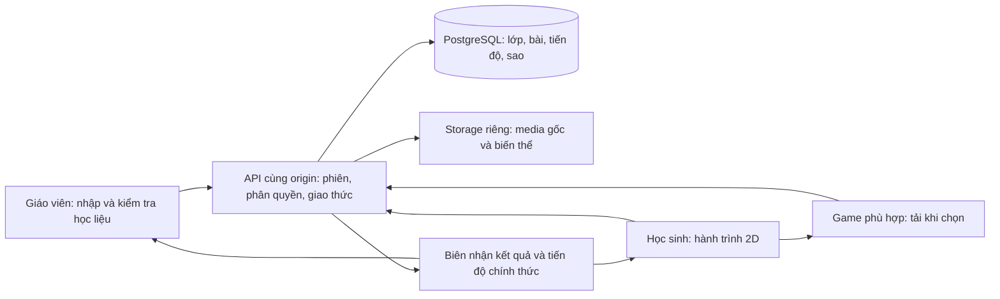

# Kế hoạch hoàn chỉnh: tối ưu, sửa và nâng cấp Bảo An Learning để phát hành

Ngày lập: **02/11/2026**. Phiên bản được rà soát: **3.8.0-rc.12**, commit nền `a6d0af1`, nhánh `feature/v37-premium-world`, có các thay đổi local chưa commit.

Trạng thái tài liệu: **đã triển khai bản 3.9.0-rc.1; mục 2–12 là baseline lúc lập kế hoạch, mục 13 là báo cáo thực hiện và phạm vi đã được người dùng điều chỉnh**.

## 1. Quyết định đề xuất cho bản phát hành

**Chuyển bản phát hành chính sang giao diện 2D, bỏ hẳn đường chạy 3D khỏi ứng dụng được đóng gói. Đồng thời sửa đường tải media và điểm nghẽn máy chủ.** Đây là ba phần công việc riêng, cần thực hiện và đo kết quả riêng.

Giữ đủ năm trò hiện có: Câu hỏi/Math Quest, Trí nhớ, Ghép câu, Nối từ, Xếp thứ tự; giữ tám dạng câu hỏi, quản lý lớp/học sinh, nhập học liệu, hành trình theo tuần, sao từng câu và đổi quà. Có thể tiếp tục dùng hình Cáo 2D, âm thanh phản hồi và hiệu ứng CSS ngắn, hỗ trợ tắt chuyển động.

Lưu bản 3D để tham chiếu bằng tag/commit hoặc gói nguồn riêng. Không mang thư mục lưu trữ 3D vào `public/`, `dist/` hoặc gói phát hành 2D. Không cần viết lại React, thay framework, tách microservice hoặc bổ sung hệ thống hàng đợi cho bản này.

Lý do lựa chọn:

- 3D hiện đã là tùy chọn và tải theo nhu cầu. Bỏ 3D giúp giảm dung lượng phát hành, độ phức tạp, tài nguyên GPU khi sử dụng và phạm vi kiểm thử; không đủ cơ sở hứa rằng chỉ thao tác này sẽ chữa hết tải ảnh/câu hỏi chậm.
- Đường media cloud và các giao dịch PostgreSQL cần tối ưu riêng. Hồ sơ staging trước đây đã ghi nhận lỗi và độ trễ lớn dưới tải nhiều học sinh.
- Giá trị cần hoàn thiện trước phát hành là học sinh vào đúng bài nhanh, nội dung đọc/nghe rõ, lưu kết quả chắc chắn và quay lại hành trình liền mạch.

**Thứ tự ưu tiên:** đo và phân loại lỗi → sửa tải đồng thời trên backend → hoàn tất bản 2D và CSS → tối ưu ảnh/âm thanh/câu hỏi → hoàn thiện nhập bài và liên thông → nghiệm thu cloud, phục hồi và phát hành có kiểm soát. Có thể chuyển các thay đổi 2D nhỏ, độc lập lên trước trong khi chuẩn bị môi trường đo backend.

## 2. Kết quả đánh giá và bằng chứng

### 2.1. Đã kiểm tra mới ngày 02/11

| Nội dung | Kết quả | Phạm vi/giới hạn |
|---|---|---|
| `npm run typecheck` | Đạt | Cấu hình hiện kiểm tra `src`, Vite và khai báo kiểu của tools; chưa kiểm tra kiểu toàn bộ server `.mjs` |
| `npm run build` | Đạt | Build local; không xác nhận tốc độ website đang triển khai |
| `npm test` | **337 đạt, 0 lỗi** | 110 renderer + 10 release + 174 online + 43 cloud local/fixture |
| Browser/E2E | Chưa chạy lại trong đợt lập kế hoạch | Không lấy kết quả browser cũ để ghi thành kết quả mới |
| Cloud/load/backup thực tế | Chưa chạy mới trong đợt này | Số liệu staging bên dưới là lịch sử ngày 26/10 |
| Dependency audit | Chưa chạy mới | Cần thực hiện tại cổng phát hành |

Lần chạy test đầu tiên trong sandbox gặp 7 lỗi `EACCES` khi kết nối localhost; chạy lại với quyền kết nối localhost đã đạt đủ 337 kiểm thử. Không coi lỗi môi trường đó là lỗi logic ứng dụng. Log mới: `test-results/optimization-plan-2026-11-02-tests.log`.

Các thay đổi local có sẵn liên quan cleanup bộ đếm đăng nhập trong server và test được giữ nguyên. Việc cleanup này đã có kiểm thử đạt, không lập lại thành một lỗi chưa sửa.

### 2.2. Dung lượng đo từ cây tệp và build mới

Đơn vị MiB = 1.048.576 byte. Các số gzip do Vite báo dùng kB thập phân; chưa phải số byte thực tế CDN truyền tới thiết bị.

| Thành phần | Số đo hiện tại | Ý nghĩa |
|---|---:|---|
| Toàn bộ `dist/` | 22.357.019 byte, **21,32 MiB**, 86 tệp | Dung lượng artifact tĩnh, không phải tổng tải của một lần mở trang |
| `public/models/` | 18.666.431 byte, **17,80 MiB**, 23 tệp | Khoảng **83,5%** dung lượng bản build hiện tại |
| `public/art/` | 1.613.391 byte, **1,54 MiB**, 16 tệp | Cần phân biệt hình đang dùng ở 2D với hình lịch sử |
| Mô hình tối ưu ngoài 5 tên tệp được manifest hiện tại tham chiếu | 10 tệp, 7.892.652 byte, **7,53 MiB** | Ứng viên loại khỏi artifact mới; không tự xóa bản deployment cũ còn phục vụ phiên cũ |
| JS entry | 226,19 kB; gzip 71,12 kB | Có React/runtime; 3D không mặc nhiên tải cùng entry |
| JS Three.js | 595,22 kB; gzip 149,92 kB | Chunk động, loại khỏi bản 2D |
| CSS màn học sinh | 271,54 kB; gzip 52,60 kB | Đang nặng hơn nhu cầu một màn chọn bài 2D |
| `src/styles/game-base.css` | 294.399 byte, khoảng 4.175 dòng có nội dung | Cần tách theo màn hình, gỡ CSS 3D có kiểm chứng |
| JS quản trị | 113,57 kB; gzip 37,89 kB | Đã được tải sau đăng nhập quản trị |

Không cộng dung lượng `node_modules`, backup, báo cáo, video test hoặc ZIP cũ vào dung lượng người học phải tải. Tuy nhiên phải kiểm tra chúng không lọt vào gói phân phối.

### 2.3. Những điểm đã xác nhận trong mã nguồn

| Phần | Bằng chứng | Đánh giá |
|---|---|---|
| 3D là tùy chọn | `src/screens/StudentScreen.tsx`: chế độ `light`, nút Khám phá 3D, `lazy(WorldCanvas)` | Không được chẩn đoán Three.js luôn chặn màn đăng nhập |
| Tùy chọn 3D cũ có thể được nhớ | `initialDisplayMode` đọc localStorage | Bản 2D phải xử lý sở thích đã lưu, không chỉ đổi mặc định |
| Game và bài dùng chung thành tích | `OnlineStudentWorld.tsx`, `question-rewards.ts`, hai store | Phải giữ nguyên ID nguồn, quy tắc sao và idempotency khi tối ưu |
| Mở game đã tải JS song song API | `OnlineStudentWorld.tsx`, `startGame` | Giữ và đo tiếp, không ghi việc này thành tối ưu chưa có |
| Ảnh cloud đi vòng qua Functions | `server/cloud-api.mjs:129–140`, `supabase-storage.mjs` | Xác thực → DB → Storage download toàn tệp → hash → trả bytes |
| Media không được HTTP cache | `privateHeaders`, `netlify.toml` | Bảo vệ dữ liệu riêng; mỗi lần cần mạng có thể lặp lại đường máy chủ |
| Range audio vẫn đọc đầy đủ object từ Storage | Nhánh media cloud tải bytes trước `subarray` | Có thể tăng băng thông/độ trễ, cần đo |
| Ảnh hiện chỉ kiểm tra hợp lệ/kích thước | `src/core/online-media-check.ts`, nhánh upload server | Chưa có pipeline tạo nhiều kích cỡ ảnh để hiển thị |
| Ảnh sẵn sàng trước đồng hồ | `MathQuest.tsx`, `OnlineExerciseRunner.tsx`, `useQuestionClock.ts` | Đang bảo vệ học sinh khỏi mất thời gian khi tải ảnh; cần giữ |
| Mọi `mutate` PostgreSQL khóa workspace | `server/postgres-store.mjs:62–65` | Học sinh khác nhau cùng đơn vị có thể chờ cùng một hàng dữ liệu |
| Cloud pool có `max:1` | `server/cloud-config.mjs:8` | Không kết luận đây là lỗi; pool nhỏ có thể phù hợp serverless, cần đo trước điều chỉnh |
| Summary phân trang sau khi gom lịch sử | `summaryProgress`, `studentSummary` | JSON trả về nhỏ chưa bảo đảm DB chỉ làm việc trên một trang |
| Parse Excel một lần đã có | `prepareOnlineDocument`, `parsedDocument` trong dashboard | Giữ kết quả này; nâng cấp worker nếu còn chặn giao diện |
| SW cũ được gỡ lúc khởi động | `src/core/online-bootstrap.ts` | Không có căn cứ nói toàn bộ 3D đang được precache mỗi lần mở ứng dụng |
| Build vẫn sinh worker và manifest toàn tài nguyên | `tools/offlineBuild.mjs`, `vite.config.ts` | Cần làm rõ đường build online; sửa cùng đóng gói và test phụ thuộc |

### 2.4. Số liệu staging lịch sử phải đưa vào danh sách chặn phát hành

Nguồn: `docs/DANH_GIA_CHUYEN_SAU_2026-10-26.md`, mục kết quả smoke tải staging bằng tài khoản quản trị.

- Tạo 30 tài khoản tổng hợp; chạy 1 tài khoản riêng trước, sau đó 29 luồng đồng thời.
- **9/30 luồng hoàn tất; 21 luồng thất bại.** Đây không phải 30 người dùng hoạt động liên tục trong 60 phút.
- p95 đầu-cuối: journey **24.658 ms**, summary **11.301 ms**, mở game **18.049 ms**, mở câu **11.967 ms**, trả lời **13.144 ms**.
- Có HTTP 500; chưa có log đủ để phân loại tất cả lỗi thành lock timeout, pool timeout, cold start hoặc lỗi khác.
- Đợt lập kế hoạch này chưa kiểm tra website hiện tại có cùng commit hay còn cùng hiện tượng. Không trình bày số liệu cũ thành đo mới.

**Kết luận đánh giá:** nền tảng nghiệp vụ và kiểm thử local tốt; điểm chặn phát hành rộng nằm ở hiệu năng cloud chưa đạt bằng chứng nghiệm thu, đường media còn tốn công, artifact 3D dư và chưa diễn tập phục hồi cloud đầy đủ. Chưa đủ căn cứ tuyên bố sẵn sàng phát hành rộng.

## 3. Mục tiêu nghiệm thu sau tối ưu

Đây là **mục tiêu đề xuất**, không phải kết quả hiện đã đạt. Chốt cấu hình đo trước khi bắt đầu và giữ nguyên khi so sánh trước/sau.

### 3.1. Điều kiện đo

- Desktop: Chrome/Edge, màn 1366×768, thiết bị Windows RAM 4–8 GB có sẵn để nghiệm thu.
- Mobile: Android Chrome RAM khoảng 4 GB, màn rộng 360–390 px; thêm iPhone/Safari nếu đưa vào phạm vi hỗ trợ chính thức.
- Kiểm tra trình duyệt có cache trống và có cache; cloud lạnh và đã hoạt động phải báo riêng.
- Kịch bản mô phỏng mạng: download 4 Mbps, upload 1 Mbps, RTT 150 ms, CPU slowdown 4×. Kèm một lượt thiết bị/mạng thật tại Việt Nam; không đánh đồng mô phỏng với thiết bị thật.
- API đo đầu-cuối cùng vị trí máy phát tải; tách p50/p95, số mẫu, tỷ lệ lỗi, byte, SQL, pool và lock. Không dùng trung bình để che các lần chờ lâu.

| Chỉ tiêu | Mục tiêu bản phát hành |
|---|---|
| Artifact web 2D, chưa gồm học liệu nhập lên server | **≤ 5 MiB** tệp tĩnh chưa nén |
| 3D trong artifact và luồng chạy | Không có `.glb`, chunk Three.js, khởi tạo WebGL hoặc nút bật 3D |
| JS trước đăng nhập | Tổng gzip **≤ 100 KiB**; xác nhận bằng dependency graph và Network |
| CSS cần cho màn học sinh ban đầu | Tổng gzip **≤ 20 KiB** |
| LCP trên cấu hình mô phỏng | ≤ 2,5 giây trong ít nhất 5 lượt đại diện |
| CLS | ≤ 0,1; ảnh có kích thước/vùng giữ chỗ |
| Phản hồi tương tác | Mục tiêu INP ≤ 200 ms khi có đủ mẫu; chưa đủ mẫu thì ghi thời gian tương tác lab, không gọi là INP thực tế |
| Summary, cloud đã hoạt động | p95 ≤ 1 giây |
| Mở câu, cloud đã hoạt động | p95 ≤ 0,8 giây |
| Gửi đáp án, cloud đã hoạt động | p95 ≤ 1,2 giây |
| Mở lượt chơi API, cloud đã hoạt động | p95 ≤ 1,5 giây |
| Chọn game → câu đầu dùng được | p95 ≤ 3 giây, với ảnh đã tối ưu ≤ 150 KiB trên cấu hình đo |
| Ảnh câu hiện tại tải + giải mã | p95 ≤ 1,5 giây với ảnh ≤ 150 KiB; ảnh đặc biệt có ngân sách riêng |
| Cloud lạnh | Theo dõi riêng; mục tiêu API p95 ≤ 3 giây, không trộn vào số warm |
| Tải đồng thời | 30 học sinh trong 60 phút đạt rồi mới tăng 100; đủ cả ảnh, nghe, retry, kết thúc bài |
| Lỗi khi nghiệm thu tải | 0 lỗi 5xx/timeout không giải thích; mọi sai lệch sao/số dư phải bằng 0 |
| Lặp thao tác | 50 lần vào/thoát bài không tăng bộ nhớ liên tục hoặc còn request/audio/observer của lượt đã thoát |

Với test tải, HTTP 400/401/403/409/429 do chủ động kiểm tra quy tắc phải được tách khỏi lỗi bất ngờ; không loại những lỗi thật khỏi mẫu p95 hoặc báo cáo thành đạt.

## 4. Kiến trúc đích và luồng liên thông

SQLite tiếp tục phục vụ bản cục bộ Windows qua cùng hợp đồng API/nghiệp vụ. PostgreSQL là kho chính thức của bản cloud. Hai chế độ không tự đồng bộ dữ liệu với nhau trong kế hoạch này; nếu chuyển dữ liệu phải có quy trình di chuyển và kiểm tra riêng.

### 4.1. Luồng giáo viên

Chọn lớp → chọn tuần → chọn Excel/Word và media → kiểm tra có tiến độ → xem lỗi đúng dòng/tệp → xác nhận các câu hợp lệ → giao bài → xem đúng số câu của từng môn/game phù hợp → học sinh nhận trong lần làm mới tiếp theo.

Chuyển lớp/tuần khi nhập dở phải xác định rõ đang lưu bản nháp ở đâu. Khi chưa giao thành công, không thông báo đã giao. Khi giao lại cùng request, không tạo tuần hoặc sao trùng.

### 4.2. Luồng học sinh

Đăng nhập → tuần hiện tại → bộ đang học → game phù hợp → câu hỏi/media sẵn sàng → trả lời → máy chủ xác nhận → tiến độ/sao/ví cập nhật cùng kết quả → câu kế tiếp hoặc hoàn thành → quay lại đúng vị trí hành trình.

Giữ quy tắc tối đa 3 sao mỗi câu nguồn, thành tích dùng chung giữa game, học lại chỉ cộng phần tăng. Chuyển tuần chỉ khi đủ yêu cầu hiện tại; tuần đã đóng vẫn khóa.

### 4.3. Quy ước liên thông

- Một `ModuleId`/registry cho game, một tập hợp đồng API; không dùng ID cảnh 3D làm trung gian chọn game nữa.
- `packId`, `contentVersion`, `itemId`, `playId`, `attemptKey`, `requestId` được giữ xuyên suốt; request cũ không ghi đè trạng thái của phiên mới.
- Frontend chỉ cập nhật sao sau biên nhận thành công. Khi mất phản hồi, dùng lại đúng khóa và nội dung yêu cầu, không sinh khóa mới để thử lại.
- Luồng lỗi có ba trạng thái rõ: chưa gửi được, đang xác minh kết quả, đã được máy chủ lưu. Không cho thông báo thành công khi mới gửi request.
- Hoàn thành bài, ví, bảng tiến độ và trang quản trị lấy cùng dữ liệu chính thức. Màn mới làm mới đúng phạm vi cần thiết; không tải lại toàn ứng dụng sau mỗi câu.
- Không buộc thêm WebSocket để đạt liên thông. Giữ cập nhật tại chỗ từ biên nhận và làm mới khi cần; chỉ bổ sung thông báo thời gian thực nếu đo thấy nhu cầu cụ thể.

## 5. Danh sách công việc sửa và nâng cấp

Mức ưu tiên: **P0** = chặn phát hành rộng hoặc điều kiện bắt buộc để xác minh; **P1** = cần hoàn tất cho bản phát hành tối ưu; **P2** = cải thiện tiếp khi baseline và phần chặn đã ổn. Đây là mức ưu tiên thực hiện, không phải tuyên bố mọi mục đều là lỗ hổng/lỗi nghiêm trọng.

### Gói A — Chốt baseline và đo đúng chỗ

#### A01 — Chốt nguồn, deployment và tập dữ liệu đo — P0

- **Việc làm:** ghi commit, thay đổi chưa commit, version UI/API, schema, runtime Node, vị trí Functions/DB/Storage; thêm build ID/commit rút gọn vào status hoặc thông tin phát hành không chứa bí mật.
- Chuẩn bị staging riêng và tài khoản tổng hợp có các tuần ngắn/dài, đủ tám dạng, ảnh, audio, lịch sử sao/đổi quà. Không trộn dữ liệu test vào lớp thật.
- **Tệp liên quan:** `server/api-diagnostics.mjs`, `server/cloud-api.mjs`, `netlify/functions/online.mjs`, script build/package, `tools/staging-game-smoke.mjs`.
- **Đầu ra:** bảng baseline trước/sau và khả năng xác nhận browser đang chạy đúng frontend/backend của lần thử.
- **Nghiệm thu:** xác minh cùng build; fixture tái lập được; giữ riêng thay đổi local đã tồn tại; không ghi tài khoản/mật khẩu vào log hoặc repo.

#### A02 — Đo frontend, API, Storage và PostgreSQL — P0

- **Việc làm:** ghi mốc chọn game, nhận play, bắt đầu/kết thúc ảnh, giải mã ảnh, nhận câu, câu có thể trả lời, gửi và nhận xác nhận đáp án.
- Tái sử dụng `createPerformanceReporter`; liên kết request với support ID khi cần; ghi pool wait, số truy vấn, thời gian DB, Storage, parse/serialize và cold initialization.
- Đối chiếu `pg_stat_activity`, `pg_locks` hoặc dữ liệu giám sát tương đương có quyền truy cập. `lockingSqlMs` hiện chứa cả thực thi/mạng, **không phải phép đo lock wait chính xác**.
- **Tệp:** `server/api-diagnostics.mjs`, `server/postgres-store.mjs`, `src/core/online-client.ts`, phần host game/media.
- **Nghiệm thu:** chỉ ra phần nào chiếm thời gian ở ít nhất 5 lượt cold, 20 lượt warm và đợt 30 người; log không chứa đáp án, mật khẩu, cookie hoặc URL có token. Có lấy mẫu và giới hạn lưu lượng log.

### Gói B — Bỏ 3D đúng cách và làm bản 2D gọn

#### B01 — Chốt một màn học sinh 2D — P1

- **Việc làm:** dùng nhánh giao diện nhẹ hiện có; bỏ nút Khám phá 3D, chất lượng cảnh, điều khiển đảo và trạng thái chờ cảnh. Xử lý localStorage từng ghi `3d` để người dùng cũ vào 2D an toàn.
- Trang đầu chỉ tập trung bài hiện tại, nút học, tiến độ tuần và ví. Học liệu chưa được giao có trạng thái chờ rõ ràng.
- **Tệp:** `src/screens/StudentScreen.tsx`, `src/screens/OnlineStudentWorld.tsx`, `src/styles/student-assigned-games.css`.
- **Nghiệm thu:** tài khoản mới/cũ đều vào 2D; đủ game phù hợp từ API; bàn phím/cảm ứng/cuộn hoạt động; không cần cảnh để mở bài.

#### B02 — Tách game khỏi các phụ thuộc trình diễn 3D — P1

- **Việc làm:** bỏ mapping `getSceneForModule` khỏi luồng học; gỡ props cảnh không còn cần; chuyển trạng thái mascot thực sự còn dùng sang thành phần UI 2D hoặc loại callback không có tác dụng.
- Kiểm tra `GameMascot`, `GameCompletion`, `GameSceneContext`, kiểu `GuideMood/WorldId/QualityChoice`, phần tử `ba37-game-scene-slot`. Giữ hình Cáo 2D và hiệu ứng thật sự được sử dụng.
- Không xóa theo chuỗi `3d`, `three` hoặc `ba37` một cách máy móc: có tên class/biến liên quan quy tắc ba sao hoặc giao diện còn dùng.
- **Tệp:** các tệp trên, `src/games/*`, `src/core/registry.ts`, `src/world3d/*`.
- **Nghiệm thu:** năm game chạy đủ chức năng trên bản không có Three.js; không còn import runtime từ `src/world3d`; typecheck và kiểm thử nghiệp vụ đạt.

#### B03 — Bỏ 3D khỏi build, dependency và gói phát hành — P1

- **Việc làm:** lưu mốc nguồn trước; gỡ `three`, `@types/three` và cập nhật lockfile sau khi B02 hoàn tất; gỡ sinh model trong `build`, `modelTransportPlugin`, chunk `three-vendor` và header model không còn cần.
- Loại `.glb`, prototype/mobile GLB, mô hình tối ưu cũ, generator chỉ phục vụ 3D và asset 3D khỏi artifact mới. Phân loại tài nguyên trước khi dọn bản nguồn.
- Cập nhật `test:renderer`, `test:assets`, `verify:local`, CI và package contract cùng thay đổi; lưu test lịch sử ngoài nhóm kiểm thử hiện hành nếu cần tham chiếu.
- Đổi mô tả/tên gói nội bộ đang mang hậu tố `3d` nếu cần; không đổi tên sản phẩm Bảo An Learning.
- **Tệp:** `package.json`, `package-lock.json`, `vite.config.ts`, `public/models`, `tools/modelTransport*`, `tools/generate_optimized_models.mjs`, `.github/workflows/verify.yml`, các test liên quan.
- **Nghiệm thu:** artifact ≤ 5 MiB; không `.glb`/Three.js; 0 request model và 0 WebGL khi đăng nhập/chơi đủ năm game; cài dependency sạch và build sạch thành công.

#### B04 — Tách CSS và kiểm soát cuộn — P1

- **Việc làm:** tách CSS màn chọn bài, layout câu hỏi, từng game, dialog/ví và hiệu ứng. Chỉ tải CSS game khi mở game; bỏ quy tắc 3D và ghi đè không còn chủ sở hữu.
- Xác định ai quản lý cuộn: trang hành trình, dialog game và bảng quản trị; rời dialog phải trả overflow/focus đúng. Giữ khoảng trống ảnh để hạn chế nhảy bố cục.
- **Tệp:** `src/styles/game-base.css`, `question-layout.css`, các screen và game import CSS.
- **Nghiệm thu:** CSS màn học sinh ban đầu gzip ≤ 20 KiB; không cắt mất đáp án/nút ở 1366×768, 360×800 và phóng chữ 200%; test scrolling, focus, mobile và năm game đạt.

### Gói C — Làm ảnh và âm thanh tải nhanh

#### C01 — Tạo ảnh hiển thị phù hợp khi nhập — P1

- **Việc làm:** giữ ảnh gốc; sinh ảnh hiển thị cỡ khoảng 640/960/1280 px theo loại câu; WebP ưu tiên khi rõ nét, PNG cho sơ đồ/chữ cần giữ chất lượng. Không phóng to ảnh nhỏ và không ép mọi ảnh về một định dạng.
- Ngân sách phổ biến 50–150 KiB/ảnh; ảnh cần chữ nhỏ hoặc hình học được phép lớn hơn, có kiểm tra rõ nét. Giữ alt và lưu width/height, mime, byte, variant hash.
- Xử lý preview và xác nhận dung lượng trước upload. Server xác minh đầu ra và giới hạn pixel/byte; không chỉ tin mime hoặc kết quả từ client.
- **Điểm bảo toàn dữ liệu:** ảnh tối ưu là biến thể. Không đổi `mediaId`, hash nguồn dùng làm định danh học liệu, `itemId` hoặc lịch sử sao chỉ vì đổi cách hiển thị. Lưu `variantSha256` riêng; media cũ được bổ sung biến thể bằng tác vụ có thể chạy lại, không ghi đè ảnh gốc.
- **Tệp:** `src/core/online-media-check.ts`, màn nhập bài, `server/cloud-api.mjs`, `server/supabase-storage.mjs`, hai store và migration metadata khi cần.
- **Nghiệm thu:** bộ ảnh thật rõ chữ/toán; phần lớn ảnh thông thường đạt ngân sách; ảnh lỗi bị chặn rõ; tối ưu media cũ không thay số sao hoặc nội dung chấm.

#### C02 — Một bộ tải ảnh có giới hạn và dùng lại trong phiên — P1

- **Việc làm:** dùng chung image loader, gộp request cùng ảnh đang chạy, tối đa khoảng 2 ảnh tải đồng thời, ưu tiên ảnh câu hiện tại. Dùng blob URL trong bộ nhớ nếu phù hợp.
- Cache ứng dụng chỉ trong phiên đang đăng nhập, giới hạn byte/số mục và thời gian sống; khóa theo user/workspace + media + biến thể/version. Hủy request và giải phóng blob khi đổi tài khoản, phiên hết hạn, rời phạm vi bài hoặc vượt ngân sách.
- Không lưu ảnh học sinh vào service worker/IndexedDB/HTTP cache dùng chung. Việc giữ ảnh trong RAM phải theo cùng chính sách phân quyền; không hứa thu hồi được những byte người dùng đã tải về.
- **Tệp:** `src/components/QuestionMedia.tsx`, module loader mới, `src/core/online-client.ts`, phần cleanup phiên.
- **Nghiệm thu:** cùng ảnh trong cùng phạm vi phiên không tải lặp vô ích; retry có giới hạn; không hiển thị nhầm ảnh/câu; logout rồi tài khoản khác không dùng bộ nhớ cũ; 50 lần vào/thoát không tích lũy blob.

#### C03 — Giảm chi phí đường media cloud — P1

- **Phương án chính trước phát hành:** giữ media cùng origin và bucket riêng; phục vụ biến thể nhỏ; lưu metadata lúc nhập; kiểm tra lại quyền ở mỗi request; đo xem có cần cache bytes trên từng Functions instance với dung lượng/TTL giới hạn.
- Nếu thêm cache phía server, chỉ dùng lại bytes đã kiểm tra hash, vẫn kiểm tra quyền và trạng thái tài khoản mỗi request. Cache instance không được coi là nguồn dữ liệu bền vững và không được tăng không giới hạn.
- Giữ HTTP `no-store` cho JSON nhạy cảm. Nếu thay header media, phải kiểm tra đồng thời `privateHeaders`, `netlify.toml`, request cache và các test đang bắt buộc no-store; không chỉ sửa một nơi rồi kết luận cache đã có tác dụng.
- **Phương án dự phòng khi số đo chưa đạt:** cấp URL ký ngắn hạn riêng cho ảnh sau kiểm tra quyền. Đây là thay đổi mô hình truy cập: người có URL có thể dùng tới hết hạn; logout không tự hủy URL. Phải chốt TTL, log che token, CSP/CDN và quyền thu hồi trước khi chọn. Không mặc định áp dụng cho audio.
- **Tệp:** nhánh GET/HEAD media trong `server/cloud-api.mjs`, `supabase-storage.mjs`, `netlify.toml`, `QuestionMedia.tsx`, test media/private.
- **Nghiệm thu:** ảnh đạt mục tiêu đầu-cuối; tài khoản bị chặn không lấy thêm ảnh qua API; hash sai/thiếu object báo lỗi có hỗ trợ; không chuyển bucket thành public để làm nhanh.

#### C04 — Tối ưu âm thanh nhưng giữ giao thức câu nghe — P1

- **Việc làm:** đo audio đầu tiên và Range; lưu thời lượng được server xác minh tại nhập để tránh parse lại không cần thiết. Xem xét MP3/OGG cho giọng đọc dài, luôn giữ tệp nguồn và duyệt chất lượng.
- Giữ một audio hoạt động; thoát bài phải dừng và giải phóng decoder/request. Không preload toàn bộ audio của tuần; ưu tiên câu đang học.
- Giao thức hiện chỉ ghi nhận delivery ở một số điều kiện GET đầy đủ và dùng thời lượng server làm điều kiện mở đồng hồ. Phải kiểm tra đầy đủ Range/retry/seek trước khi đổi cách phục vụ. Không dùng audio đã cache để bỏ qua biên nhận riêng của lượt/câu hiện tại.
- Nếu cần endpoint biên nhận riêng, thiết kế và version hóa rõ; không xem sự kiện client `ended` là bằng chứng máy chủ chắc chắn biết học sinh đã nghe thực tế.
- **Tệp:** `QuestionMedia.tsx`, `src/core/question-audio.ts`, `server/audio-duration.mjs`, nhánh media, `server/question-protocol.mjs` và hai store.
- **Nghiệm thu:** Chrome/Edge và mobile phát được; lỗi mạng có retry; câu nghe giữ đúng luật mở câu/sao; audio cũ không tiếp tục phát sau thoát/đăng xuất.

### Gói D — Tối ưu câu hỏi và tải đồng thời

#### D01 — Thu hẹp khóa PostgreSQL có thiết kế nhất quán — P0

- **Việc làm trước sửa:** từ A02 phân loại lỗi 500; tạo test nhiều kết nối PostgreSQL thật trong cùng workspace và khác workspace. PGlite một hàng đợi không chứng minh được cạnh tranh thật.
- Lập bảng thao tác: đăng nhập/logout/reset mật khẩu, khóa/đổi lớp, mở game/câu, trả lời, chuyển tuần, nhập/cập nhật bài, giữ chỗ/duyệt quà. Với mỗi thao tác, ghi rõ đối tượng cần nhất quán và loại khóa.
- Hướng thiết kế: nếu cần khóa cấu hình toàn đơn vị, cân nhắc shared lock tương thích giữa các thao tác đọc cấu hình và exclusive lock cho thay đổi toàn đơn vị; sau đó khóa user/học sinh, lượt chơi, sổ sao/đổi quà theo một thứ tự thống nhất. Phải kiểm tra tương thích các loại row lock với câu UPDATE thực tế, không thay `FOR UPDATE` bằng một loại khóa khác theo phỏng đoán.
- Mọi thao tác chạm cùng dữ liệu phải tuân cùng giao thức: chỉ bỏ khóa workspace ở `attempt` trong khi admin vẫn theo đường cũ sẽ chưa bảo đảm đúng. Khi nhiều học sinh bị tác động, khóa theo thứ tự ID ổn định.
- Giữ unique constraint/idempotency; kiểm tra lại session/quyền sau khi lấy khóa; tổng sao, số dư và biên nhận cùng giao dịch. Không gọi Storage hoặc chờ client trong giao dịch đang giữ khóa.
- **Tệp:** `server/postgres-store.mjs`, migration/index nếu cần, `tests/postgres-*`, công cụ tải staging.
- **Nghiệm thu:** 30 rồi 100 học sinh; thử trả lời cùng câu từ hai tab, reset/logout/khóa tài khoản đồng thời trả lời, chuyển lớp/tuần, cập nhật nội dung, hai yêu cầu đổi quà tranh số dư. Không cộng trùng, không âm số dư, không chấp nhận phiên đã thu hồi theo thứ tự commit đã quy định; có kiểm tra deadlock/retry.

#### D02 — Giảm truy vấn summary theo dữ liệu tích lũy — P1

- **Việc làm:** đo `EXPLAIN (ANALYZE, BUFFERS)` trên staging/dataset tổng hợp; giảm đọc toàn bộ awards/redemptions/audit/weeks để dựng trang hiện tại.
- Phân trang lịch sử ở DB; tổng hợp số dư/tiến độ hoặc bảng trạng thái hiện tại chỉ khi phép đo chứng minh cần. Nếu bổ sung dữ liệu tổng hợp, cập nhật cùng giao dịch và có tác vụ đối soát từ lịch sử gốc.
- Giữ dữ liệu lịch sử để truy vết; không xóa attempt/award chỉ để summary nhanh.
- **Tệp:** `summaryProgress`, `studentSummary`, `student-summary.mjs`, `question-journey.mjs`, migration/index, hợp đồng và UI phân trang ví nếu đổi.
- **Nghiệm thu:** dữ liệu 40 tuần, ít nhất 3 môn, lịch sử đổi quà đại diện vẫn đạt p95 summary; đọc trang không tăng theo toàn bộ lịch sử vô hạn; kết quả bằng baseline nghiệp vụ.

#### D03 — Giảm công việc mở câu và nộp đáp án — P1

- **Việc làm:** đo số query/row/byte; tránh parse lại pack bất biến hoặc đọc tất cả events nhiều lần trong một request. Cache pack theo workspace + packId + contentVersion với giới hạn nếu phép đo cho thấy lợi ích.
- Chỉ dùng dữ liệu bất biến trong cache; quyền phiên, tuần hiện tại và trạng thái học sinh phải kiểm tra mới. Nếu cần bảng trạng thái câu hiện tại, cập nhật atomic và đối soát được với log attempt.
- Giữ giao thức chỉ mở câu được phép hiện tại; không gửi đáp án/lời giải hoặc toàn bộ câu tương lai nhằm giảm round trip.
- **Tệp:** `server/postgres-store.mjs`, `question-protocol.mjs`, `question-journey.mjs`, test query budget và hồi quy sao.
- **Nghiệm thu:** mở câu p95 ≤ 0,8 giây, trả lời ≤ 1,2 giây trên điều kiện đã chốt; retry giữ kết quả; không bỏ kiểm chứng server để đạt tốc độ.

#### D04 — Cấu hình kết nối, cold start và timeout — P1

- **Việc làm:** xác minh vùng Functions/DB/Storage và loại endpoint PostgreSQL đang dùng; đo pool wait và số kết nối trên mỗi instance/tổng instance.
- Đánh giá Supabase transaction pooler cho Functions; giữ TLS xác minh chứng chỉ, giao dịch trên cùng client và session setting bằng `SET LOCAL` khi dùng transaction pooling.
- `max:1` không tự động là cấu hình sai. Chỉ tăng pool sau khi chứng minh hàng đợi trong cùng instance và tính được ngân sách kết nối toàn hệ thống. Không tăng timeout để che lỗi tải.
- **Tệp:** `server/cloud-config.mjs`, `netlify/functions/online.mjs`, `.env.cloud.example`, cấu hình deployment.
- **Nghiệm thu:** warm/cold báo riêng; không cạn kết nối, không rò client; số liệu pool/SQL có thể giải thích; lỗi hạ tầng trả mã hỗ trợ rõ.

#### D05 — Tối ưu luồng câu mà vẫn công bằng thời gian — P1

- **Việc làm:** giữ việc tải chunk game song song `playCompact` đang có; gộp các yêu cầu trùng do effect/focus/StrictMode; dừng request đọc cũ khi chuyển bài.
- Với ảnh, ưu tiên tải ngay khi nhận metadata shell; chỉ mở đồng hồ theo điều kiện hiện hành khi ảnh hiện tại sẵn sàng. Với câu nghe, giữ điều kiện thời lượng/biên nhận. Không bắt đầu giờ ngay lúc chọn game.
- Có thể chuẩn bị trước bytes ảnh câu kế tiếp đã được phép tham chiếu trong shell khi đường mạng rảnh; không mở câu tương lai hoặc prefetch `question-open`. Chưa thêm API prepare/ready hai bước cho bản đầu nếu không thực sự cần.
- Không hiển thị trước prompt/đáp án ở thời điểm chưa tính giờ làm thay đổi luật sao. Muốn đổi giao thức phải có phiên bản, migration và kiểm thử riêng.
- **Tệp:** `OnlineStudentWorld.tsx`, `useQuestionClock.ts`, `MathQuest.tsx`, `OnlineExerciseRunner.tsx`, `QuestionMedia.tsx`.
- **Nghiệm thu:** ảnh chậm/lỗi không làm mất sao thời gian; câu không ảnh không chờ phần media; câu mới không lấy đồng hồ/ảnh cũ; đường vào bài đạt mục tiêu.

### Gói E — Nhập bài, giao diện và liên thông

#### E01 — Đưa xử lý nhập nặng khỏi luồng giao diện khi cần — P1

- **Việc làm:** dùng parse-once hiện có; đo long task khi parse XLSX/DOCX, hash, tạo ảnh. Chuyển phần CPU gây giật sang Web Worker, truyền buffer có kiểm soát; không thêm worker cho bước vốn rất nhẹ.
- Giữ giới hạn tài liệu/media, lọc file chỉ được câu hợp lệ dùng; tiến độ theo bước thực: đọc → phân tích → kiểm tra → tối ưu media → tải lên → xem trước → giao bài.
- **Tệp:** `OnlineAdminDashboard.tsx`, `online-document-import.ts`, `excel-import.ts`, `online-media-check.ts`, worker mới nếu đo cần.
- **Nghiệm thu:** bộ 140 câu + 16 WAV thật hoặc bộ tương đương được ghi rõ nguồn; UI còn thao tác/hủy được; lỗi đúng dòng, không bỏ âm thầm câu; parse không bị lặp khi đổi trang preview.

#### E02 — Nhập lại, hủy và giao bài không tạo dữ liệu sai — P1

- **Việc làm:** giữ batch upload đang có; tên trùng khác hash phải báo đúng; retry không upload trùng bytes; chỉ commit giao tuần khi nội dung/media đã được kiểm tra.
- Khi hủy trước giao, nêu rõ media đã tải nhưng chưa gắn bài; có báo cáo/dọn media mồ côi theo thời gian chờ, kiểm tra tham chiếu và không đụng media được lượt học hoặc bản nội dung cũ dùng.
- Media tối ưu giữ định danh nguồn; sửa lời giải và thay đổi nội dung chấm vẫn theo quy tắc version hiện có. Đồng bộ giới hạn local/cloud qua status và thông báo cho giáo viên.
- **Tệp:** màn quản trị, nhánh media/week API, hai store, import identity, script cleanup riêng nếu cần.
- **Nghiệm thu:** nhập lại không nhân tuần/câu/sao; hủy/retry an toàn; tuần đã đóng được bảo vệ; lớp khác không nhận nhầm bộ.

#### E03 — Chuẩn hóa trạng thái, điều hướng và phục hồi khi mạng lỗi — P1

- **Việc làm:** rà soát các trạng thái tải/đang lưu/đã lưu/thử lại trong năm game, ví và chuyển tuần; dùng thành phần chung ở nơi thực sự lặp.
- Trả về đúng focus/vị trí cuộn khi thoát bài; làm mới vừa đủ sau biên nhận. Request cũ không được làm giảm sao đang hiển thị. Có cách thoát an toàn khi ảnh hoặc API lỗi kéo dài.
- Giữ cơ chế pending attempt và khóa gửi hiện có, chỉ sửa nếu tái hiện lỗi hoặc để thống nhất hợp đồng. Không tuyên bố đang thiếu các bảo vệ đã có test.
- **Tệp:** `OnlineStudentWorld.tsx`, các game, `save-failure-message.ts`, dialog tuần/ví, `online-client.ts`.
- **Nghiệm thu:** mất mạng trước/sau commit, click đúp, đổi tab, quay lại, reload và hết phiên đều dẫn tới thông báo đúng; sao/ví/trang quản trị khớp server.

#### E04 — Hợp đồng chung, bảo trì và kiểm soát dữ liệu — P1/P2

- **P1:** bổ sung contract test dùng chung SQLite/PostgreSQL cho phần thay đổi trong bản này; bảo vệ session, phân quyền media, thu hồi tài khoản, CSRF, hạn mức, sao và đổi quà.
- **P1:** giữ bản cleanup login-limit đã sửa; theo dõi số hàng hết hạn, không coi index tự dọn dữ liệu. Xác minh trên DB thật khi chạy tải.
- **P2:** bổ sung JSDoc/checkJs hoặc chuyển từng module server sang TypeScript sau khi ổn hành vi; tách nghiệp vụ thuần khỏi truy vấn từng bước. Không viết lại cả hai store trước phát hành.
- Chính sách giữ audit/attempt/backup cần phân biệt lịch sử nghiệp vụ với log kỹ thuật. Log kỹ thuật giới hạn thời gian/dung lượng; không xóa chứng cứ sao tùy tiện.
- **Tệp:** `src/core/*contracts*`, `server/*store.mjs`, `tests/helpers`, các nhóm test online/cloud.
- **Nghiệm thu:** cùng fixture và thao tác cho kết quả nghiệp vụ tương đương trên hai backend; không lộ dữ liệu khi đổi tài khoản; dependency audit mới được phân loại và xử lý theo phạm vi ảnh hưởng.

### Gói F — Kiểm thử, phục hồi và phát hành

#### F01 — Bộ kiểm thử đúng với bản 2D — P0/P1

- Cập nhật các lệnh test/CI khi bỏ renderer 3D; giữ toàn bộ kiểm thử nghiệp vụ. Số test có thể giảm vì bỏ sản phẩm 3D, không đánh giá chất lượng chỉ bằng tổng số.
- Bổ sung chặn artifact có GLB/Three.js, ngân sách CSS/JS, ảnh lỗi/chậm, retry, tài khoản cũ lưu mode 3D, phiên browser cũ cập nhật lên bản mới.
- Chạy E2E năm game/tám dạng qua API thật của local và smoke staging tương ứng. Không chỉ chạy fixture component với giao thức khác server.
- Bộ nhập tệp thật phải được chạy và ghi đầu vào; mục cần cho phát hành không được để skip rồi tính đạt.
- **Tệp:** `tests/visual/online-*.spec.ts`, test release/online/cloud, `playwright.online.config.ts`, `.github/workflows/verify.yml`.
- **Nghiệm thu:** tất cả kiểm tra bắt buộc đạt, mọi skip có quyết định rõ phạm vi; ảnh/video/log của lỗi được lưu đủ truy vết.

#### F02 — Đo tải nhiều kết nối thật và dữ liệu một năm học — P0

- Theo các bước 1 → 10 → 30 người; chỉ tăng lên 100 sau khi 30 người đạt. Mỗi mức chính chạy 60 phút; thêm đợt burst cùng đăng nhập/cùng vào bài/cùng chuyển câu.
- Phân bố địa chỉ nguồn phù hợp với mô hình lớp học và tách phép thử giới hạn đăng nhập khỏi tải chơi bài. Hạn mức IP/username hiện có có thể chủ động trả 429; không tắt bảo vệ hoặc lẫn các lỗi cố ý này với năng lực xử lý game.
- Bao gồm ảnh, audio, sai → gợi ý → đúng, gửi lại khi mất phản hồi, complete, quay về, summary và đổi quà; cả học sinh cùng lớp/đơn vị và khác đơn vị.
- Theo dõi p95 từng API, lỗi, lock/pool wait, query count, CPU/RAM/connections, Storage egress, cold start. So sánh số sao/số dư với tính toán từ fixture sau đợt chạy.
- **Tệp:** nâng cấp `tools/staging-game-smoke.mjs` hoặc công cụ tải chuyên dụng có nguồn được kiểm soát; không dùng script hiện tại như chứng nhận 60 phút/100 người.
- **Nghiệm thu:** đạt bảng mục tiêu; 0 sai lệch dữ liệu; không còn lỗi 500 chưa phân loại; có baseline và số đo sau sửa cùng điều kiện.

#### F03 — Backup/restore cloud và rollback — P0

- Snapshot PostgreSQL và bộ object Storage liên quan theo cùng mốc nhất quán: tạm ngừng ghi trên môi trường thử khi cần; manifest gồm hash, metadata, phiên bản ứng dụng/schema.
- Phục hồi sang DB/bucket trống, kiểm tra lớp, học sinh, nội dung, media, lượt chơi, sao, ví và đổi quà; thu hồi/đóng phiên phù hợp để không dùng nhầm phiên từ bản sao.
- Đo RPO/RTO thực tế; mục tiêu ban đầu RPO ≤ 24 giờ và RTO ≤ 60 phút nếu vận hành chấp nhận. Phải sửa mục tiêu hoặc quy trình nếu nguồn lực thực không đáp ứng; không ghi đạt khi chưa diễn tập.
- Mỗi migration có mô tả backup, chạy lại, forward fix và khả năng code cũ đọc schema mới. Rollback code ưu tiên với migration bổ sung tương thích; chỉ restore DB khi bắt buộc vì có thể mất các ghi mới.
- **Tệp:** tài liệu vận hành, migration Supabase, công cụ backup/restore cloud được lựa chọn; bản SQLite vẫn kiểm tra riêng bằng đường phục hồi hiện có.
- **Nghiệm thu:** phục hồi vào môi trường trống và chạy trọn một lượt học/đổi quà; hash media và số dư đúng; người vận hành làm theo được.

#### F04 — Gói sạch, cập nhật phiên cũ và rollout — P0/P1

- Làm rõ build online: bootstrap đang gỡ SW cũ trong khi plugin vẫn sinh offline worker. Tách tạo manifest/hash/build ID khỏi hành vi precache; giữ đường gỡ SW cũ đủ để người dùng nâng cấp được.
- Sửa cùng `tools/package_release.mjs` và test đang yêu cầu `sw.js`/PWA. Không xóa plugin rồi làm mất build ID, license hoặc làm vỡ ZIP Windows.
- Asset hash được cache dài hạn; HTML được xác thực/làm mới; API riêng giữ chính sách riêng. Kiểm tra header trên deployment thực, không chỉ file cấu hình. Ảnh giao diện chưa có hash phải được version hóa hoặc có chính sách cập nhật phù hợp.
- Gói mới dùng phiên bản mới, ví dụ `3.9.0-rc.1` trước `3.9.0`; đồng bộ package/runtime/manifest, không ghi đè ZIP RC12 với nội dung khác.
- Kiểm tra gói không chứa `.env`, token, DB người dùng, backup, `node_modules`, test-output hay nguồn 3D lưu trữ. Giữ notice/license cho dependency và art còn dùng.
- Triển khai staging → một lớp pilot 3–5 ngày học → mở thêm lớp theo bằng chứng. Giữ rollback code và theo dõi tối thiểu 7 ngày đầu mở rộng; dừng mở rộng khi có lệch sao, lỗi tải hoặc mất quyền truy cập.
- **Nghiệm thu:** cài mới và nâng cấp bản cũ đều dùng được; release manifest xác định đúng build/schema/hash và phản ánh đúng trạng thái nghiệm thu; người dùng tự đăng nhập, học, quay lại và giáo viên xem kết quả.

## 6. Ma trận nghiệm thu liên thông bắt buộc

| Luồng | Thử cụ thể | Điều kiện đạt |
|---|---|---|
| Tài khoản | Login, logout, đổi/reset mật khẩu, khóa học sinh | Không còn phiên có quyền ghi sau thu hồi theo quy tắc commit; UI yêu cầu đăng nhập đúng |
| Giao bài | Tạo lớp → nhập → xem trước → giao → học sinh mở | Đúng lớp/tuần/môn, số câu và game phù hợp |
| Nội dung | Đủ tám dạng, đủ năm game phù hợp | Không bỏ câu; giao thức UI/API thống nhất |
| Ảnh | Mạng chậm, 404/503, ảnh lớn, ảnh chung nhiều câu | Hiện đúng ảnh, retry được, không tính giờ trong thời gian chờ theo luật hiện tại |
| Âm thanh | GET/Range/retry/seek, thoát khi đang phát | Không mắc kẹt câu nghe; delivery/time rule và cleanup đúng |
| Sao | Sai → đúng, dùng gợi ý, 1 lên 3 sao, đổi game | Chỉ cộng chênh lệch; không nhân sao cùng nguồn |
| Retry | Mất mạng trước và sau commit, click đúp | Một kết quả logic, giữ nguyên request/attempt key |
| Nhiều tab | Hai tab cùng học/cùng đổi quà | Không mất cập nhật, không âm số dư, thông báo xung đột rõ |
| Tuần | Đủ/chưa đủ sao, ôn 2 sao, chuyển tuần | Giữ quy tắc khóa và tiếp tục học hiện có |
| Sửa học liệu | Nhập lại, sửa lời giải, đổi nội dung chấm | ID/version đúng; thành tích cũ được bảo toàn theo chính sách |
| Quà | Giữ chỗ, duyệt/từ chối, trao, hủy, thao tác cùng lúc | Số dư và lịch sử đúng ở cả UI/admin/DB |
| Điều hướng | Thoát game, mở ví, cuộn, tab focus, phóng chữ | Trở về đúng màn, không khóa cuộn hoặc mất nút |
| Phục hồi | Restore DB + Storage vào nơi trống | Học tiếp và đối soát thành tích/media thành công |
| Nâng cấp | Browser cũ/SW cũ/mode 3D cũ → bản 2D | Không kẹt cache, thiếu chunk hoặc lỗi schema |

## 7. Thứ tự triển khai và ước lượng

Ước lượng **22–32 ngày công kỹ thuật**, khoảng **5–7 tuần làm việc** với một lập trình viên và người QA/người dùng phối hợp kịp. Đây là ước lượng theo phạm vi, không phải cam kết ngày phát hành. Thời gian chờ quyền cloud, tệp thật, thiết bị và người nghiệm thu chưa tính vào ngày công; pilot cần thời gian sử dụng thực.

| Đợt | Công việc | Ước lượng | Điều kiện kết thúc |
|---|---|---:|---|
| 1 | A01–A02: nguồn, baseline, đo và phân loại lỗi | 2 ngày | Có đúng build staging, số liệu trước sửa và chẩn đoán có bằng chứng |
| 2 | B01–B04: bản 2D, gỡ phụ thuộc/asset, CSS | 3–4 ngày | Build 2D gọn; năm game còn nguyên; kiểm tra layout đạt |
| 3 | D01–D04: khóa, truy vấn, kết nối | 6–9 ngày | Nhiều kết nối thật không sai dữ liệu; 30 người đạt bước thử sơ bộ |
| 4 | C01–C04 + D05: media và đường vào câu | 4–6 ngày | Ảnh/audio/câu đáp ứng ngân sách, đồng hồ và quyền đúng |
| 5 | E01–E04 phần P1: nhập bài, liên thông, contract | 3–5 ngày | Tệp thật, retry, ví, tuần và hai backend đạt ma trận |
| 6 | F01–F04: full QA, tải 60 phút, restore và gói RC | 4–6 ngày | Hồ sơ nghiệm thu và rollback đầy đủ, đủ điều kiện pilot |

Phần P2 về chuyển kiểu toàn server/refactor sâu chỉ thực hiện sau RC nếu không cần để sửa lỗi đã xác nhận. Các ước lượng trên không bao gồm viết lại toàn backend hoặc thêm đồng bộ local–cloud.

Chuỗi phụ thuộc quan trọng:

1. A01/A02 → D01 → D02/D03/D04 → F02.
2. B01 → B02 → B03; B04 phải qua kiểm thử game/layout trước đóng gói.
3. C01 → C02/C03; C04 chỉ thay giao thức sau khi có test audio và kế hoạch version.
4. D05 phụ thuộc quy tắc đồng hồ, không phụ thuộc việc bỏ 3D.
5. F03 và F04 hoàn tất trước mở rộng sử dụng; không lấy kết quả local thay cho cloud.

## 8. Phân công theo vai trò và hồ sơ hoàn thành

- **Chủ sản phẩm/người vận hành:** chốt phạm vi thiết bị, số học sinh đồng thời, tiêu chí sao giữ nguyên, lớp pilot và chấp nhận RPO/RTO.
- **Lập trình viên:** mỗi hạng mục có patch nhỏ, mô tả vấn đề → thay đổi → bằng chứng trước/sau → cách quay lui. Không gộp xóa 3D, sửa khóa và đổi giao thức audio thành một thay đổi khó phân loại lỗi.
- **QA:** chạy ma trận chức năng, browser/thiết bị/mạng và tải có kiểm soát; ghi cả số mẫu lỗi/bỏ qua.
- **Giáo viên và học sinh thử:** ít nhất một giáo viên tự nhập/giao bài và nhóm học sinh đại diện tự hoàn thành buổi học trên thiết bị mục tiêu; ghi bước vướng và thời gian chờ.

Mỗi ticket chỉ chuyển sang hoàn tất khi có: mã thay đổi, tệp liên quan, test tương ứng, số đo nếu là tối ưu, rủi ro còn lại và cách rollback. Không dùng riêng câu “đã tối ưu” làm bằng chứng.

Đầu ra bàn giao cuối:

1. Mã nguồn bản 2D và dependency lockfile sạch.
2. Gói web/Windows mới có manifest, hash, version và license.
3. Bảng trước/sau về artifact, tải trang, ảnh, API, tải đồng thời và chi phí Storage/kết nối.
4. Báo cáo E2E, thiết bị thật, nhập tệp thật và kết quả pilot.
5. Biên bản restore cloud/SQLite, hướng dẫn backup, cập nhật, rollback và xử lý lỗi có support ID.
6. Danh sách P2 còn lại với phạm vi rõ, không gộp vào tuyên bố hoàn tất P0/P1.

## 9. Các cổng quyết định phát hành

- [ ] Đúng frontend/backend/build ID và migration trong mọi môi trường nghiệm thu.
- [ ] Bản 2D không có đường tải 3D; artifact và CSS/JS đạt ngân sách.
- [ ] Đủ năm game/tám dạng, sao/ví/tuần/nhập lại giữ đúng nghiệp vụ.
- [ ] Ảnh, audio, câu hỏi đạt tốc độ trên mạng/thiết bị mục tiêu; lỗi có đường phục hồi.
- [ ] Tải 30 rồi 100 học sinh đạt, không còn 500 chưa phân loại hoặc sai lệch dữ liệu.
- [ ] Đã phục hồi PostgreSQL + Storage vào môi trường trống; kiểm chứng hash và số dư.
- [ ] Typecheck, nhóm test hiện hành, build, E2E, package và dependency review đạt; skip bắt buộc đã được giải quyết.
- [ ] Cài mới, nâng cấp từ RC12 và rollback đã thử; không mang dữ liệu/bí mật vào gói.
- [ ] Giáo viên/học sinh nghiệm thu pilot; có người theo dõi lỗi và thực hiện khôi phục.

Nếu năng lực thực tế chỉ đạt 30 người, có thể đề xuất pilot giới hạn đúng mức đã nghiệm thu. Không công bố hỗ trợ 100 người khi chưa đạt đợt thử đó. Chỉ cập nhật `releaseReady`/trạng thái nghiệm thu trong manifest sau khi cổng tương ứng thực sự hoàn tất.

## 10. Những việc nên tránh trong đợt này

- Chỉ ẩn nút 3D nhưng vẫn đóng gói toàn bộ model/dependency/test bắt buộc 3D.
- Hứa bỏ 3D sẽ giải quyết HTTP 500 và độ trễ PostgreSQL.
- Tăng timeout/pool vô điều kiện hoặc bỏ xác thực, hash, chống gửi trùng để tạo số đo đẹp.
- Chuyển media riêng thành public; bật cache toàn `/api/*`; cache audio rồi bỏ qua giao thức câu nghe.
- Đổi hash/ID học liệu cũ khi nén ảnh làm sai lịch sử và sao.
- Tải toàn bộ câu hỏi, ảnh hoặc audio của cả năm học để có cảm giác chuyển câu nhanh.
- Viết lại toàn bộ framework/backend hoặc thêm tính năng lớn trước khi hoàn tất nghiệm thu hiện có.
- Xóa lịch sử nghiệp vụ, backup hoặc deployment cũ trong lúc dọn artifact của bản mới.

## 11. Tài liệu kỹ thuật đối chiếu

Các nguồn sau dùng để đối chiếu phương án kỹ thuật; số đo và phát hiện của dự án đến từ mã nguồn/kiểm tra local và báo cáo lịch sử đã nêu.

- Phân biệt cache `no-store`, `private` và asset có hash theo [MDN Cache-Control](https://developer.mozilla.org/en-US/docs/Web/HTTP/Reference/Headers/Cache-Control). Header `private` không làm mất tác dụng của `no-store` đang áp dụng.
- Phương án URL ký cho bucket riêng và giới hạn thu hồi theo [Supabase: Serving assets from Storage](https://supabase.com/docs/guides/storage/serving/downloads). Đây là lý do URL ký chỉ là phương án có điều kiện trong C03.
- Chọn phương thức kết nối serverless và chỉ tăng pool khi có bằng chứng theo [Supabase: Connect to your database](https://supabase.com/docs/guides/database/connecting-to-postgres).
- Theo dõi khóa và thống nhất thứ tự lấy khóa theo [PostgreSQL: Explicit Locking](https://www.postgresql.org/docs/current/explicit-locking.html). Cần đối chiếu thêm phiên bản DB thực tế khi triển khai.

## 12. Trạng thái tại thời điểm bàn giao kế hoạch

**Đã hoàn tất:** rà soát mã nguồn hiện tại, đọc hồ sơ cũ, đo dung lượng/build mới, chạy typecheck và 337 kiểm thử, lập kế hoạch chi tiết theo gói/ticket/cổng nghiệm thu.

**Chưa thực hiện:** xóa 3D, thay đường media, sửa khóa/truy vấn/giao thức, chạy tải cloud mới, phục hồi cloud, triển khai hoặc phát hành. Không có thay đổi chức năng ứng dụng trong đợt lập kế hoạch này.

**Việc bắt đầu đầu tiên khi triển khai:** A01/A02 để có đúng build và chẩn đoán; B01/B02 để cụ thể hóa bản 2D; ưu tiên xử lý kết quả D01 trước khi mở rộng học sinh.

## 13. Báo cáo thực hiện — bản 3.9.0-rc.1

### 13.1. Phạm vi được người dùng chốt trong quá trình sửa

- Thực hiện sửa trực tiếp theo kế hoạch và PROMPT 2, giữ một báo cáo tại chính tệp này.
- Dọn các bản phần mềm cũ, mã/tài nguyên 3D và tệp không còn cần. **Giữ đúng hai ZIP trong `backups/` theo câu trả lời riêng của người dùng.** Giữ `.online/`, cấu hình riêng và học liệu trong `outputs/`.
- Người dùng **không yêu cầu đo tải cloud**, chọn kiểm tra/chạy local; ưu tiên ảnh, âm thanh và upload, sau đó bàn giao gói đưa lên GitHub và hướng dẫn SQL nếu cần.
- Các mục đo tải/khóa/truy vấn cloud và diễn tập phục hồi cloud của kế hoạch ban đầu không thuộc cổng bàn giao local của đợt này. Không ghi chúng thành đã kiểm chứng hoặc đã sửa.
- Không thay schema SQLite/PostgreSQL phiên bản 1; không migration mới, không sửa luật sao, danh tính câu, xác thực hoặc dữ liệu đang dùng. Không deploy/push GitHub bằng công cụ trong đợt này.

### 13.2. Các thay đổi và số đo local

| Phần | Trước | Sau |
|---|---:|---:|
| Artifact web chưa nén | 21,32 MiB | Khoảng **2,52 MiB**, 53 tệp; giảm khoảng **88%** |
| GLB/Three.js trong artifact | Có | **0**, mã 3D và model cũng đã được gỡ khỏi checkout |
| CSS riêng màn học sinh ban đầu | gzip 52,60 kB | gzip **1,43 kB**; CSS game tải khi chọn trò |
| JS đăng nhập | gzip khoảng 71 kB entry | Tổng trước đăng nhập được kiểm tra bằng browser, ngân sách ≤ 100 KiB |
| Ảnh đầu bài | Bắt đầu tải sau khi component game sẵn sàng | Tải cùng lúc với chunk/CSS game, dùng cùng request/cache |
| Ảnh câu kế | Đợi sang câu rồi tải | Chuẩn bị sau biên nhận trả lời đúng, không mở sớm đồng hồ |
| Tải lại ảnh cùng lượt | Có thể lặp | Gộp request, tối đa 2 job mạng, cache RAM theo lượt, dọn khi thoát/đổi phiên |
| Media Storage | Mỗi lần đọc có thể tải lại object | Cache bytes đã kiểm hash: tối đa 16 MiB, 16 mục, TTL 30 giây; vẫn kiểm tra quyền mỗi API request |
| Xác minh thời lượng audio | Có thể parse lại | Gộp cùng hash/MIME, tối đa 64 kết quả, TTL 5 phút; không cache biên nhận câu nghe |
| Upload media lớn | JSON/base64 truyền nguyên | Gzip khi server công bố hỗ trợ và có lợi; file sau giải nén giữ nguyên bytes/hash/chất lượng |
| Tệp cũ đã dọn bằng lệnh đã xác minh | — | **2.051 tệp**, 36 thư mục, khoảng **575,20 MiB**; gỡ 2 junction mà không chạm thư viện bên ngoài |
| Dependency 3D | Three.js và types | Đã bỏ; npm loại 7 package không còn cần |

Số giảm của upload phụ thuộc loại tệp. Kiểm thử với payload ảnh + PCM tone 69.257 byte nhận 5.542 byte sau nén, **chỉ là fixture**, không đại diện mọi bài nghe. Kiểm thử thêm dữ liệu ngẫu nhiên 256 KiB kiểm tra nén được phần dư thừa của base64 và giải nén khớp hoàn toàn. Không công bố một tỷ lệ tiết kiệm cố định cho mọi PNG/JPEG/MP3.

### 13.3. Theo dõi từng task

#### A01 — Nhận dạng nguồn và phiên bản

- **Status:** PASS trong phạm vi local/gói nguồn.
- **Problem / Root cause:** version RC cũ không đủ phân biệt các thay đổi local hay UI/API khác nguồn.
- **Files changed:** `tools/buildIdentity*`, `server/build-identity.mjs`, `server/api-diagnostics.mjs`, hai adapter, Vite, `src/main.tsx`, `netlify.toml`, test build identity.
- **Fix:** hash nguồn thực, kể cả thay đổi chưa commit; version dùng từ package; xuất `build-info.json`, source ID của root và API status. Netlify đóng gói thêm tệp nhận dạng.
- **Verification:** kiểm tra hash đổi khi nguồn đổi, không nhận nhầm Git của thư mục cha, không công bố trường riêng; browser đối chiếu source ID/version UI–API trên Chrome/Edge.
- **Regression check:** package/API/status tests và build đạt.
- **Remaining risk:** deployment thật chưa thực hiện; commit nền vẫn `a6d0af1`, ZIP nguồn là working-tree snapshot.

#### A02 — Chẩn đoán thời gian và nguyên nhân lỗi

- **Status:** PARTIAL.
- **Problem / Root cause:** log lỗi trước đây chưa phân loại được lỗi PostgreSQL, chưa nối mẫu timing với support ID.
- **Files changed:** `server/api-diagnostics.mjs`, `server/cloud-api.mjs`, `src/core/online-client.ts`, test diagnostics.
- **Fix:** allowlist mã lock timeout/query cancellation/connection/deadlock; liên kết request ID; Performance measure phía browser có nhãn cố định và giới hạn số bản ghi.
- **Verification:** test che dữ liệu riêng, phân loại mã, request chồng nhau, hạn mức log và logger lỗi đều đạt.
- **Regression check:** không đổi response nghiệp vụ, không thêm SQL hoặc dữ liệu riêng vào log.
- **Remaining risk:** chưa chạy giám sát PostgreSQL/Netlify thật; người dùng đã bỏ phần đo cloud trong đợt này. `lockingSqlMs` không được gọi là lock wait chính xác.

#### B01 — Một giao diện học sinh 2D

- **Status:** PASS.
- **Problem / Root cause:** nhánh cảnh và sở thích 3D cũ tạo thêm luồng sử dụng không cần cho bản nhẹ.
- **Files changed:** `StudentScreen.tsx`, `OnlineStudentWorld.tsx`, style shell.
- **Fix:** một hub 2D, bỏ lựa chọn/điều khiển cảnh; bỏ qua sở thích 3D lưu từ bản cũ, giữ game theo học liệu được giao.
- **Verification:** tài khoản cũ ghi mode 3D vẫn vào 2D; game, ví, tuần, mobile và phóng chữ/scroll được kiểm tra.
- **Regression check:** không thay dữ liệu bài hoặc registry game.
- **Remaining risk:** nghiệm thu thiết bị vật lý ngoài phạm vi browser local vẫn chưa thực hiện.

#### B02 — Tách game khỏi engine/cảnh

- **Status:** PASS.
- **Problem / Root cause:** host/mascot/completion còn mapping, props và context dành cho cảnh đã bỏ.
- **Files changed:** `OnlineStudentWorld`, `StudentScreen`, `GameMascot`, `GameCompletion`; gỡ `src/world3d` sau kiểm tra dependency graph.
- **Fix:** mascot 2D; bỏ mapping scene, slot cảnh và callback renderer; giữ feedback/hoàn thành game thật.
- **Verification:** TypeScript và năm game qua API thật local; không runtime import engine, không WebGL/canvas cảnh.
- **Regression check:** sao, gợi ý, thoát, hoàn thành và bàn phím giữ đúng.
- **Remaining risk:** không còn nhánh 3D trong bản này.

#### B03 — Dọn dependency/asset/build 3D

- **Status:** PASS.
- **Problem / Root cause:** model gốc/tối ưu cũ, generator, dependency và test renderer không còn là thành phần sản phẩm.
- **Files changed:** package/lockfile, Vite, `tools/onlineBuild*`, CI, asset gate; gỡ model, engine, generator/transport và test chỉ phục vụ phần đã nghỉ.
- **Fix:** Three.js/types được bỏ hoàn toàn; build chỉ chứa asset online; worker tự gỡ, không precache. Các bài test nghiệp vụ hiện hành không bị tắt.
- **Verification:** source/artifact không có thư mục model/engine; asset gate 53 tệp, khoảng 2,52 MiB; browser xác nhận 0 request model/0 WebGL.
- **Regression check:** bộ test hiện hành thay 110 test của renderer đã gỡ bằng cổng sản phẩm 2D; giữ release/online/cloud tests và thêm kiểm thử mới.
- **Remaining risk:** hai ZIP nguồn cũ còn trong `backups/` theo yêu cầu giữ, được loại khỏi gói phân phối.

#### B04 — CSS và chủ sở hữu vùng cuộn

- **Status:** PARTIAL.
- **Problem / Root cause:** toàn bộ stylesheet game bị tải ngay ở màn học sinh.
- **Files changed:** `student-shell.css`, import CSS của host và sáu component game/bài tập.
- **Fix:** shell nhỏ cho hub/dialog; CSS game tải theo chunk trò chơi. Nút hiệu ứng 2D có trạng thái giảm chuyển động.
- **Verification:** ngân sách CSS trước khi mở game, scroll 1366×768/390×844, mobile, focus và các layout game đạt.
- **Regression check:** không xóa quy tắc còn dùng chỉ dựa trên tên class; không mất nút/đáp án.
- **Remaining risk:** CSS dùng chung trong game còn lớn; chưa tách hoàn toàn từng game hoặc refactor cả lịch sử stylesheet.

#### C01 — Giảm dữ liệu truyền của media

- **Status:** PARTIAL so với phương án nhiều biến thể ảnh ban đầu; phần upload theo phạm vi mới đã PASS.
- **Problem / Root cause:** JSON/base64 tăng kích thước truyền của tệp ảnh và âm thanh.
- **Files changed:** `online-client.ts`, `server/json-body.mjs`, hai adapter/status, test upload và helper browser.
- **Fix:** nén gzip bất đồng bộ ở browser cho payload lớn khi có capability; server giải nén bất đồng bộ, kiểm ngân sách cả hai chiều rồi chạy validation cũ.
- **Verification:** gzip/không gzip, server cũ, tệp nguyên bytes/hash, batch gửi lại, gzip hỏng/đầu ra quá lớn đều được kiểm tra; import ảnh/audio/Excel qua browser đạt.
- **Regression check:** không đổi MIME, danh tính học liệu, file gốc, sao hoặc schema.
- **Remaining risk:** chưa có ảnh nhiều kích cỡ trong Storage hoặc chuyển mã lossy; không tuyên bố đã giảm dung lượng tệp gốc trong database.

#### C02 — Bộ tải ảnh chung

- **Status:** PASS.
- **Problem / Root cause:** ảnh lặp có thể tạo request/decoder/network resource không cần thiết.
- **Files changed:** `question-image-loader.ts`, `QuestionMedia.tsx`, host game, cleanup session và test loader.
- **Fix:** gộp request theo scope lượt/URL, tối đa 2 job; timeout; dùng blob URL trong RAM, hạn mức cache rảnh/TTL và dọn theo scope/phiên.
- **Verification:** gộp/khác scope, hủy cả hàng đợi, retry lỗi 503, TTL/byte budget, ảnh chậm/lỗi, 50 lần vào/thoát trên hai browser đạt.
- **Regression check:** không lưu media riêng vào SW/IndexedDB, không dùng ảnh của lượt cũ cho câu mới.
- **Remaining risk:** tổng RAM còn phụ thuộc ảnh đang hiển thị và decoder trình duyệt; không có chứng nhận thiết bị RAM thấp thật.

#### C03 — Đường media server

- **Status:** PASS cho thay đổi đã kiểm chứng local; hiệu năng deployment thật UNVERIFIED.
- **Problem / Root cause:** nhiều lượt đọc một object bất biến có thể gọi lại Storage.
- **Files changed:** `supabase-storage.mjs`, nhánh media cloud và test Storage.
- **Fix:** cache có hạn mức/TTL theo object path + SHA-256; gộp tải đang chạy; chỉ nhận bytes khớp hash, trả bản sao Buffer và xóa cache khi remove.
- **Verification:** bucket public bị chặn; hash sai không cache; TTL/byte budget, clone Buffer, cùng request, lỗi và retry đạt.
- **Regression check:** API vẫn xác thực và kiểm quyền trước cache; vẫn kiểm size/hash trước trả file; không bật CDN public.
- **Remaining risk:** cache riêng mỗi instance, không phải lưu bền; chưa đo tốc độ cloud theo lựa chọn của người dùng.

#### C04 — Audio

- **Status:** PARTIAL.
- **Problem / Root cause:** parse thời lượng có thể lặp; upload PCM/base64 có phần dư truyền lớn.
- **Files changed:** `audio-duration.mjs`, cache Storage, upload gzip và test audio/media.
- **Fix:** cache thời lượng đã xác minh theo hash/MIME có hạn mức/TTL; nén truyền lossless; giữ dừng/giải phóng audio và biên nhận nghe riêng từng câu.
- **Verification:** WAV thật, hỏng/quá hạn mức, MIME khác, cache hết hạn, nghe/đợi ACK/thoát và giữ sao đạt.
- **Regression check:** Range và điều kiện mở đồng hồ không bị bỏ; không tự chuyển mã/làm giảm chất lượng bài nghe.
- **Remaining risk:** lần đọc Storage đầu cho Range vẫn lấy object đầy đủ; chưa lưu duration vĩnh viễn hoặc chuyển mã nguồn.

#### D01 — Cơ chế khóa PostgreSQL

- **Status:** UNVERIFIED, ngoài cổng local đã được người dùng chốt.
- **Problem / Root cause:** nguy cơ khóa workspace đã ghi ở baseline, chưa có log môi trường thật để phân loại toàn bộ lỗi.
- **Files changed / Fix:** không đổi khóa hoặc kiến trúc đồng bộ.
- **Verification:** các test nhất quán hiện hành vẫn đạt; không dùng PGlite để tuyên bố đã chứng minh tải nhiều kết nối thật.
- **Regression check:** giữ kiểm tra session/reset/tuần/sao/đổi quà cũ.
- **Remaining risk:** khả năng chịu tải cloud chưa được xác nhận; không coi mục này là đã sửa.

#### D02 — Summary theo lịch sử

- **Status:** UNVERIFIED, ngoài phạm vi sửa khi chưa có baseline cần thiết.
- **Problem / Root cause:** truy vấn còn gom lịch sử trước phân trang như đánh giá ban đầu.
- **Files changed / Fix:** không thay truy vấn hoặc thêm bảng tổng hợp theo phỏng đoán.
- **Verification:** summary/weekly journey/query-budget tests local đạt.
- **Regression check:** số dư, lịch sử và tuần đóng giữ nguyên.
- **Remaining risk:** dữ liệu tích lũy quy mô thật chưa được nghiệm thu.

#### D03 — Công việc server của từng câu

- **Status:** UNVERIFIED cho tối ưu truy vấn cloud.
- **Problem / Root cause:** chưa có profiling thực để chọn thay đổi nhỏ nhất trong play/attempt.
- **Files changed / Fix:** không đổi việc chấm/kiểm chứng server; phần gộp mở câu trùng được thực hiện ở D05.
- **Verification:** các ngân sách truy vấn và test trả lời/duplicate/completion đạt.
- **Regression check:** không gửi trước đáp án/câu tương lai hoặc bỏ kiểm chứng.
- **Remaining risk:** p95 cloud chưa đo; người dùng không yêu cầu phép đo này.

#### D04 — Pool, vùng và cold start

- **Status:** UNVERIFIED trên hạ tầng.
- **Problem / Root cause:** cấu hình runtime thật chưa được nghiệm thu trong đợt sửa local.
- **Files changed / Fix:** không tăng pool/timeout; hướng dẫn cấu hình rõ Transaction pooler, secret server và origin.
- **Verification:** cloud-config/TLS tests vẫn đạt.
- **Regression check:** giữ xác minh chứng chỉ và hạn mức kết nối cũ.
- **Remaining risk:** phụ thuộc cấu hình khi chủ dự án triển khai.

#### D05 — Đường mở câu và ảnh

- **Status:** PASS cho luồng local.
- **Problem / Root cause:** ảnh đầu phụ thuộc component/CSS đã tải; ảnh kế phụ thuộc thao tác sang câu; effect có thể mở câu trùng khi đang chờ.
- **Files changed:** `online-client.ts`, `QuestionMedia.tsx`, `OnlineStudentWorld.tsx`, MathQuest, runner và test clock/loading.
- **Fix:** gộp chỉ request mở câu đang chạy; tải ảnh đầu song song chunk; chuẩn bị ảnh kế sau đúng. Không prefetch `question-open` hoặc audio receipt.
- **Verification:** giữ chunk game chưa trả vẫn thấy request ảnh đầu, đồng hồ chưa mở; sau đúng tải ảnh kế đúng một lần, đồng hồ kế chỉ mở khi sang câu; retry mở câu vẫn thực hiện lại được.
- **Regression check:** ảnh chậm/lỗi và câu nghe không bị trừ thời gian tải, request cũ không đổi kết quả mới.
- **Remaining risk:** không hứa p95 trên mạng/cloud chưa thử.

#### E01 — Xử lý nhập bài

- **Status:** PASS trong phạm vi fixture/local hiện hành.
- **Problem / Root cause:** cần giữ parse-once, chỉ kiểm tra/upload tư liệu thực sự cần; chưa có lỗi CPU mới chứng minh cần thêm worker.
- **Files changed:** upload transport/client và test media request; giữ parser/preview đã đạt.
- **Fix:** giữ giới hạn tài liệu/media, phân trang và hủy; bổ sung gzip cho phần truyền lớn, không refactor parser ngoài lỗi đã xác nhận.
- **Verification:** fixture 140 câu/16 WAV và mẫu 36 câu đủ tám dạng nhập/xem trước/giao bài qua browser; các nhóm lỗi được loại đúng.
- **Regression check:** không đọc/upload 14 WAV không được dùng trong fixture, không tải dashboard lại lúc preview.
- **Remaining risk:** bộ 140 câu gốc riêng của tác giả chưa có; hai test tương ứng ghi skip.

#### E02 — Nhập lại/hủy/commit

- **Status:** PARTIAL so với toàn bộ kế hoạch.
- **Problem / Root cause:** tối ưu truyền không được tạo bản sao hoặc đổi ý nghĩa hash.
- **Files changed:** codec request, helper/test nhập/media; giữ cơ chế nhập identity và commit cũ.
- **Fix:** bytes sau giải nén là bytes cũ; retry và batch vẫn qua cùng validation/dedup/transaction.
- **Verification:** tên trùng, tệp hỏng, lỗi batch, cập nhật nguồn và bảo toàn sao đạt.
- **Regression check:** không xóa Storage hoặc dữ liệu đang dùng trong đợt dọn filesystem.
- **Remaining risk:** chưa thêm tác vụ dọn media mồ côi trên cloud.

#### E03 — Trạng thái và điều hướng

- **Status:** PASS cho kiểm thử local.
- **Problem / Root cause:** cần giữ các trạng thái pending/error/focus khi đổi lớp trình diễn và tải media.
- **Files changed:** host, scope media, CSS shell, test loading/scrolling/online.
- **Fix:** giữ biên nhận authoritative; cleanup theo lượt/phiên; hiệu ứng 2D tắt được; cập nhật test nâng cấp, quyền riêng tư và link cũ đúng hành vi hiện hành.
- **Verification:** lỗi mạng/ACK chậm, retry, thoát, ví, mật khẩu, focus và cuộn đạt.
- **Regression check:** không xác nhận sao trước server, không khóa cuộn sau rời game.
- **Remaining risk:** chưa thay nghiệm thu người dùng/thiết bị thật.

#### E04 — Hợp đồng và bảo trì

- **Status:** PARTIAL.
- **Problem / Root cause:** hai backend và giới hạn body/media cần giữ cùng nguyên tắc.
- **Files changed:** parser JSON dùng chung, test gzip/giới hạn, dependency/lockfile và cổng release.
- **Fix:** cùng xử lý gzip và giới hạn đầu ra; giữ bản cleanup login-limit có sẵn, bổ sung test media/data integrity.
- **Verification:** các nhóm online/cloud, auth, reward, restore, request budget và dependency audit đạt ở local.
- **Regression check:** không reset schema hoặc sửa luật để giảm thời gian.
- **Remaining risk:** chưa chuyển toàn bộ server sang TypeScript hoặc làm lại toàn bộ contract test.

#### F01 — Regression Gate local

- **Status:** PASS cho cổng local đã chốt; hai ca cần tệp gốc riêng vẫn UNVERIFIED.
- **Problem / Root cause:** phần đã gỡ cần cổng hiện hành tương ứng, giữ kiểm tra nghiệp vụ.
- **Files changed:** npm scripts, CI, test worker nghỉ, asset gate 2D, tests upload/cache/prefetch và các ca UI liên quan.
- **Fix:** thay các ca chỉ dành renderer đã nghỉ, giữ/đối chiếu phạm vi; worker mới được kiểm không cache và tự unregister; không tắt test nghiệp vụ.
- **Verification:** lượt `npm run verify:local` cuối hoàn tất exit 0: 242 unit/integration, TypeScript/build/asset gate đạt; 146 browser PASS, 2 skip, 0 fail trên Chrome/Edge. Có cả các ca media/nhập và ảnh đầu mới.
- **Regression check:** các lỗi test còn gọi helper 3D, chờ worker cũ claim và đổi URL trước login hoàn tất đã sửa đúng expected behavior và chạy lại.
- **Remaining risk:** hai test cần tệp tác giả riêng vẫn skip, không tính đạt.

#### F02 — Tải cloud nhiều kết nối

- **Status:** UNVERIFIED, người dùng đã bỏ khỏi phạm vi đợt này.
- **Problem / Root cause:** baseline tải thật cũ không đạt, chưa có xác minh mới.
- **Files changed / Fix:** không chạy hoặc thêm tải live; gỡ công cụ smoke cũ khi dọn tệp không còn dùng theo phạm vi mới.
- **Verification:** không tuyên bố local/browser là tải cloud 30–100 học sinh.
- **Regression check:** không tạo tài khoản/lớp test mới trên website thật.
- **Remaining risk:** sức chịu tải production chưa được chứng minh.

#### F03 — Phục hồi cloud

- **Status:** UNVERIFIED cho cloud, ngoài phạm vi local đã chốt.
- **Problem / Root cause:** phục hồi PostgreSQL + Storage cần môi trường đích riêng.
- **Files changed / Fix:** không thay hoặc xóa dữ liệu thật; giữ các lệnh backup/restore SQLite và hai ZIP nguồn người dùng yêu cầu giữ.
- **Verification:** test backup/restore SQLite và reauthentication local đạt.
- **Regression check:** dọn source/cache không chạm `.online/`, cấu hình hoặc học liệu tác giả.
- **Remaining risk:** chưa diễn tập RPO/RTO cloud; không ghi một backup SQLite thành backup Supabase.

#### F04 — Gói sạch và bàn giao GitHub

- **Status:** PARTIAL cho toàn bộ rollout; phần local/gói RC đã kiểm chứng, push/deploy thuộc thao tác người dùng.
- **Problem / Root cause:** bản cũ mang model/asset dư, version/worker và hướng dẫn không còn đúng.
- **Files changed:** build/packager, README, guide HTML, cấu hình và báo cáo này.
- **Fix:** version 3.9.0-rc.1 đồng bộ; gói mới không mang `.env.local`, DB, node_modules, outputs, backup hoặc 3D; source manifest có `deletedPaths` để cập nhật repo đúng các mục đã gỡ.
- **Verification:** asset gate, package/manifest/hash tests đạt; ZIP local thực tế đã giải nén và chạy tại OS temp ngoài repo, kiểm 63 tệp theo hash, khởi tạo kho rỗng, decoder audio và logout đạt. Gói nguồn có SOURCE_MANIFEST để kiểm snapshot và các đường dẫn đã gỡ.
- **Regression check:** không ghi đè ZIP RC cũ; các RC cũ đã dọn theo yêu cầu, hai ZIP backups vẫn còn.
- **Remaining risk:** GitHub/Netlify do người dùng đưa lên; không tuyên bố đã push/deploy.

### 13.4. Kết quả bàn giao cuối

**READY FOR FINAL LOCK — phạm vi bản RC chạy local và gói mã nguồn để người dùng đưa lên GitHub.** Đây không phải xác nhận đã triển khai hoặc nghiệm thu chịu tải cloud; các mục đó đã được người dùng bỏ khỏi cổng bàn giao đợt này. Manifest vẫn giữ RC/pilot và `releaseReady:false`, không biến kiểm thử local thành nghiệm thu người dùng production.

| Cổng cuối | Kết quả |
|---|---|
| TypeScript + syntax | PASS |
| Unit/integration | **242 PASS, 0 FAIL**: 12 release/build identity + 185 online/media + 45 cloud fixture |
| Build | PASS, 53 tệp, khoảng **2,52 MiB**, không GLB/Three.js |
| Browser Chrome/Edge | **146 PASS, 2 SKIP, 0 FAIL**, khoảng 10,1 phút; hai skip là cùng đầu vào tác giả gốc chưa có |
| Nâng cấp worker/link cũ | PASS, không replay dữ liệu riêng từ cache cũ, 2D và bàn phím/scroll đúng |
| 50 lượt mở/thoát và 30 game hoàn tất | PASS trên từng browser, kiểm sao và tài nguyên theo fixture |
| Upload gzip | PASS, giải nén cùng bytes/hash, giới hạn đầu ra, server cũ và retry/dedup giữ đúng |
| Dependency advisory | `npm audit --json`: **0** advisory được báo tại lần kiểm tra cuối, 159 dependency theo metadata |
| Gói local thực tế | PASS: `bao-an-learning-3.9.0-rc.1.zip`, chạy từ temp ngoài workspace, không dùng node_modules của repo |
| Schema/migration | Không thay đổi; **không cần SQL nâng cấp** trên dữ liệu hiện có |
| Lint | Dự án không có lệnh lint riêng; không ghi lint PASS |

Source ID của build đã kiểm: `c8510c77917cecd0cbdc2bb5abed1cd547a05cdee4753ce1acbdef2a3b648226`. Build ID gói local: `c8510c77917cecd0`. Commit nền là `a6d0af1`; mọi thay đổi đang ở working tree, chưa push.

Gói bàn giao tại `releases/bao-an-learning-3.9.0-rc.1.zip` và `releases/bao-an-learning-3.9.0-rc.1-source.zip`. Gói nguồn dùng snapshot sạch, không chứa khóa, SQLite, backup, node_modules hoặc output tác giả; `SOURCE_MANIFEST.json` lưu hash từng tệp, `workingTreeSnapshot:true` và danh sách tệp cũ đã gỡ. Khi cập nhật chính checkout hiện tại, `git add -A` sẽ ghi nhận cả phần xóa để GitHub không giữ lại source 3D cũ.

Hướng dẫn cấu hình/SQL: `docs/NETLIFY_SUPABASE.md`. Database đã có chỉ giữ cấu hình và redeploy. Database Supabase mới dùng toàn bộ `supabase/migrations/202610150001_online.sql`, rồi `supabase/verify.sql` và bucket riêng; không xóa schema/bảng khi nâng cấp.

Gzip dùng API chuẩn [CompressionStream](https://developer.mozilla.org/en-US/docs/Web/API/CompressionStream) và giải nén có ngân sách của [Node zlib](https://nodejs.org/api/zlib.html); không thêm thư viện chuyển mã hoặc thay định dạng học liệu.

Tệp cấu hình riêng `.env.cloud.local` đã được tạo bằng chế độ chỉ tạo mới, không ghi đè nếu người dùng đã có tệp. Hướng dẫn lấy từng giá trị và chạy SQL nằm ở `docs/NETLIFY_SUPABASE.md`. Các khóa/mật khẩu không được chép vào báo cáo/gói nguồn. Phạm vi mới không cần tài khoản đo tải staging để hoàn tất bản local.

Hai ZIP `source-production-checkpoint-1792111428591.zip` và `V362_RC2_before_V37.zip` được giữ nguyên theo lựa chọn của người dùng. Lệnh dọn gộp đầu tiên bị bộ duyệt tự động từ chối trước khi thực thi; lệnh sau loại toàn bộ vùng dữ liệu/backup được bảo vệ, xác minh target nằm trong workspace, gỡ riêng junction và chỉ dọn các nhóm đã rà soát. Không xóa thư viện ở đích junction bên ngoài workspace.
