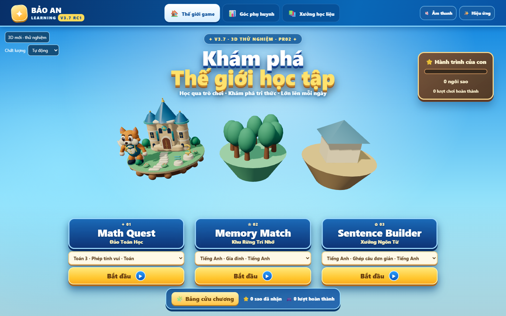
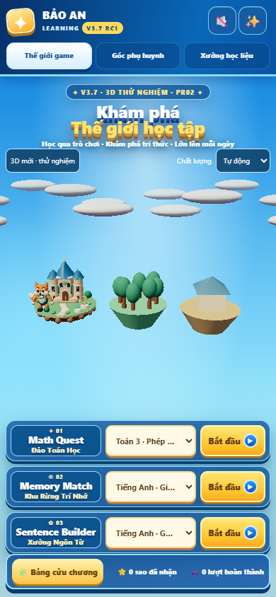

# BẢO AN LEARNING V3.7 RC1 — báo cáo PR-00 / PR-01 / lát cắt PR-02

Ngày thực hiện: **14/10/2026**, múi giờ Việt Nam. Báo cáo bên dưới lưu lịch sử PR-02. **Cập nhật mới nhất:** đã sản xuất và tích hợp asset PR-03 theo quyết định tiếp tục trực tiếp của chủ dự án; đủ năm GLB/PBR. [Nguồn và thông số](ASSET_LICENSES_V37.md), bằng chứng production trong `V37_art_qa/`. Chờ duyệt mỹ thuật và điện thoại thật, chưa FINAL.

**Cập nhật sau phản hồi chất lượng:** đã chỉnh lại chiều sâu cảnh, tỷ lệ cáo/đảo Toán và giao diện. Báo cáo này lưu bằng chứng của bản PR02 đầu tiên; ảnh và số liệu mới nằm ở [V37_depth_qa/visual-review.md](V37_depth_qa/visual-review.md) và thư mục `V37_depth_qa/`. Không dùng số liệu/ảnh cũ dưới đây để đại diện cho cảnh đã sửa.

**Cập nhật tương tác và thống nhất giao diện:** các đảo ban đầu ngang hàng, cáo chờ ở góc trái rồi nhảy sang đảo được chọn, vòng đảo quay đưa lựa chọn ra trước. Chỉ còn giao diện 3D mới; renderer cũ là dự phòng tự tải khi lỗi, không chạy song song. Bằng chứng hiện tại nằm trong [V37_carousel_qa/visual-review.md](V37_carousel_qa/visual-review.md); các số liệu dưới đây lưu lịch sử PR02 đầu tiên.

**Cập nhật khung cảnh trong bài test:** đã đồng bộ Math/Memory/Sentence với trang chủ, dùng lại cùng renderer/canvas/GLB và cáo, thêm cảnh trong đảo, theme bảng học và phản ứng/phần thưởng chung. [Báo cáo và kết quả mới](V37_games_qa/verification.md), [ảnh trước/sau](V37_games_qa/visual-review.md). Việc mở bài nay chuyển canvas trang chủ thành cảnh game thay vì chỉ pause sau overlay; dữ liệu/logic học tập vẫn giữ nguyên.

Đã triển khai renderer premium thật trên nền React V3.6.2 RC2: cáo GLB có PBR, skin và ba clip xương; đảo Toán có lâu đài, đường đi và biểu tượng số. Hai đảo còn lại trong chế độ mới là landmark thủ tục để giữ bố cục, chưa phải asset premium. Không dùng ảnh concept làm tấm phẳng thay mô hình.

## Mở bản chạy thật

Chạy `MO_V37_PREMIUM_WINDOWS.bat`, mở **http://localhost:5178/?premium3d=1**. Hoặc chạy:

```powershell
npm ci
npm run build
npm run preview -- --port 5178
```

URL `/` mở cảnh mới. Không còn nút lựa chọn hai phiên bản; query `premium3d` và biến môi trường cũ không đổi renderer nữa. Khi cảnh mới tải thành công, chunk legacy không được tải; nếu lỗi, renderer mới được dọn trước khi dựng dự phòng trên canvas khác. Quality tự động/thủ công chỉ điều chỉnh hiển thị; không tải lại GLB khi chọn đảo hoặc đổi quality. Dự phòng chỉ có hai preset độ phân giải; low/balanced cùng ánh xạ balanced, không coi đó là ba tier đầy đủ.

Preview ở cổng 5178 là origin khác `localhost:5173` hoặc `127.0.0.1:5173`. Trình duyệt không chia sẻ IndexedDB giữa các origin; điểm ở preview mới có thể bắt đầu từ 0 dù dữ liệu origin cũ vẫn còn. Để tiếp tục dùng dữ liệu React cũ, chạy mã mới qua `START_WINDOWS.bat` trên đúng hostname/cổng trước đây; không có migration tự động giữa các origin hoặc với bản HTML.

## Baseline và phạm vi bảo toàn

- Workspace ban đầu chưa có Git. Đã tạo Git cục bộ; baseline `645a6b67bb35a89b3c0c126db466cb958b0a72c0`, nhánh `feature/v37-premium-world`. Chưa có remote hay pull request GitHub.
- Snapshot trước sửa: `backups/V362_RC2_before_V37.zip`. Checksum gói bàn giao và snapshot trong `docs/V37_qa/baseline-checksums.json`.
- Baseline typecheck, content, guide-animation PASS; core FAIL do `memory281.test.mjs` hard-code đường TypeScript Linux. Đã sửa sang dependency local, giữ nguyên assertions. Premium gate baseline FAIL do thiếu cả năm model.
- Vite trong sandbox Windows bị EPERM ở realpath. Build lại với quyền thực thi ngoài sandbox đã PASS cả baseline lẫn bản mới; không sửa mã Vite để che lỗi môi trường. Log riêng `baseline-build-unrestricted.txt` và `build.txt`.
- Hash toàn bộ `src/core/` và `src/games/` **không đổi**, xem `protected-source-hashes.json`. App chỉ sửa chữ phiên bản; các hàm recordAttempt/completeSession/leaveGame giữ nguyên. DB version 1 và ba object store không đổi.
- Baseline screenshot được chụp trên bản build riêng ở cổng 5176, bundle `index-DTgO0IIM.js`; không dùng bản mới để giả baseline.
- `baseline-isolated-data.json` là export IndexedDB/localStorage của **profile QA riêng**, không phải backup hồ sơ thật của người dùng. Không mở/xóa/migrate DB của profile đang sử dụng. Nếu sau này migration dữ liệu, phải lấy backup profile thật trước.

## Thay đổi triển khai

`src/world3d/renderer/` thêm contract, factory, legacy adapter, Three renderer, GLTFLoader có abort, kiểm tra decode texture, cleanup geometry/material/texture/ImageBitmap/skin, cửa sổ median/P95 và quality hysteresis. Three chỉ nằm trong chunk lazy, không import vào Game SDK hoặc game.

WorldCanvas sở hữu canvas trong một host: factory thay canvas khi premium thất bại, hủy promise trễ khi điều hướng, dọn RAF/listener/ResizeObserver, pause khi tab ẩn hoặc game mở, theo dõi reduced-motion động. Scene chưa hoàn tất tải không chạy RAF. Mất context chuyển sang renderer dự phòng trên canvas mới, không tái sử dụng context đã mất.

StudentScreen giữ nguyên ba nút Bắt đầu/select trong DOM và thêm nút xem thử/quality. CSS gom ở `real3d31.css`; sửa lỗi nút Next nằm ngoài 320×640, giữ vùng phản hồi cố định và vùng chạm 44px. Màu asset chuyển sRGB sang linear đúng glTF; cáo đứng trên mặt đảo và không bị cắt ở mobile.

Asset mới có generator gốc `tools/generate_v37_slice_assets.mjs`; nguồn, SHA, texture, mesh/triangle/rig/clip và giới hạn nằm trong **ASSET_LICENSES_V37.md**. Chỉ điền hai license có model thật; ba license còn lại để trống.

## Kiểm thử

| Lệnh | Kết quả | Log |
|---|---|---|
| `npm run typecheck` | PASS | `V37_qa/typecheck.txt` |
| `npm run test:core` | 44/44 PASS | `V37_qa/test-core.txt` |
| `npm run test:content` | 4/4 PASS | `V37_qa/test-content.txt` |
| `npm run test:guide-animation` | 13/13 PASS | `V37_qa/test-guide-animation.txt` |
| `npm run test:renderer` | 26/26 PASS | `V37_qa/test-renderer.txt` |
| `npm run test:syntax` | PASS | `V37_qa/test-syntax.txt` |
| `npm run build` | PASS; premium chunk >500 kB có cảnh báo thật | `V37_qa/build.txt` |
| `npm run test:premium` | 26/26 PASS, production Edge | `V37_qa/browser-tests.txt` |
| `npm run test:visual` | 4/4 PASS, production Chrome | `V37_qa/legacy-browser-tests.txt` |
| `npm run gate:premium-art` | **FAIL: thiếu memory/language/environment** | `V37_qa/gate-premium-art.txt` |
| `node tools/check_offline_v37.mjs` | PASS, HTML riêng | `V37_qa/offline-evidence.json` |

React E2E thực hiện Math **8/8**, Memory **6/6**, Sentence **6/6**. React seed thực tế có sáu câu Sentence, khác con số năm trong kế hoạch và HTML; không sửa nội dung chỉ để khớp tài liệu. Đã thử spam đáp án/Next, ghép cặp sai rồi phục hồi, chỉ số drag sai, học liệu JSON mới qua Creator, không ghi đè `id@version`. Events/sessionId/packId/contentVersion, completed/abandoned, refresh và đóng/mở tab được kiểm tra qua IndexedDB thật tại origin localhost, không mock storage.

Runtime kiểm tra GLB phản hồi HTTP, mesh/texture/skin, cả ba clip làm thay đổi xương trên renderer production; missing GLB, texture decode lỗi, không WebGL và WEBGL_lose_context đều giữ đường vào game qua DOM. Hai mươi vòng home/parent không còn RAF hoặc listener canvas sau unmount. Đã kiểm tra pause khi game mở cả trong thời gian model đang tải.

Viewport: **1920×1080, 1440×900, 1366×768, 1024×768, 768×1024, 390×844, 375×812, 320×640**, thêm landscape. Kiểm tra overflow, bounding boxes, vật cản pointer, touch, bàn phím, reduced-motion và độ ổn định vùng phản hồi. Đây là viewport giả lập trên Windows; chưa thay cho Android/iPhone thật.

HTML V3.6.2 không chỉnh sửa, checksum giữ nguyên. Kiểm thử độc lập hoàn thành **8/8 Math, 6/6 Memory, 5/5 Sentence**, ba lịch sử và 19 sao vẫn có sau refresh; dùng localStorage của file URL trong profile QA riêng. Không có Three/PBR/rig premium của React trong HTML. Điều này không chứng minh durability trên mọi trình duyệt/origin của bản HTML.

## Bundle và hiệu năng quan sát

Baseline entry JS **300,75 kB / gzip 97,48 kB**. Bản mới entry JS **274,29 kB / gzip 85,77 kB**; legacy lazy **30,42 kB / gzip 12,65 kB**; premium lazy **648,64 kB / gzip 165,93 kB**. Đây là code split, không làm Three biến mất khỏi tổng tải khi bật premium. Hai GLB tổng khoảng **2,32 MB**; estimate texture GPU khoảng **8 MiB**, không phải số GPU memory được profiler xác nhận.

Thiết bị đo: **Windows 10.0.26300, Intel Core Ultra 5 125H, RAM khoảng 32 GiB, Intel Arc qua ANGLE/D3D11, Edge 155.0.4283.45 headless**. Không phải SwiftShader. Snapshot thời gian ngắn sau tải ở 1440×900 ghi median **59,9 FPS**, P95 **16,8 ms**, balanced/DPR1, khoảng 87 draw calls gồm shadow passes. 390/320 cũng chạy trên **cùng GPU desktop**, nên không ghi chúng thành benchmark điện thoại. RAM/GPU memory peak, chế độ pin, long-task profiler và mạng chậm chưa nghiệm thu; chưa kết luận performance gate toàn bộ đạt.

Số liệu gốc trong `V37_qa/browser-evidence.json`; snapshot FPS có cửa sổ 180 frame và không tính khoảng pause. Legacy FPS chỉ là estimate EMA, không ghi giả thành median/P50.

## Ảnh từ ứng dụng thật và điểm cần duyệt





Baseline cùng viewport: `V37_qa/baseline-1440x900.png`, `baseline-390x844.png`, `baseline-320x640.png`. Có thêm ảnh `premium-320x640.png`. Ảnh chỉ là bằng chứng bổ sung; phải mở runtime để duyệt chuyển động và thao tác.

| Hạng mục duyệt mỹ thuật | Trạng thái |
|---|---|
| Cáo: silhouette, mắt, biểu cảm, Idle/Cheer/Victory | Chờ chủ dự án, chưa tự chấm 4/5 |
| Lâu đài, đường đi, ký hiệu đảo Toán | Chờ duyệt |
| Lighting/PBR, scale, depth, màu | Chờ duyệt và đối chiếu concept được chốt |
| Thao tác Math trên Android/iPhone thật | Chưa kiểm tra |
| Ba đảo premium đồng nhất / môi trường premium | Chưa bắt đầu PR-03 |

**Điều kiện tiếp tục:** theo kế hoạch, “Điều kiện để bắt đầu PR-03: cáo và Math Island đã đạt tiêu chuẩn hình ảnh trên máy thật”. Cần chủ dự án duyệt lát cắt, kiểm thử điện thoại thật và cung cấp/đối chiếu concept đã chốt trước khi mở rộng. Không tạo ba file giả để vượt gate; chưa bắt đầu V3.8.

## Rollback

1. Bản hiện tại dùng một giao diện mới với dự phòng tự động; nút/flag quay về bản cũ đã bỏ theo yêu cầu chủ dự án. Nếu cần quay lại bản có lựa chọn, dùng checkpoint Git `a84e881` trong thư mục riêng. Ba game và IndexedDB không đổi.
2. Nếu cần hoàn nguyên code, checkout baseline trong một thư mục riêng hoặc giải nén snapshot vào thư mục mới. Không chép đè mù lên bản hiện tại.
3. Không xóa IndexedDB/localStorage để rollback renderer. Hai nhánh React/HTML có dữ liệu riêng.
