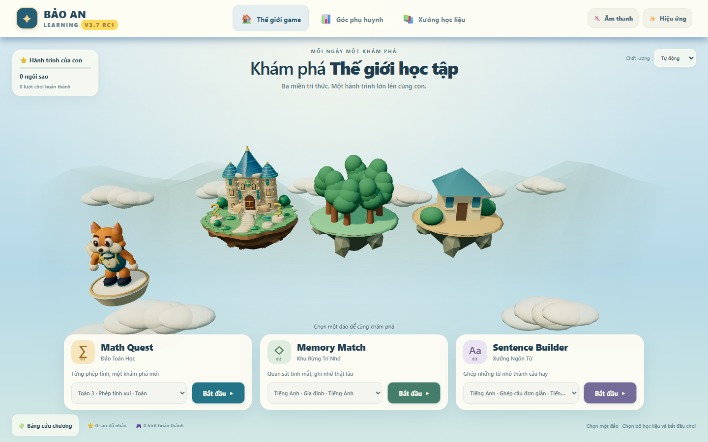
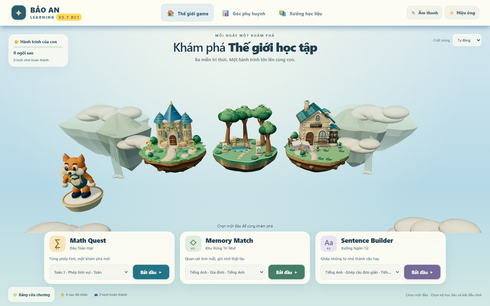
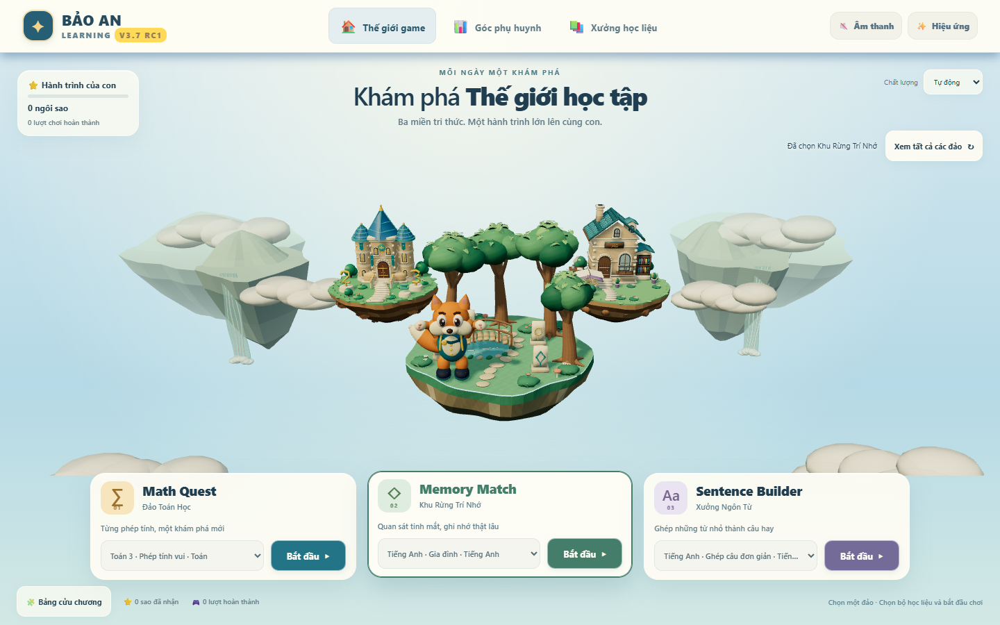
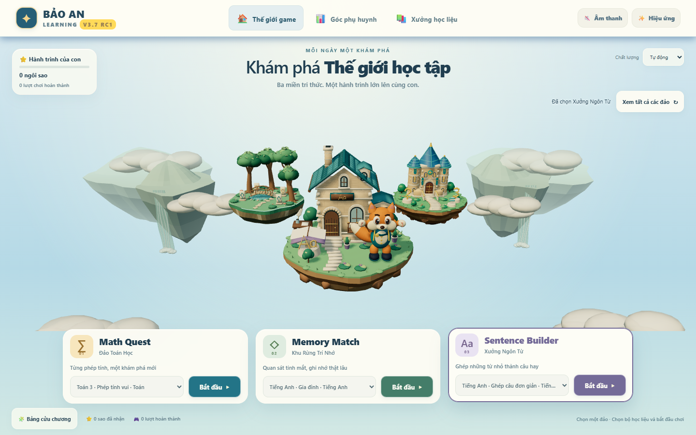
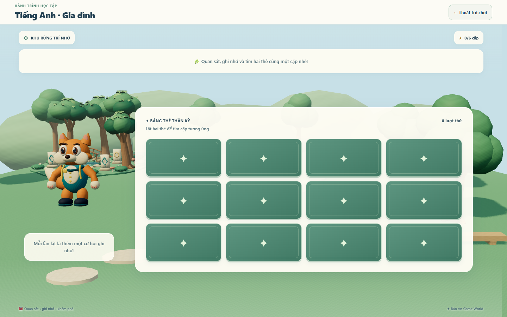
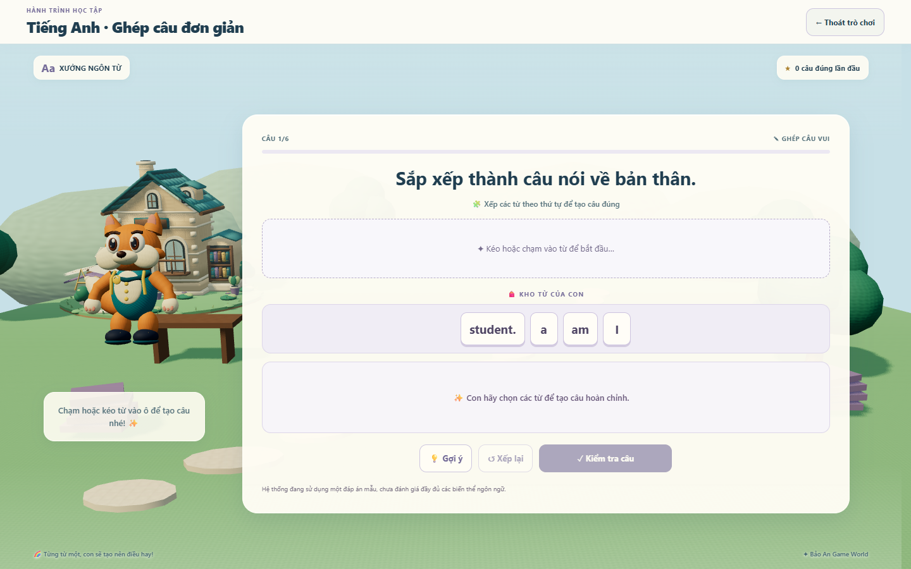
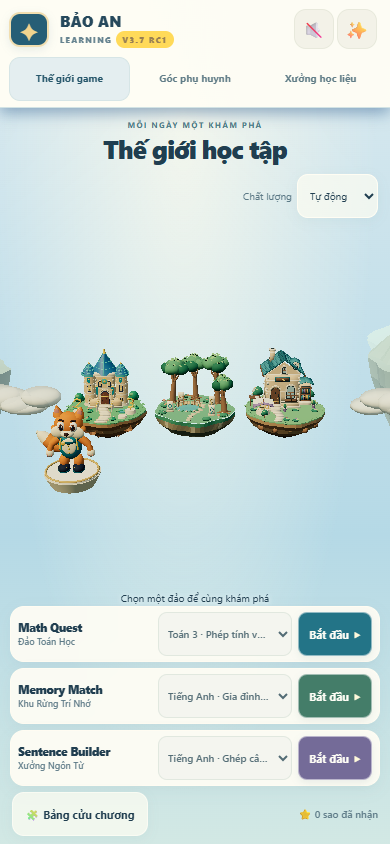
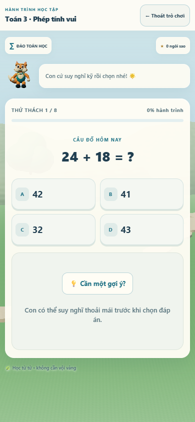
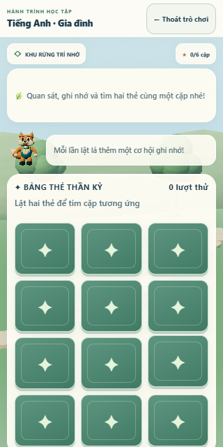

# Ảnh đối chiếu V3.7 PR03

Ảnh trực tiếp từ React production trên Edge, profile QA riêng. Bản trước trong `baseline/` dùng hai GLB; bản mới tải đủ năm GLB. Không có ảnh concept hoặc ảnh dựng giả screenshot. [Build/kiểm tra/giới hạn](verification.md).

## Trang đảo 1440×900

Trước: Trí nhớ/Ngôn từ là landmark tạm. Sau: cây/rễ/cầu/hồ và kiến trúc/sách/cửa/mái có hình học và PBR; nền có đảo xa, thác và mây. Ba đảo ban đầu ngang hàng, cáo ở bệ chờ góc trái.

## Khi chọn đảo

Đảo được chọn quay ra trước và tăng tỷ lệ; cáo đáp vào vùng trống. Cây/nhà và nút vẫn đọc được.

## Bài học

Cùng model đảo, vật liệu và nhân vật từ trang chủ. Canvas chuyển vào bài học; DOM/thẻ/kho từ vẫn thao tác trên lớp riêng. Tiền cảnh instancing dùng vật liệu của đảo tương ứng.

## Viewport điện thoại trên Windows

390×844/320×640 dùng touch emulation cùng GPU desktop. Màn nhỏ ưu tiên nội dung, cảnh nền/cáo thu gọn theo vùng còn lại. Chưa thay nghiệm thu điện thoại thật.

Video `art-world-demo.webm` gồm tổng quan, ba lựa chọn quay–nhảy, ba cảnh học và trở về; chỉ canvas. Chủ dự án vẫn cần xem/duyệt bản chạy về chuyển động, ánh sáng, vật liệu và nhân vật; test và ảnh không tự xác nhận FINAL.
