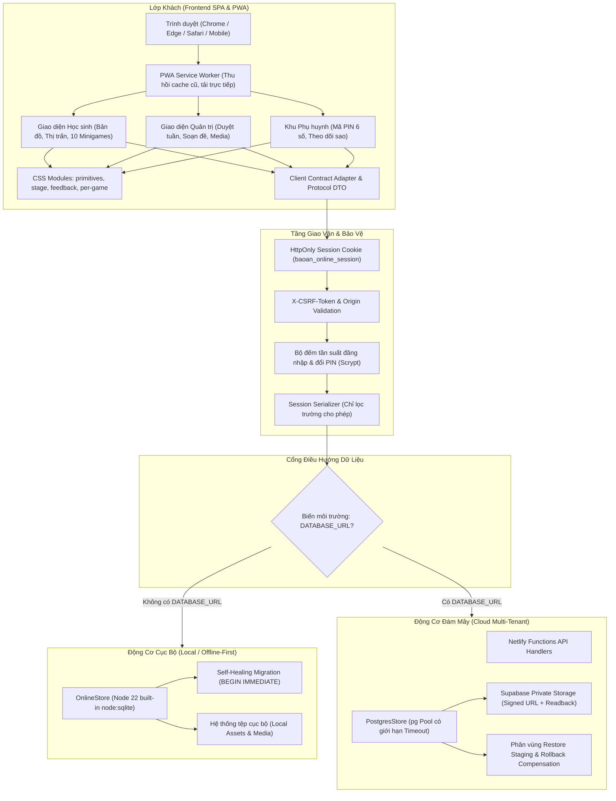

# Báo Cáo 02: Kiểm Toán Kiến Trúc Kỹ Thuật & An Toàn Bảo Mật

**Dự án:** BẢO AN LEARNING — Phiên bản `4.0.2`  
**Ngày kiểm toán:** 06/11/2026, Asia/Saigon  
**Tiêu chuẩn đánh giá:** OWASP Top 10, WCAG 2.1 AA, Nguyên tắc phòng thủ chiều sâu (Defense in Depth)

---

## 1. Sơ Đồ Kiến Trúc Hệ Thống Hiện Tại

Hệ thống được thiết kế theo mô hình lai (Hybrid Dual-Engine Architecture), hỗ trợ hoạt động ngoại tuyến độc lập trên máy tính trường học (SQLite) đồng thời tích hợp dịch vụ đám mây tập trung (PostgreSQL + Supabase + Netlify).

---

## 2. Đánh Giá Kiến Trúc Kỹ Thuật

### 2.1. Phân tách trách nhiệm (Separation of Concerns)
- **Điểm mạnh:**
  - **Hợp đồng dữ liệu nhất quán:** Các tệp hợp đồng (`contracts.ts`, `online-contracts.ts`, `world-map-contracts.ts`) định nghĩa kiểu chặt chẽ bằng TypeScript interfaces, chia sẻ chung giữa Client và Server, ngăn ngừa lỗi sai lệch trường (field drift).
  - **Tầng mạng tập trung:** Tầng giao tiếp mạng được gom gọn tại `src/core/online-client.ts`, loại bỏ hiện tượng gọi `fetch` rải rác trong các component UI.
  - **Tách biệt CSS mô-đun hóa (Hoàn thành mới nhất):** Toàn bộ stylesheet minigames đã được chẻ nhỏ khỏi khối monolithic cũ:
    - CSS nền tảng: `primitives.css` (tokens, buttons, hud, progress track), `stage.css` (dialog, stage-backdrop, mascot), `feedback.css` (particles, answer cards), `completion.css` (curtain, confetti, victory crest).
    - CSS theo từng trò chơi: `math-quest.css`, `memory-match.css`, `sentence-builder.css`, `word-connect.css`, `sequence-trail.css`, `boat-race.css`, `fox-kitchen.css`, `treasure-flip.css`, `online-exercise.css`.
    - CSS bối cảnh theo môn: `fishing.css`, `sentence-context.css`, `connect-context.css`.
    - Khi học sinh mở một trò chơi cụ thể, trình duyệt chỉ tải đúng stylesheet của trò chơi đó (kích thước < 4.5 kB) thay vì tải 268 kB như trước.
  - **Lazy Loading Component:** Các phân hệ lớn (`MathQuest`, `BoatRace`, `MemoryMatch`, `SentenceBuilder`, v.v.) được nạp động thông qua React `lazy` và `Suspense` (`src/games/loaders.ts`), giữ bundle chính `index.js` ở mức ~226 kB.
- **Hạn chế & Nợ kỹ thuật cần lưu ý:**
  - File `server/online-store.mjs` và `server/postgres-store.mjs` có kích thước lớn (> 1.500 dòng), kiêm nhiệm nhiều nghiệp vụ (người dùng, bài tập tuần, sổ cái sao, thị trấn, đổi quà).
  - *Đề xuất dài hạn:* Trong các phiên bản lớn tiếp theo, có thể chia nhỏ thành các domain service con (`UserAuthService`, `CurriculumService`, `RewardLedgerService`, `TownService`) dùng chung transaction context.

### 2.2. Tính đối sánh giữa hai Động cơ Dữ liệu (Dual-Store Parity)
- Bộ kiểm toán ghi nhận mức độ đối sánh rất cao giữa SQLite và PostgreSQL:
  - Cả hai store đều áp dụng cùng một logic kiểm tra quyền `assignedPack`, cùng thuật toán chống lặp vị trí đúng trong câu hỏi xáo trộn, cùng bộ quy tắc phân xử revision khi lưu tự động, và cùng giới hạn tối đa 3 sao cho mỗi mục học liệu.
  - Đã có các bài kiểm thử đối sánh tự động (`tests/world-map-api.test.mjs`, `tests/badges-streaks.test.mjs`, `tests/online-contest.test.mjs`) chạy song song trên cả hai engine và kiểm tra kết quả đồng nhất 100%.

---

## 3. Kiểm Toán An Toàn Bảo Mật & Rủi Ro Dữ Liệu

### 3.1. Đóng triệt để rò rỉ đáp án trước khi trả lời (Khắc phục N01 - P0)
- **Nguy cơ trước đây:** Endpoint mở câu hỏi (`question-open`) và tóm tắt (`summary`) từng trả về đối tượng session thô chứa `displayedCorrectIndex` và mảng hoán vị `permutation`. Học sinh hiểu biết kỹ thuật có thể mở DevTools Network tab để xem trước đáp án mà không cần suy nghĩ.
- **Biện pháp đã hoàn tất:**
  - Triển khai hàm `sanitizeSessionForClient(session)` tại `server/question-protocol.mjs`.
  - Áp dụng nguyên tắc **Allowlist (Chỉ cho phép những gì được định nghĩa)**: Chỉ tuần tự hóa các trường phục vụ hiển thị câu hỏi cho học sinh (`sessionId`, `packId`, `itemId`, `presentationId`, `shuffledOptions`, `prompt`, `type`).
  - Toàn bộ chỉ số đáp án đúng và bản đồ nội bộ được giữ bí mật trên máy chủ, chỉ được trả về sau khi học sinh đã gửi câu trả lời hợp lệ và máy chủ đã chấm điểm xong.
  - Đã xác thực qua kiểm thử R201–R203: chèn trường nội bộ giả mạo, serializer ngăn chặn 100% không cho lọt ra ngoài client.

### 3.2. Quyền sở hữu và cách ly gói ôn tập (Khắc phục N05 - P1)
- **Nguy cơ trước đây:** Hệ thống chỉ dựa vào tiền tố `packId.startsWith('review-')` để xác định gói ôn tập, dẫn tới lỗ hổng kiểm soát truy cập đối tượng ở mức chức năng (BOLA / IDOR): Học sinh B có thể học và lấy sao từ gói ôn tập câu sai của học sinh A nếu đoán được ID.
- **Biện pháp đã hoàn tất:**
  - Bổ sung trường `ownerStudentId` rõ ràng trong bảng `packs`.
  - Cơ chế kiểm soát truy cập tại `assignedPack`:
    - Nếu gói thuộc tuần đã giao của lớp -> Cho phép học.
    - Nếu là gói ôn tập cá nhân: bắt buộc `pack.ownerStudentId === auth.studentId`. Nếu khác, máy chủ từ chối ngay với mã lỗi `403 Forbidden` (`Con chỉ được học gói ôn tập của chính mình.`).
    - Ngăn chặn hoàn toàn việc giáo viên đặt tên gói có từ `review-` để lách luật khóa tuần.

### 3.3. Quy trình khôi phục dữ liệu an toàn & Phục hồi lỗi (Khắc phục N02 - P0)
- **Nguy cơ trước đây:** Quy trình Restore tải các tệp media lên bucket chính ngay lập tức trước khi commit SQL. Nếu câu lệnh SQL bị lỗi giữa chừng, kho media bị ghi đè dữ liệu rác không thể hoàn tác.
- **Biện pháp đã hoàn tất:**
  - Áp dụng phân vùng `staging/restore-<jobId>/` trên Supabase Storage.
  - Xác thực đối soát readback 100% từng tệp media và hash SHA-256.
  - Commit dữ liệu bảng SQL thành công trước khi di chuyển media sang vùng chính thức.
  - Tự động kích hoạt cơ chế đền bù (Rollback Compensation) nếu có bất kỳ lỗi nào xảy ra trong chuỗi tác vụ.

### 3.4. Quản lý phiên đăng nhập và phân quyền (Authentication & Authorization)
- **Cơ chế xác thực:**
  - Xác thực bằng mật khẩu băm chuẩn `scrypt` an toàn cao chống brute-force.
  - Cookie phiên mang cờ `HttpOnly`, `SameSite=Lax`, tên định danh `baoan_online_session`.
  - Mọi yêu cầu ghi dữ liệu (POST, PUT, DELETE) bắt buộc kèm header `X-CSRF-Token` khớp với token bí mật gắn với phiên đăng nhập.
  - Phân quyền theo vai trò: `student` (học tập, làm bài, tích sao), `admin` (quản trị lớp, duyệt học liệu tuần, đối soát kho media), `parent` (mã PIN 6 số, giám sát và duyệt quà).
  - Không có sự nhập nhằng giữa các vai trò; admin gọi endpoint của student bị chặn với HTTP 403.

### 3.5. Quy tắc bảo mật Supabase RLS (Row Level Security)
- Toàn bộ 29 bảng dữ liệu trong PostgreSQL đám mây đều kích hoạt RLS (`ALTER TABLE ... ENABLE ROW LEVEL SECURITY`).
- Phân tách rõ ràng giữa vai trò Runtime (`authenticated`, `service_role`) và vai trò Migration (`postgres`). Không cấp quyền ghi tùy tiện vào các bảng điểm và sổ cái phần thưởng.

---

## 4. Đánh Giá Khả Năng Bảo Trì & Triển Khai (Maintainability & Deployability)

1. **Tính độc lập của gói triển khai:** Gói phát hành `releases/bao-an-learning-4.0.2.zip` chứa đầy đủ mã chạy đã build, file thực thi và dữ liệu mẫu cần thiết, có thể khởi động độc lập trên Windows mà không cần cài đặt thêm runtime bên ngoài.
2. **Khả năng tương thích Netlify Functions:** File `netlify/functions/api.ts` được thiết kế thuần Node.js runtime không phụ thuộc binary compiled C++, đảm bảo triển khai mượt mà lên hạ tầng Netlify công cộng.
3. **PWA Service Worker:** Khắc phục triệt để hiện tượng dính cache phiên bản cũ nhờ hàm kích hoạt ngay (`self.skipWaiting()`) và xóa toàn bộ cache cũ khi có phiên bản mới.
