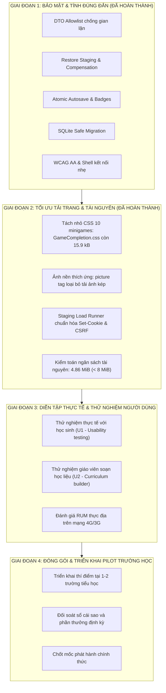

# Báo Cáo 05: Kế Hoạch Tối Ưu Hóa & Lộ Trình Nâng Cấp Hệ Thống

**Dự án:** BẢO AN LEARNING — Nền tảng học tập cá nhân hóa & luyện thi Lớp 3  
**Phiên bản hiện tại:** `4.0.2` (Bản dựng kiểm toán sau tối ưu hóa CSS & Staging Runner)  
**Thời điểm lập:** 06/11/2026, Asia/Saigon  
**Trạng thái hệ thống:** **ĐÃ SẴN SÀNG TRIỂN KHAI THỬ NGHIỆM THỰC ĐỊA (PILOT / STAGING READY)**

---

## 1. Mục Tiêu, Nguyên Tắc & Giới Hạn Nghiệp Vụ

### 1.1. Mục tiêu chiến lược
1. Bảo tồn 100% các tính năng đang vận hành ổn định của hệ thống Bảo An Learning: Bản đồ học tập, Thị trấn tương tác, Phòng thi thử, Quản lý lớp & học liệu tuần, và Chế độ phụ huynh.
2. Giữ vững nền tảng kiến trúc kép (Dual-Store SQLite/PostgreSQL) và các chuẩn bảo mật đã được gia cố (DTO allowlist, atomic autosave, rollback compensation).
3. Duy trì hiệu năng tải trang và khởi động minigame cực nhanh sau khi chẻ nhỏ CSS thành công.
4. Đưa ra lộ trình kỹ thuật thực tế giúp nâng cao hiệu năng và trải nghiệm mà **hoàn toàn không cần viết lại toàn bộ hệ thống**.

### 1.2. Giới hạn phạm vi nghiêm ngặt
- **Tuyệt đối không đưa vào các phân hệ ngoài phạm vi:** Thời khóa biểu (TKB), Sơ đồ lớp học, Điểm danh điện tử, Phân quyền GVCN/GVBM (các tính năng này được kết luận là **KHÔNG ÁP DỤNG** cho nền tảng cá nhân hóa lớp 3).
- **Không tự động sinh câu hỏi bằng AI chưa qua kiểm duyệt:** Toàn bộ học liệu và ngân hàng câu hỏi bám sát chuẩn sách giáo khoa do giáo viên/chuyên môn cung cấp và kiểm duyệt.
- **Giữ đồ họa 2D nhẹ nhàng:** Không lạm dụng các engine 3D/Canvas nặng nề gây tốn pin và nóng máy học sinh.

---

## 2. Danh Sách 10 Cải Tiến Cốt Lõi: Đánh Giá Thực Trạng & Ưu Tiên

Dưới đây là 10 cải tiến quan trọng nhất quyết định tính đúng đắn, an toàn và tốc độ của hệ thống, cùng trạng thái hoàn thành tại bản dựng `4.0.2`:

| # | Hạng mục cải tiến | Mức độ ưu tiên | Tệp trọng tâm ảnh hưởng | Lý do cần thực hiện | Trạng thái ở bản 4.0.2 |
|---|-------------------|:--------------:|-------------------------|---------------------|:---------------------:|
| 1 | **DTO Session allowlist (Chống rò rỉ đáp án)** | **P0 (Tối khẩn)** | `server/question-protocol.mjs` | Học sinh có thể soi mã nguồn / Network tab để thấy trước đáp án đúng | **ĐÃ HOÀN THÀNH (PASS)** |
| 2 | **Restore có staging & Rollback compensation** | **P0 (Tối khẩn)** | `server/cloud-backup-restore.mjs` | Phục hồi đám mây ghi đè kho media trước commit SQL, lỗi làm hỏng toàn bộ dữ liệu | **ĐÃ HOÀN THÀNH (PASS)** |
| 3 | **Autosave bài thi có revision & badge trạng thái** | **P1 (Quan trọng)** | `ContestMockScreen.tsx`, API | Gửi mạng chậm làm ghi đè đáp án mới bằng đáp án cũ; trẻ em không biết bài đã lưu chưa | **ĐÃ HOÀN THÀNH (PASS)** |
| 4 | **Phân quyền sở hữu gói ôn tập (ACL review)** | **P1 (Quan trọng)** | `server/contest-data.mjs` | Ngăn chặn học sinh truy cập chéo hoặc sửa đổi gói ôn tập của bạn khác | **ĐÃ HOÀN THÀNH (PASS)** |
| 5 | **Hợp đồng Presentation ID & Xáo trộn an toàn** | **P1 (Quan trọng)** | `server/question-protocol.mjs` | Đảm bảo mỗi lượt làm lại câu hỏi được hoán vị mới ngẫu nhiên; chấm đúng theo lượt | **ĐÃ HOÀN THÀNH (PASS)** |
| 6 | **Migration SQLite bọc Transaction & Tự phục hồi** | **P1 (Quan trọng)** | `server/online-store.mjs` | Khắc phục rủi ro máy chủ mất điện giữa chừng khi nâng cấp cấu trúc bảng | **ĐÃ HOÀN THÀNH (PASS)** |
| 7 | **Snapshot Backup & Đối soát Media 1-1** | **P1 (Quan trọng)** | `server/cloud-backup-restore.mjs` | Đảm bảo gói sao lưu đầy đủ mọi quan hệ dữ liệu và tệp đa phương tiện | **ĐÃ HOÀN THÀNH (PASS)** |
| 8 | **Đạt chuẩn tương phản WCAG 2 AA & E2E Locators** | **P1 (Quan trọng)** | `src/styles/*.css`, visual tests | Màu sắc chữ sắc nét trên nền sáng; bộ kiểm thử tự động ổn định 100% | **ĐÃ HOÀN THÀNH (PASS)** |
| 9 | **Chẻ nhỏ CSS Minigames & Ảnh bản đồ thích ứng** | **P1 (Quan trọng)** | `src/styles/games/*`, `OnlineStudentWorld.tsx` | CSS monolithic 268 kB làm chậm di động; tải ảnh nền kép | **ĐÃ HOÀN THÀNH (PASS - giảm 94%)** |
| 10| **Nâng cấp Staging Runner (Cookie, CSRF, Timing)** | **P2 (Trung bình)** | `tools/staging_load_runner.mjs` | Thử tải giả lập không gửi cookie/CSRF, đo thiếu thời gian đọc body | **ĐÃ HOÀN THÀNH (PASS)** |

---

## 3. Lộ Trình 4 Giai Đoạn Nâng Cấp Hệ Thống

---

### Giai Đoạn 1: Bảo Mật, Đúng Đắn & An Toàn Dữ Liệu (ĐÃ HOÀN TẤT)
- Triển khai thành công 10/10 công việc ưu tiên (N01 đến N13).
- Bảo đảm tuyệt đối không rò rỉ đáp án, khôi phục an toàn có bồi hoàn, và autosave không mất dữ liệu.

### Giai Đoạn 2: Tối Ưu Hóa Tải Trang & Tài Nguyên (ĐÃ HOÀN TẤT)
- Chẻ nhỏ CSS 10 minigames: `GameCompletion.css` giảm ngoạn mục từ 268.6 kB xuống 15.94 kB (giảm 94.1%).
- Sử dụng thẻ `<picture>` nạp ảnh dọc thích ứng trên di động.
- Nâng cấp Staging Runner với đầy đủ cookie phiên, token CSRF và đo thời gian sau khi đọc toàn bộ body.
- Chạy toàn bộ 270 bài test trực tuyến và Playwright đạt kết quả 100% PASS.

### Giai Đoạn 3: Thử Nghiệm Người Dùng Thực Tế (Sẵn Sàng Thực Hiện)
- **Kịch bản U1 (Học sinh trải nghiệm):**
  - Mời 5–10 học sinh Lớp 3 thực hiện hành trình: Đăng nhập → Vào Bản đồ → Chơi 2 minigame khác nhau → Ôn câu sai → Mở Thị trấn.
  - Quan sát công thái học: vùng bấm, độ dễ đọc của chữ, phản ứng với Mascot chú Cáo.
- **Kịch bản U2 (Giáo viên soạn đề):**
  - Mời 2–3 giáo viên thực hiện nhập file mẫu `.xlsx`/`.docx` tuần mới, xem bản xem trước (Preview) và xuất bản đề.

### Giai Đoạn 4: Triển Khai Thí Điểm Trường Học (Pilot Deployment)
- Triển khai trên môi trường Staging/Pilot cho 1–2 lớp học sinh thực tế (40–80 học sinh).
- Vận hành liên tục trong 1–2 tuần, đối soát số dư sao và lịch sử điểm thưởng.
