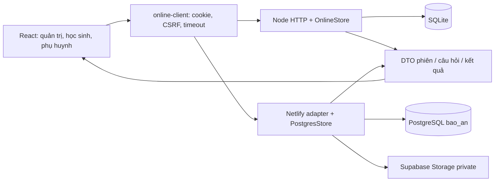

# Kiến trúc và bảo mật — kiểm toán lần 2, 06/11/2026

## 1. Bản mã và phạm vi

Kiểm tra bộ mới sau `KET_QUA_THUC_HIEN_TOI_UU.md`, vẫn là **4.0.1** nhưng runtime source ID đã đổi từ `59d67c93a8c3dd8839db1091c8760329f8d11c63984761ee5fe8342833bdff77` sang **`5d9b56a43e18706af1f541af5ef12477c679a8d2fa0c0b1e667f45f1b48261a8`**. Có 23 tệp tracked thay đổi từ lần trước. HEAD vẫn `f7c93337669379d768419ae1ab43cbde69f2aabe` và có các thay đổi chưa commit của chủ dự án.

Đợt này không sửa mã ứng dụng. Chỉ tạo chương trình kiểm tra, dữ liệu thử, log và tài liệu. Giữ lịch sử báo cáo lần 1; các kết luận dưới đây chỉ áp dụng source ID mới.

Các ca PostgreSQL API dùng cloud adapter Request/Response trên fixture PGlite. Đây là kiểm tra logic API/store của bộ mới, không phải chứng nhận deployment Supabase/Netlify thực tế.

Kiến trúc không đổi về nền: React 19/TypeScript/Vite; API cùng origin với cookie/CSRF; Node HTTP + SQLite ở local; Netlify Functions + `pg`/PostgreSQL + Supabase Storage private ở cloud. Vai trò thực tế là admin/student/parent. TKB, GVCN/GVBM, sơ đồ ghế và điểm danh trong prompt **KHÔNG ÁP DỤNG** cho dự án này.

Phân vai và lazy load vẫn là nền hợp lý; scoring, ví sao, nội dung/phiên có phiên bản vẫn ở server. Những lỗi nghiêm trọng lần này tập trung vào DTO, quyền truy cập gói ôn, giao dịch dữ liệu và biên migration. Nên sửa đúng lớp này và thêm hợp đồng kiểm thử chung cho hai backend.

## 2. N01 — P0: DTO phiên làm lộ đáp án trước khi trả lời

1. **Vị trí:** `server/question-protocol.mjs:86` (`publicSession`), `server/student-summary.mjs:5`; `presentationsById` được thêm tại `online-store.mjs:389–391`, `postgres-store.mjs:543–545`.
2. **Hiện trạng:** helper loại `questionPresentations` nhưng không loại bản đồ mới `presentationsById`; dữ liệu này chứa `permutation` và `displayedCorrectIndex`.
3. **Bằng chứng:** đăng nhập học sinh → mở câu → gọi lại `POST /play/compact` cùng requestId. Trên **SQLite HTTP và PostgreSQL API**, response HTTP 201 có chỉ số đúng và hoán vị. Chương trình lấy chỉ số đó từ response để trả lời và máy chủ chấm đúng. Kiểm tra chi tiết xác nhận `/student/summary` không lộ map trong mẫu này; đường lộ đã xác nhận là reopen compact play. Xem `evidence/independent-recheck.json` và `evidence/leak-endpoint-detail.json`.
4. **Nguyên nhân:** DTO dùng cách xóa các trường đã biết; khi thêm trường bí mật mới, trường đó tự đi ra qua phần còn lại `...view`.
5. **Ảnh hưởng:** học sinh có thể biết đáp án trước khi làm bài; cơ chế xáo vị trí và tính công bằng của chấm/sao mất ý nghĩa.
6. **Sửa cụ thể:** DTO session theo allowlist các trường công khai; giữ toàn bộ hoán vị/lịch sử/khóa đúng ở server. Rà mọi đường start/resume/summary/journey/legacy/complete/error, không chỉ `question-open`.
7. **Kỳ vọng:** trước thời điểm phản hồi được phép, không response học sinh nào có chỉ số đúng, permutation hoặc bản đồ ánh xạ nguồn.
8. **Rủi ro sửa:** client có thể đang vô tình dùng trường nội bộ; cần type công khai riêng và kiểm tra resume/retry/backup, không xóa dữ liệu server cần để chấm.
9. **Nghiệm thu:** cả hai adapter, mọi dạng câu và đường trả session; quét đệ quy response với fixture có nhiều trường nội bộ; chứng minh không thể lấy chỉ số đúng từ API trước câu trả lời. Thêm ca negative vào script chuẩn.

## 3. N02 — P0: đảo thứ tự upload trước SQL chưa bảo đảm phục hồi nguyên tử

1. **Vị trí:** `server/cloud-backup-restore.mjs`, vòng upload media trước `targetStore.transaction`.
2. **Hiện trạng:** upload thẳng vào `objectPath` đang được dùng ở đích, sau đó mới thay SQL. Nếu SQL thất bại, object Storage cũ đã bị ghi đè.
3. **Bằng chứng:** đích có dữ liệu và ảnh mới hơn; restore upload ảnh cũ từ backup, rồi inject lỗi SQL. SQL rollback và metadata ảnh mới còn nguyên, nhưng bytes ở Storage đã thành ảnh cũ, hash không khớp DB. Ca `restore-storage-overwritten-before-sql-failure`.
4. **Nguyên nhân:** hai tài nguyên không chung transaction; không có staging object path, điểm commit hoặc compensation. Thay thứ tự chỉ đổi phía có thể bị thay dở.
5. **Ảnh hưởng:** restore báo thất bại nhưng ảnh/âm thanh đang dùng đã bị đổi; DB và Storage không còn nhất quán.
6. **Sửa:** upload vào vùng/path tạm theo restore job, verify readback; snapshot đích và kế hoạch chuyển sang path mới có điểm chốt; cleanup/compensation rõ nếu SQL hoặc Storage lỗi. Không ghi đè object đang hoạt động trong bước chuẩn bị.
7. **Kỳ vọng:** thất bại giữ nguyên đích hoặc khôi phục đầy đủ theo quy trình đã diễn tập, không để media/DB lệch.
8. **Rủi ro:** tệp mồ côi, cleanup xóa nhầm tệp chung, lỗi/restart quanh điểm commit; cần manifest/job ID và kiểm tra tham chiếu.
9. **Nghiệm thu:** fault injection trước/sau từng upload, trong SQL và sau commit; restart; đích có dữ liệu mới; đối chiếu bytes/hash/bản ghi/đường dẫn. Dùng staging và bản sao.

Đường cũ “Storage lỗi thì SQL đã bị thay” được cải thiện theo thứ tự mới. Điều đó không đóng được toàn bộ yêu cầu phục hồi an toàn vì đường ngược lại trên đã tái hiện.

## 4. N03 — P1: kiểm tra một khóa ngoại không thay thế snapshot nhất quán

1. **Vị trí:** `cloud-backup-restore.mjs`, SELECT từng bảng và bước kiểm tra `attempts→plays`.
2. **Hiện trạng:** vẫn SELECT độc lập; chỉ thêm kiểm tra rằng attempt có play tương ứng.
3. **Bằng chứng:** sau khi đọc bảng users, tạo một học sinh/user bằng giao dịch hợp lệ rồi đọc students. Export báo thành công, checksum đúng; student trong bản sao trỏ user không có trong backup; restore bị lỗi FK. Ca `backup-torn-student-user-snapshot`.
4. **Nguyên nhân:** không có cùng snapshot/kết nối/giao dịch đọc; kiểm tra hậu kỳ chỉ bao một loại quan hệ.
5. **Ảnh hưởng:** backup có thể không khôi phục được khi quản trị hoặc học sinh hoạt động đồng thời.
6. **Sửa:** đọc toàn bộ bảng nghiệp vụ từ snapshot nhất quán trên cùng transaction/kết nối, chính sách media nhất quán; kiểm tra thêm đầy đủ quan hệ và invariant như lớp/người dùng/phiên/ví.
7. **Kỳ vọng:** backup là một trạng thái hợp lệ, có thể phục hồi; không chỉ vượt qua ca attempt/play cũ.
8. **Rủi ro:** transaction dài, khóa/tài nguyên và timeout; cần giới hạn, theo dõi và retry an toàn.
9. **Nghiệm thu:** đồng thời tạo user/student, play/attempt/award, quà/liên kết parent; phục hồi DB sạch và kiểm tra FK/invariant, cả dữ liệu đang ghi.

## 5. N04 — P1: preview chấp nhận metadata media nhưng thiếu toàn bộ bytes

1. **Vị trí:** `cloud-backup-restore.mjs`, kiểm tra `mediaList` trước nhánh dry-run.
2. **Hiện trạng:** kiểm tra các phần tử có trong mediaAssets nhưng chưa đối chiếu một-một với bảng media.
3. **Bằng chứng:** từ backup hợp lệ có 1 media row, bỏ `mediaAssets`, tính lại checksum; preview với uploader null vẫn `valid:true`, `mediaCount:0`. Ca `backup-missing-media-assets-accepted`.
4. **Nguyên nhân:** vòng lặp xác minh danh sách rỗng không phát hiện tệp lẽ ra bắt buộc có; checksum envelope không chứng minh backup đủ dữ liệu.
5. **Ảnh hưởng:** quản trị được thông báo bản sao hợp lệ dù media không phục hồi được.
6. **Sửa:** đối chiếu ID/path/size/hash hai danh sách; thiếu, trùng, thừa hoặc sai tham chiếu phải bị từ chối trước ghi; sau restore chỉ báo hash match khi đã đọc lại thực tế.
7. **Kỳ vọng:** preview phân biệt được đầy đủ và chỉ toàn vẹn hình thức.
8. **Rủi ro:** tương thích backup phiên bản cũ và media dùng chung; cần schema/manifest rõ.
9. **Nghiệm thu:** mất một/toàn bộ assets, duplicate ID, path sai, hash đúng nhưng không khớp metadata bảng, uploader thiếu, size sai, readback thất bại.

## 6. N05 — P1: tiền tố review- bỏ qua quyền được giao

1. **Vị trí:** `online-store.mjs:333–338`, `postgres-store.mjs:477–485` (`assignedPack`); nhánh `assertCurrentPlay` cho review.
2. **Hiện trạng:** chỉ cần packId bắt đầu `review-` và tồn tại trong cùng workspace là trả pack, chưa gắn với chủ sở hữu gói ôn/phiên thi.
3. **Bằng chứng:** A thi xong tạo review pack; B chưa được cấp gói đó vẫn start HTTP 201 và mở câu HTTP 200. Tái hiện cả SQLite HTTP/PostgreSQL API; ca `review-pack-other-child-access`.
4. **Nguyên nhân:** phân loại bằng tên thay kiểm tra quyền; mở luồng ôn tập mới bằng cách bỏ qua assignment.
5. **Ảnh hưởng:** trẻ khác có thể mở gói ôn không thuộc mình; quy tắc class/tuần/gói được giao không còn được bảo đảm trên nhánh này.
6. **Sửa:** lưu quan hệ gói ôn với student/workspace/contest/source version và kiểm tra ở mọi lần đọc/start/open/answer/media/complete; không dùng prefix làm quyền. Rà chính sách cấp sao của gói ôn để tránh nhân bản cùng nội dung thành nguồn thưởng mới.
7. **Kỳ vọng:** A ôn được, B bị 403/404 và không tạo play/award; tuần đóng và dữ liệu nguồn vẫn đúng.
8. **Rủi ro:** chặn nhầm gói ôn cũ, orphan review packs, phiên đang chơi và media quyền riêng; cần migration/chính sách hết hạn.
9. **Nghiệm thu:** chủ sở hữu, trẻ khác cùng/khác lớp, workspace khác, pack giáo viên có prefix review, gói cũ/hết hạn, retry/finish và invariant sao.

## 7. N08 — P1: migration SQLite vẫn chưa có giao dịch phục hồi sau DROP

1. **Vị trí:** `online-store.mjs:46–66`.
2. **Hiện trạng:** có dọn bảng tạm và throw lỗi, nhưng chuỗi CREATE/copy/DROP/RENAME chưa nằm trong BEGIN/COMMIT; báo cáo nói atomic vượt quá mã thực tế.
3. **Bằng chứng:** gián đoạn sau CREATE hiện khôi phục được (control xác nhận sửa). Gián đoạn sau DROP trước RENAME: khởi động mới được chấp nhận, users được tạo rỗng, admin cũ chỉ còn trong bảng tạm; `configured:false`, không còn admin trong bảng đang dùng. Ca `sqlite-migration-after-drop-account-loss`.
4. **Nguyên nhân:** chỉ kiểm tra SQL của bảng users nếu bảng này còn tồn tại; không có lịch sử bước migration và rollback cho cửa sổ users đã mất.
5. **Ảnh hưởng:** sau restart có thể không đăng nhập được và ứng dụng nhận nhầm dữ liệu cũ là chưa khởi tạo.
6. **Sửa:** migration versioned, transaction đúng với SQLite, kiểm tra bảng tạm trước mọi nhánh; tiếp tục/rollback được; fail-fast nếu chưa bảo đảm trạng thái và kiểm tra FK cuối.
7. **Kỳ vọng:** mọi điểm gián đoạn cho cùng dữ liệu cuối hoặc rollback đúng, không chỉ sau CREATE.
8. **Rủi ro:** FK/cascade/index của users, PRAGMA, ghi đồng thời và bản sao trước nâng cấp.
9. **Nghiệm thu:** dừng sau từng bước, mở lại hai lần, admin/student/parent cũ còn nguyên; FK check và số dư/phiên không đổi; diễn tập trên bản sao dữ liệu cũ.

## 8. Những phần đã cải thiện và phần chưa kiểm chứng

- Khóa PIN: kiểm tra HTTP trên cả hai backend xác nhận setup-pin cũng trả 429 trong thời gian khóa, kể cả nhập oldPin đúng. Đường bypass cũ đã đóng trong mẫu kiểm tra.
- Quyền parent, token gắn phiên, DTO parent và danh sách bảng backup vẫn được giữ; bộ Node toàn bộ chạy lại đạt.
- Cloud RLS vẫn là mô hình chặn browser role, quyền theo người dùng/workspace tại máy chủ. **CHƯA KIỂM CHỨNG** role/policy/bucket thực tế trên Supabase deployment của bản mới.
- Chưa có đường vận hành cloud backup hoàn chỉnh được xác nhận trên staging; thư viện/test không đồng nghĩa diễn tập production.
- Service worker vẫn nghỉ hưu/unregister; manifest không chứng minh học online hoạt động khi mất mạng.

Đề xuất kiến trúc: giữ adapter/store hiện tại, tách chính sách quyền/DTO/presentation và quy trình restore thành phần dùng chung với hợp đồng kiểm thử hai backend. Không cần thay framework hay di chuyển toàn bộ tệp để xử lý các lỗi này.
